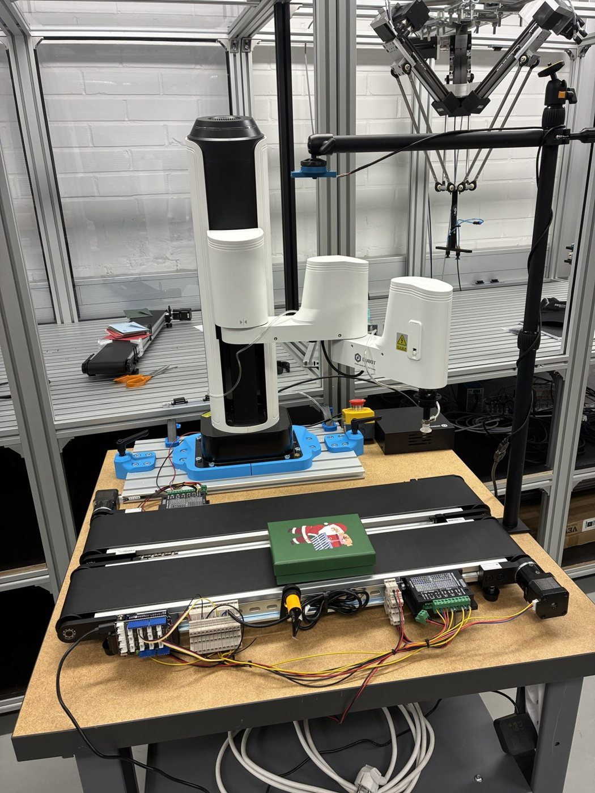
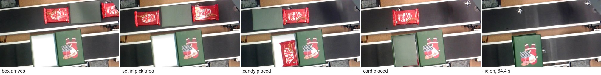
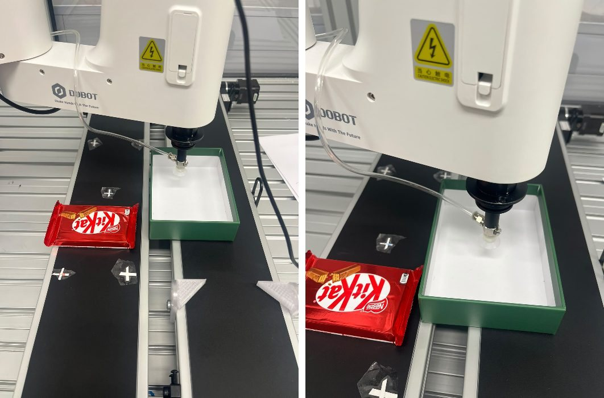
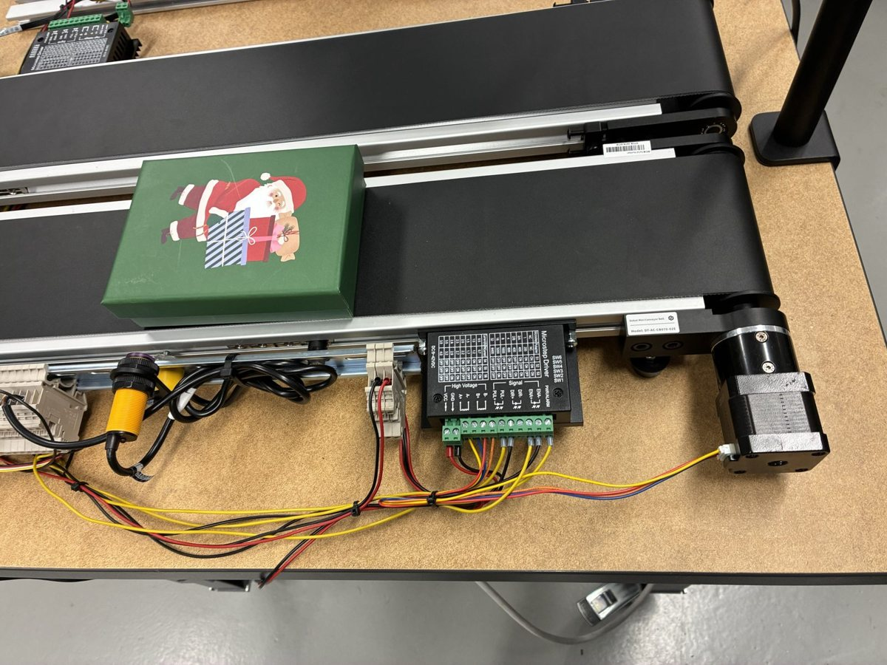
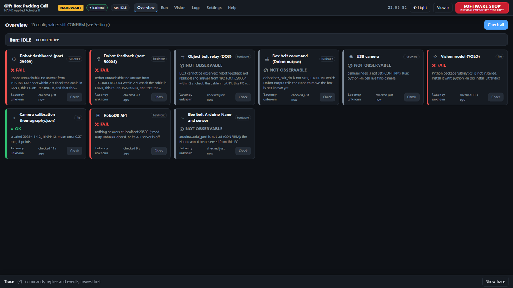
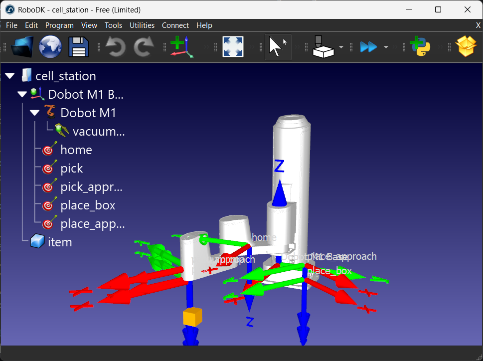

# Gift Box Packing Cell

A robot cell that packs Christmas gift boxes: one card and two candies go into each box, then the lid goes on.
It is built around a Dobot M1 Pro SCARA arm, two conveyor belts and a camera. The cell was built by a team of three in Applied Robotics Project II at HAMK (Häme University of Applied Sciences), Robotics Laboratory B118.

**Status: in progress.** V1 works on the real cell with the conveyor stopped during picking (Week 4, Nov 2026). The goal for the final demo in Week 8 is to pack while the conveyor moves.



One full cycle on the real cell, 18 Nov 2026, speed 100 %. These are the camera pictures saved in the run log `testing/live_runs/20261118_100236.csv`:



## How it works

1. The **box belt** brings an open box until an E18-D80NK sensor stops it. This belt is run by its own Arduino UNO R4 WiFi.
2. The camera checks that the box is standing still at the taught box slot.
3. The robot starts the **object belt** (cards and candies, TB6600 stepper driver) with its digital outputs. The belt stops when the items the box still needs are in the pick area.
4. The robot moves out of the camera view. A YOLO model finds the card and the candies, and a homography converts the pixel positions to robot coordinates.
5. The robot picks each item with a vacuum cup and places it in the box, then puts the lid on.
6. An operator takes the closed box away and the next box comes in.

Every real run writes a CSV log with each robot command, its reply, the detections and the pictures. The log header records the config hashes, the speed and the teacher's approval.

## Hardware

| Part | Model / detail |
|---|---|
| Robot | Dobot M1 Pro, 4-axis SCARA, reach 400 mm, J1 ±85° |
| Gripper | Vacuum cup on DO1, blow-off on DO2 |
| Object belt | DTCB conveyor, stepper motor, TB6600 driver. Robot outputs: DO3 start/stop, DO4 direction, DO16 enable |
| Box belt | DTCB-2418-0718 conveyor, Arduino UNO R4 WiFi, E18-D80NK proximity sensor |
| Camera | USB RGB camera above the belts. An Arduino Nicla Vision was tested first and dropped because its image quality was too low |
| PC | Windows 11 laptop, Ethernet to the robot (TCP ports 29999 and 30003) |

<p>


</p>

## Software

All code is in Python 3.11+. The cell software is in `software/`:

| Package | What it does |
|---|---|
| `cell_live` | Runs the real cell. Read-only device checks, the box cycle behind a safety gate, run logging, and a browser console at `http://127.0.0.1:8765` |
| `cell_sim` | The same cycle offline, with simulated devices or the RoboDK station (`robodk/cell_station.rdk`) |
| `cell_ui` | Desktop UI for configuring and comparing simulation runs |
| `third_party/dobot_api` | Dobot TCP/IP API (MIT licence, Dobot) |

Before the robot can move, the safety gate checks: a speed cap, the teacher's approval (name and date), taught points within reach, calibration, vision model, output wiring, an operator at the e-stop, and the J1 range for the path home. Passing the gate issues a one-time arm token, which is used up by that single run.

The vision code, the YOLO model (`best.pt`, YOLO11n trained on 147 lab images and validated on 22, 4 classes) and the camera-to-robot calibration are in `notebooks/week-03/Choton/code`. `cell_live` reads them through an adapter, so nothing in that folder is changed.

<p>


</p>

### Run it

```powershell
cd software
python -m pip install -r requirements.txt
python -m pytest -q              # 549 tests, fake robot and camera, no hardware needed
python -m cell_sim               # offline simulation
python -m cell_live              # device checks + console (real cell only)
```

Real runs need the robot on the lab network, the teacher present and a person at the emergency stop. See [software/cell_live/README.md](software/cell_live/README.md).

## Results so far

Real cell, 17–18 Nov 2026. All runs are in `testing/live_runs/`:

| | |
|---|---|
| Runs started on the real cell | 23 |
| Boxes filled and closed with the lid on | 4 (99.7 s, 128.4 s, 65.4 s, 64.4 s) |
| Fastest box | 64.4 s at 100 % speed, no pauses |
| Camera-to-robot calibration | 0.92 mm mean error, 5 marks |
| YOLO model, validation set | precision 0.99, recall 1.00, mAP50 0.99, mAP50-95 0.89 |
| Software tests | 549 passed |

Note: run 195652 reached the end of the log at 98.7 s but is not counted, because the lid step picked the filled box instead of the lid.

The runs before the first full box showed what had to be fixed:

- **J1 joint limit.** The first pick faulted: a straight move from home needed J1 at about 90°, but the M1 Pro allows ±85°. The robot now moves home → above the box slot → item.
- **Box slot.** Items were placed 78 mm beside the box. The slot was taught again.
- **Camera moved.** The camera rotated 6.3° in its holder. A view correction re-fits the calibration without recalibrating.
- **Lid.** The lid step is still unreliable. Some runs paused near the 375 mm reach limit, and the lid does not always close fully.

Four boxes is a small sample. The team has not yet agreed on a V1 pass criterion with the teacher.

## Next

- Agree on the V1 pass criterion and repeat the test runs.
- Make the lid step reliable.
- Find out why the box belt stops while a run is paused.
- Pack on a moving conveyor (Week 8).
- Replace the box belt with the new 220 V AC conveyor, and put the electronics in a 3D-printed enclosure (CAD in `notebooks/week-04/Rashmika/3D_Models`).

## Repository layout

```
software/         cell_live, cell_sim, cell_ui, RoboDK station, tests
notebooks/        weekly engineering notebooks, one folder per person
  week-03/Choton/   vision, YOLO model and training results, calibration, robot scripts
  week-03/Rashmika/ box belt Arduino sketch, wiring photos
  week-04/Rashmika/ enclosure CAD (Fusion 360, STL)
testing/          real run logs, simulation run logs, calibration backup, console screenshots
docs/             hardware facts, README images
planning/         project plan, tasks and risks
```

The YOLO training images (about 50 MB) are not in this repository.

## Team

| Name | GitHub | Main work |
|---|---|---|
| Rashmika Ruwanpathirana | [@Rashmika-Dineth](https://github.com/Rashmika-Dineth) | Project lead. Robot tests, belt wiring and drivers, box belt Arduino, enclosure design |
| Enamul Choton | [@enamulhqdk](https://github.com/enamulhqdk) | Vision: OpenCV, YOLO dataset and training, camera-to-robot calibration, taught points |
| Sazzad Ibna Mahfuz | [@sazzadmahfuz](https://github.com/sazzadmahfuz) | System architecture, simulation (RoboDK), cell control software, safety gate, operator console, real cell runs |

Supervisor: Leo Li, HAMK.

The course asks teams to use AI coding agents. The project rules for that work are in [CLAUDE.md](CLAUDE.md), and each notebook says how AI was used.

## License

The code in `software/` is MIT licensed, see [LICENSE](LICENSE). `software/third_party/dobot_api` keeps its own MIT licence from Dobot. Photos, notebooks and CAD files belong to their authors.
