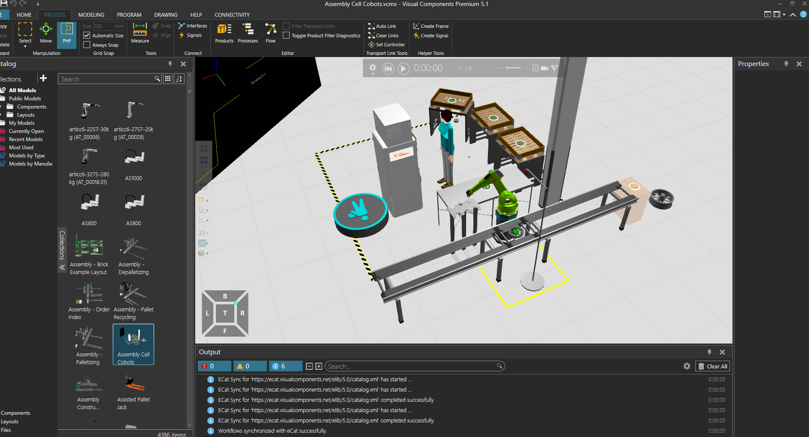

# Fictional Notebook Example

**Teaching example only. These people, tasks, hours, and results do not describe completed course work. Do not copy them as your own evidence.**

## 2026-10-27

- Task/time: EX01, agree sensor test procedure; 1 hour.
- Pair/reviewer: A + B working together; C reviews.
- My contribution: I drafted present/absent test steps; B checked the input names in the design.
- Decision: Plan five paired trials and retain every reading.
- Evidence: A draft procedure would be linked here after it is saved. No test evidence exists in this example.
- Actual result: No physical trial executed; sensor access remains unconfirmed.
- Blocker/help: Ask the teacher to confirm equipment and operating readiness.
- Next action: Revise the procedure after C's review and schedule the physical test.

    

A useful entry explains what actually happened, what remains unknown, and who will act next. Review the [weekly template](weekly-template.md) for the full file structure.
