# Engineering Notebook
## Machine Vision – Card and Candy Detection

- Name: Choton
- Project: Applied Robotics Project 02
- Task: T06 Machine vision
- Reviewer: Rashmika
- Code: [code](code/)

---

## Goal

A camera above the table finds the cards and candies, their colour and position, so the delta robot can put **2 different-colour cards + 2 different-colour candies** in each box.

## Method

Python + OpenCV. Objects are found by colour (HSV). Card or candy is decided by shape: candies are long bars (≈ 5 : 1), cards are ≈ 1.4 : 1.

| Script | What it does |
|---|---|
| `01_camera_test.py` | Live camera, save photos |
| `02_hsv_tuner.py` | Find the colour ranges (HSV) |
| `03_detect.py` | Detect cards and candies, colour and position |
| `04_calibrate.py` | Convert pixels to millimetres |
| `05_box_planner.py` | Choose which objects go into each box |
| `06_robot_program.py` | Write an igus robot program from the detected objects |
| `nicla_main.py` | Program on the Nicla Vision camera: sends the picture over Wi-Fi |

---

## 2026-10-28 – Camera Test and First Detection

### Objective

Get the camera working and detect the cards and candies by colour.

### Activities

- Installed Python and OpenCV on my laptop.
- Tested the camera board from the teacher, then switched to a USB camera.
- Took 16 photos of 2 cards (red, green) and 2 3D-printed candies (orange, blue).
- Tuned the colours and wrote the detection and box-planning scripts.

### Results

Detection is correct on **16 / 16 photos** (2 cards + 2 candies, right colour and type).

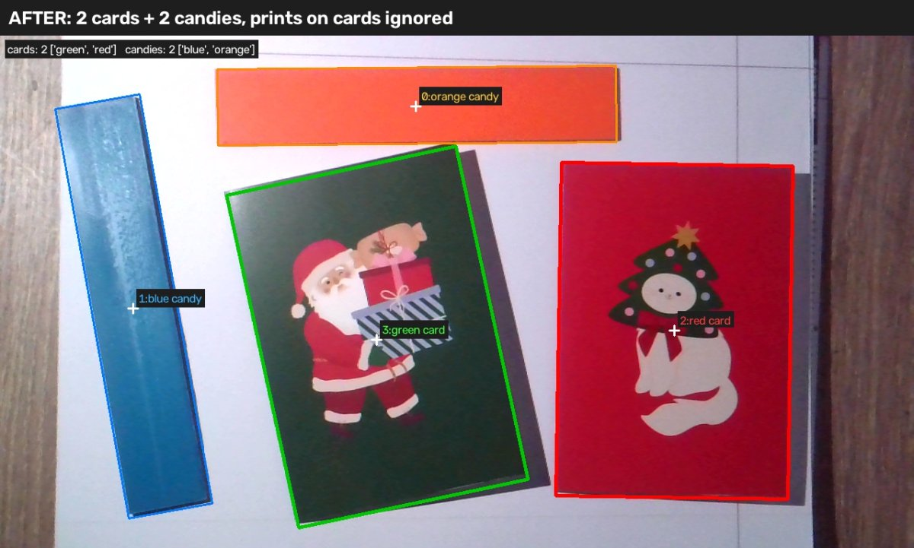

All 16 test photos:

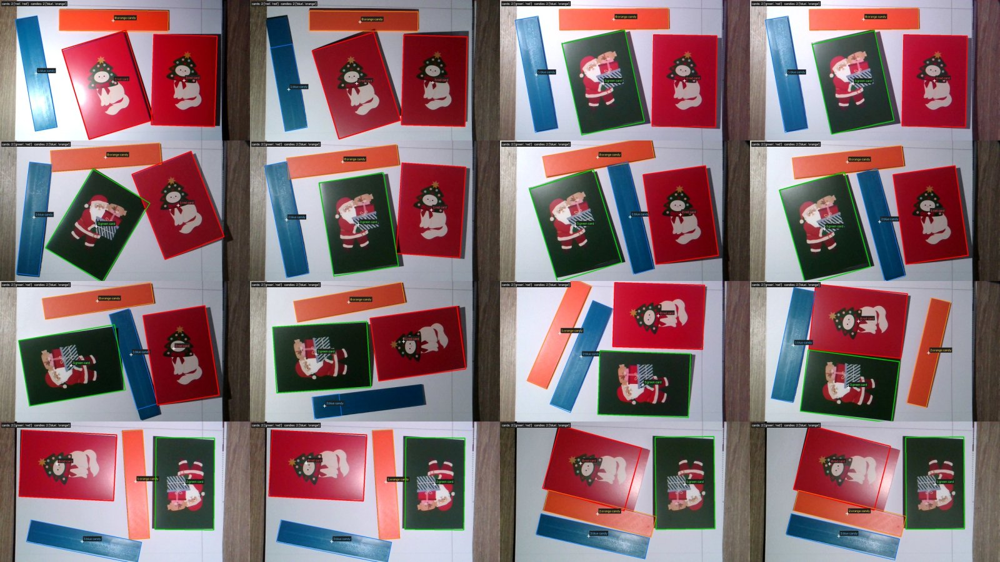

### Challenges

1. **Wrong detection.** Candies were detected as cards (they are as big as cards), and the pictures printed on the cards were detected as candies.
   → Fixed: card/candy by shape, cards filled as one shape, anything inside a card is ignored.

   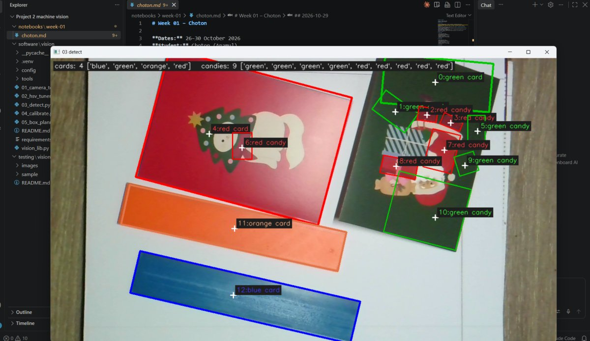

2. **Light glare split a candy bar into two.** → Accepted paler colour and joined pieces that line up.

3. **Wrong colour ranges.** The first saved "orange" range covered almost every colour. → Measured the real colours from the photos and set new ranges.

4. **Wrong camera opened.** The program opened the laptop's own camera. → Changed `camera_index` to 1 in `config/settings.json`.

### Next Steps

- Live test: 10 different layouts, count correct detections.
- Discuss with Rashmika how the delta robot is controlled and where the camera can be mounted.

---

## 2026-10-29 – Live Detection Test

### Objective

Test the detection live with the USB camera.

### Activities

- Cleaned up the project to the code that is used.
- Ran `03_detect.py` with the USB camera on 4 different layouts of the 2 cards and 2 candies.

### Results

**4 / 4 layouts correct**: 2 cards and 2 candies found every time, right colour and type, no extra objects.

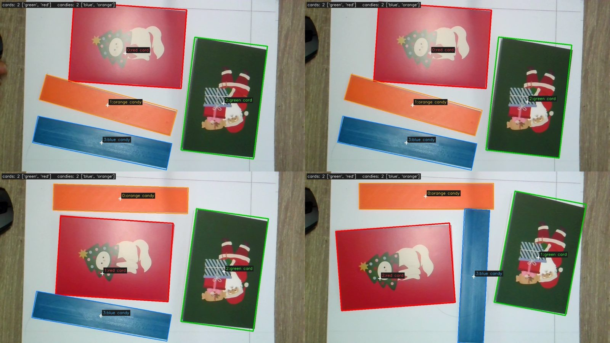

---

## 2026-10-30 – Calibration: Pixels to Millimetres

### Objective

Convert the object positions from camera pixels to millimetres on the table, so the robot can use them later.

### Activities

- Rhe delta robot uses igus Robot Control over Ethernet and a vacuum gripper. The robot cannot move yet (waiting for software V14), so the calibration was done on the table first.
- Drew a 200 × 150 mm rectangle with 4 crosses on paper under the camera.
- Ran `04_calibrate.py`: clicked the 4 crosses and typed their positions in mm. The program calculates the pixel → mm conversion (homography).
- Tested the accuracy on 3 extra dots inside the rectangle.
- Ran `03_detect.py` again: every object now shows its position in mm.

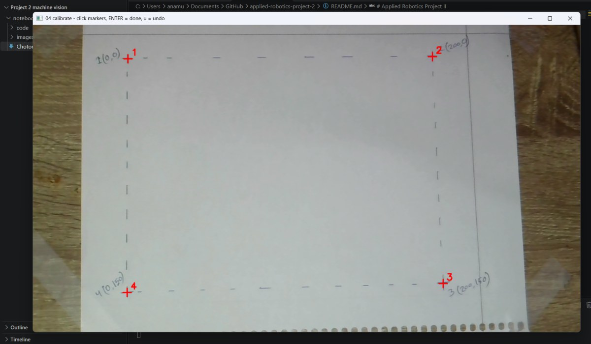

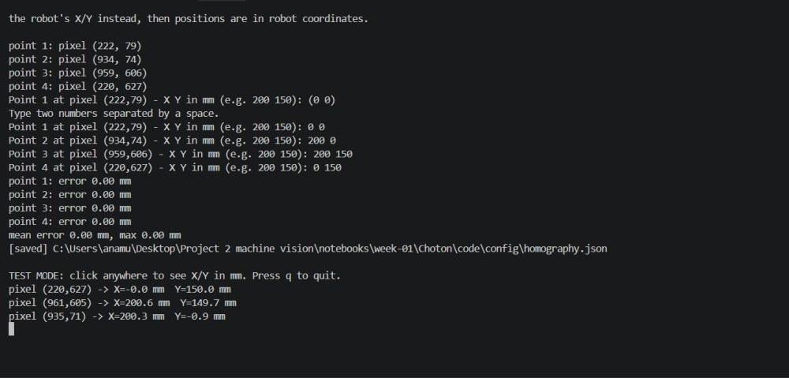

### Results

| Dot | Real (mm) | Measured by program (mm) | Difference |
|---|---|---|---|
| A | 100, 75 | 91.8, 75.3 | 8.2 mm |
| B | 50, 100 | 49.7, 102.0 | 2.0 mm |
| C | 150, 50 | 150.6, 49.6 | 0.7 mm |

- B and C are within 2 mm.
- A is 8.2 mm off in X only. Most likely the dot was drawn or clicked in the wrong place, because B and C nearby are accurate. To be re-checked.

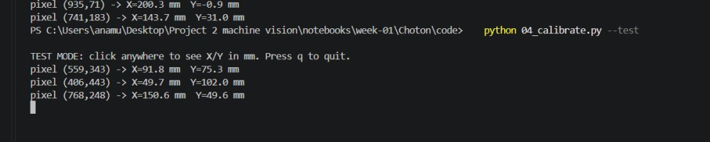

Detection with positions in mm (2 cards + 1 candy on the table):

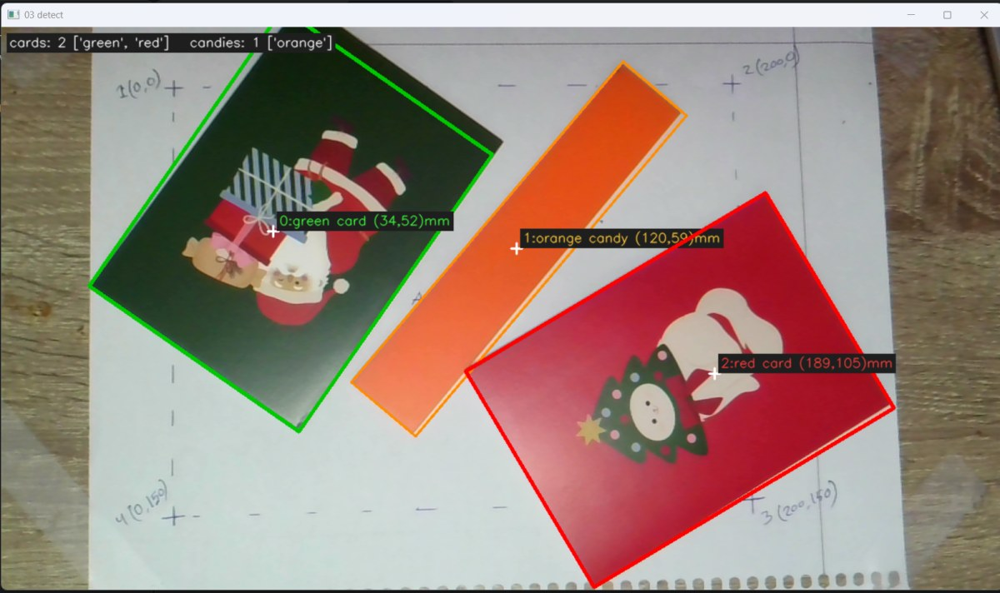

### Next Steps

- Re-check dot A.
- When the robot works: repeat the calibration with the robot tip on the crosses, so positions are in robot coordinates.
- Agree with Rashmika how vision sends positions to the robot (igus CRI or camera interface).

---

## Vision → Robot Interface (planned)

| Item | Value |
|---|---|
| Vision sends | object type (card / candy), colour, X and Y in mm, angle, box number |
| Robot | igus delta robot, igus Robot Control, vacuum gripper |
| Connection | Ethernet from PC to robot controller (igus CRI or camera interface) – to be confirmed with Rashmika |
| Pick point | centre of the object (suction cup) |

---

## Weekly Reflection

### Done this week

- Detection of 2 cards and 2 candies by colour and shape: **16 / 16 photos** and **4 / 4 live layouts** correct.
- Box plan: 2 different-colour cards + 2 different-colour candies per box.
- Calibration from pixels to mm: error **≤ 2 mm** at 2 of 3 test points.

### Not done / blocked

- The robot cannot move yet (robot software V14 is missing), so the vision is not connected to the robot.
- Calibration to robot coordinates waits for the robot.

### What I learned

- Size alone is not enough to tell objects apart; shape (aspect ratio) works better.
- Light and glare change the colours, so the lighting must stay the same.
- A flat table needs only 4 known points to convert pixels to mm.

### Plan for Week 2

- Mount the camera above the robot's work area.
- Calibrate with the robot tip to get robot coordinates.
- Send the pick list to the robot together with Rashmika.

---

## 2026-11-02 – From Camera to Robot Program

### Objective

Use the detected positions to make a robot program automatically, so the robot picks the objects where they really are.

### Activities

- Read the team's updates: Rashmika got the robot software (V14) and the robot moves; Sazzad made a gift-box program for the igus simulation with fixed positions.
- Re-calibrated the camera (it had moved).
- Added the robot's working area to the camera view and robot X/Y to every object.
- Wrote `06_robot_program.py`: it detects the objects, chooses 2 cards + 2 candies, and writes an igus Robot Control program (.xml, same format as Sazzad's) with the real positions.

### Results

- The program found all 4 objects inside the robot's reach and wrote a robot program with **45 commands** (move, vacuum on/off, place in box).

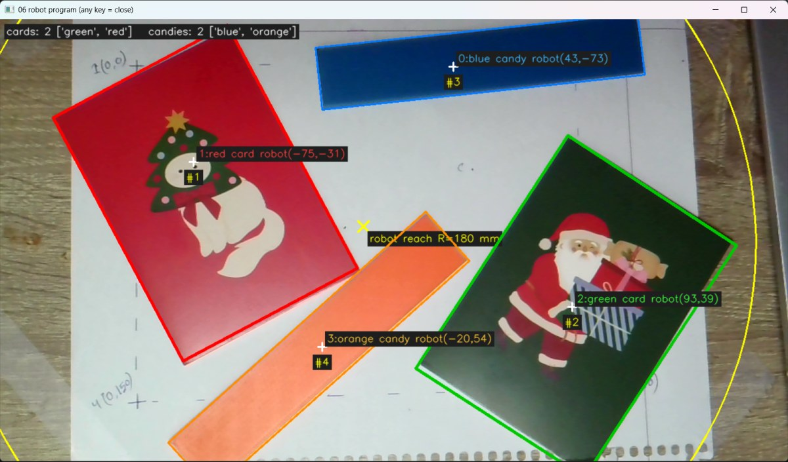

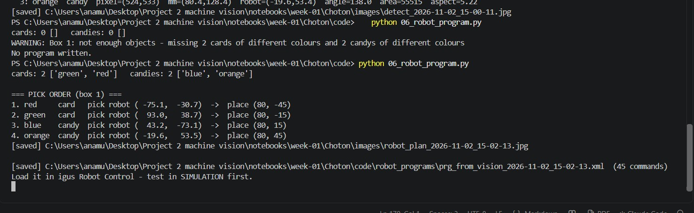

### Challenges

1. **Robot reach too small at first.** I used ±80 / ±60 mm from Sazzad's test program, but these were only his test positions. → Changed to the igus value for DLE-DR-0001: a circle of about 360 mm diameter.

   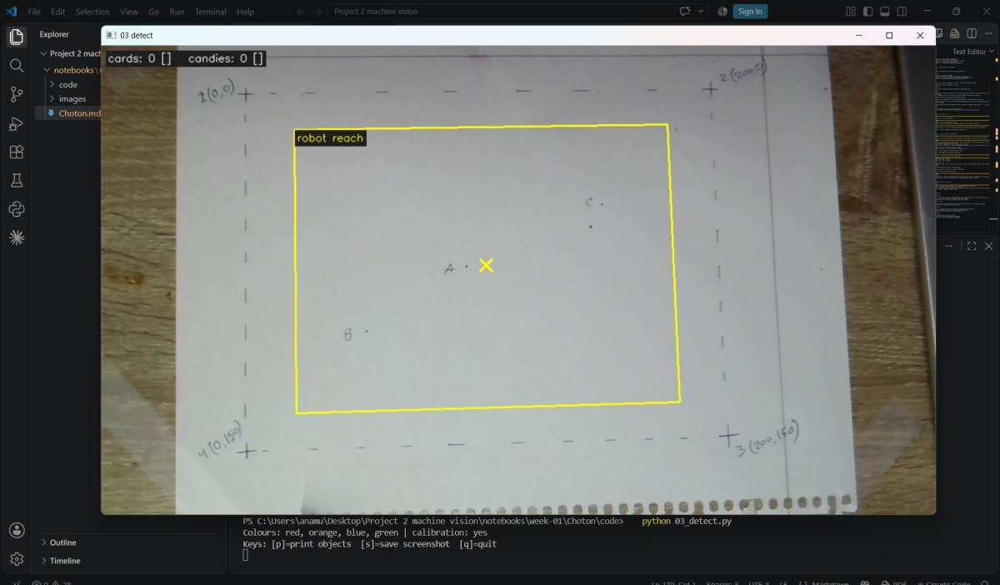

   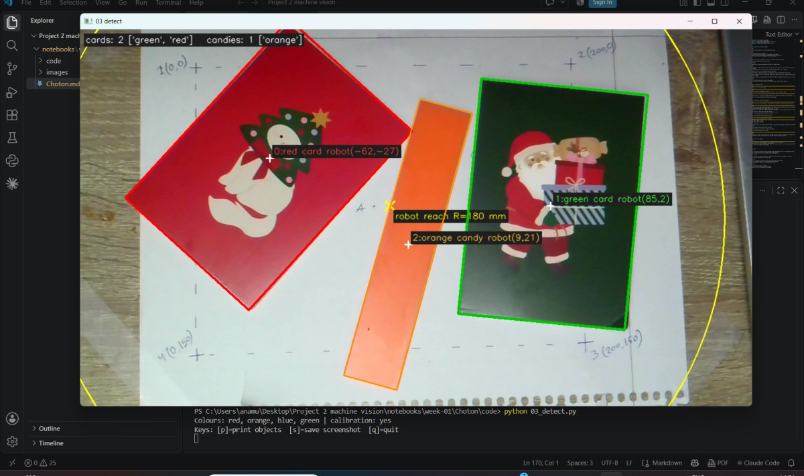

2. **No objects found when making the program.** The script used only the first camera picture, which is dark while the camera starts. → It now waits for the camera and uses the best of 10 pictures.

### Next Steps

- Sazzad tests the generated program in the igus simulation.
- The robot positions are temporary (robot centre = middle of the paper). Calibrate again with the robot tip when the camera is mounted at the robot.

---

## 2026-11-04 – Nicla Vision Camera

### Objective

Use the small Nicla Vision camera (suggested by Rashmika) instead of the USB camera, so it can later be mounted at the robot.

### Activities

- Identified the board as an **Arduino Nicla Vision** (GC2145 sensor) with OpenMV IDE and updated its firmware to 5.0.1.
- Wrote `nicla_main.py`: the Nicla sends its picture over Wi-Fi (iPhone hotspot) and our Python code reads it like a normal camera.
- Gave the Nicla its own colour ranges and calibration, so the USB camera settings are kept.
- Tested detection and the robot program with the Nicla picture.

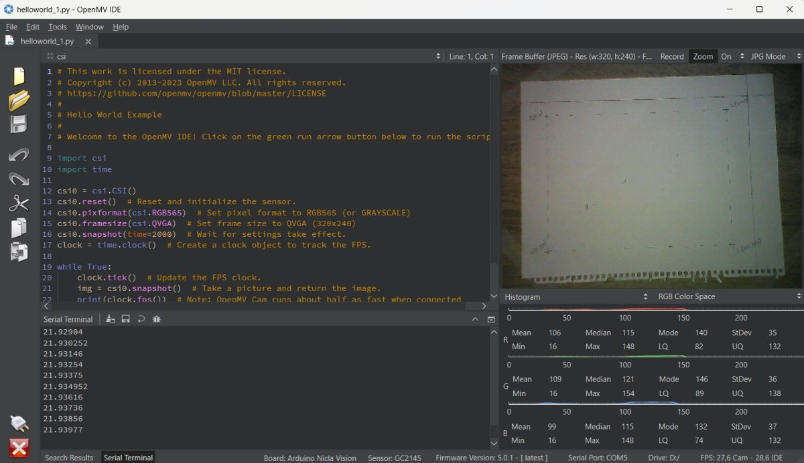

### Results

- The Nicla picture reaches our Python code over Wi-Fi at **480 × 320**.
- Detection finds **2 cards + 2 candies** correctly (live and on 3 test photos), and the robot program is written from the Nicla picture.

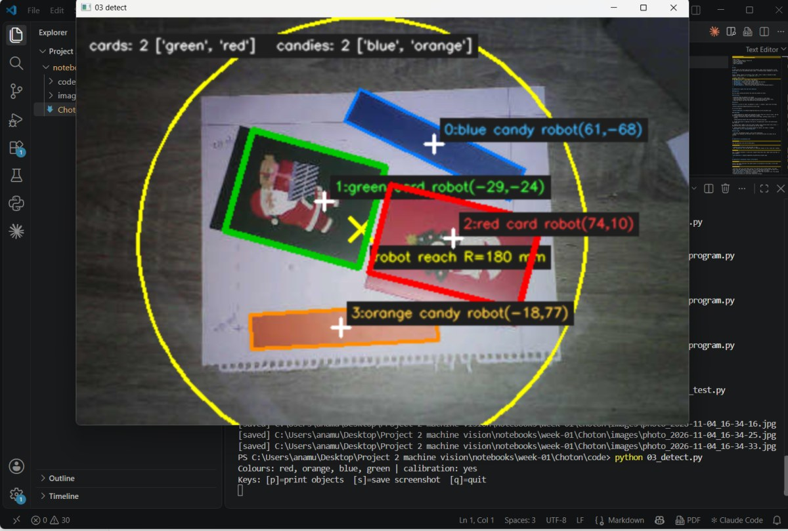

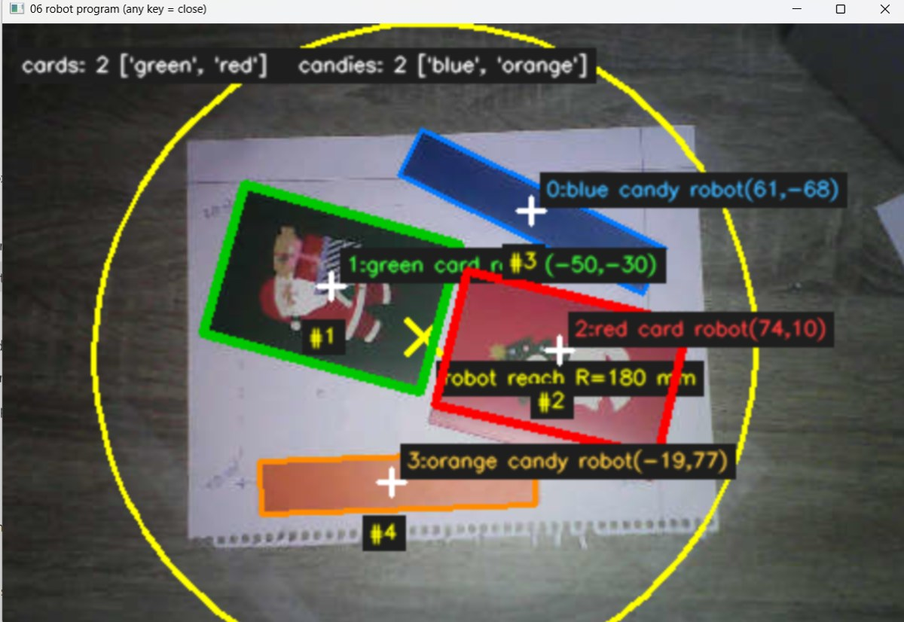

### Challenges

1. **USB cable without data.** Windows did not see the board. → Used another cable.
2. **Wi-Fi chip errors** (`CYW43 hdr mismatch`, `sdio timeout`) right after connecting. → Turned off the Wi-Fi power saving and ran the program on the board without the IDE.

   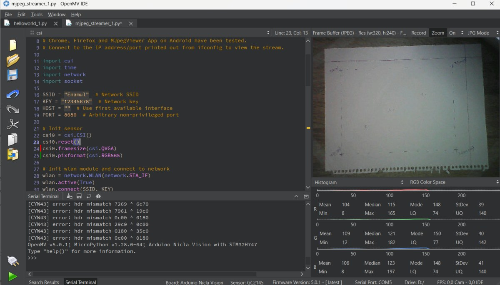

3. **Low picture quality and greenish colours.** 640 × 480 did not fit in the Nicla's memory. → Used 480 × 320, better JPEG quality and locked the white balance.

   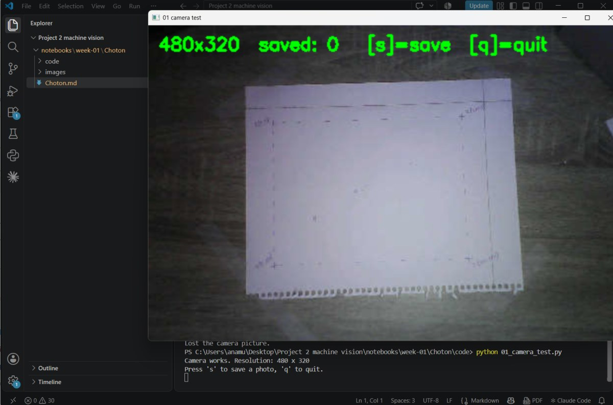

4. **Glare** from the lamp made the green card look grey. → Light from the side; new colour ranges for the Nicla.

### Next Steps

- Check the calibration accuracy with the Nicla (dots A, B, C).
- Copy `nicla_main.py` to the Nicla as `main.py` so it starts by itself in the lab.
- Decide with the team: Nicla (small, wireless) or USB camera (better picture, more stable).

