# Engineering Notebook
## Individual Robot Project 02 – Delta Robot Investigation and Development

- Name: Rashmika Ruwanpathirana
- Project: Applied Robotics Project 02
- Start Date: 27-10-2026
- Finished Date: 05-11-2026
- Location: HAMK Robotics Laboratory B118
- Robot: Delta Robot (model to be identified)

---

## Introduction

In this project, I will investigate the Delta robot available at HAMK, understand its mechanical structure and operating principles, and explore its capabilities and limitations.

The initial stage will focus on identifying the robot model, understanding its coordinate system, investigating its working area, and exploring the available controller and programming interfaces. Based on the findings, I will investigate suitable simulation tools and develop a practical application that demonstrates the robot's capabilities.

The project will follow an engineering development process involving observation, research, planning, programming, testing, evaluation, and documentation. The engineering notebook will record the work completed, observations, results, challenges, and future improvements.

## Goal

By completing the project, I aim to:

- Identify the Delta robot model and understand its mechanical structure.
- Investigate its working area, coordinate system, and movement limitations.
- Understand the robot's control system and available programming interfaces.
- Investigate suitable simulation software and available robot models.
- Perform controlled movement tests and examine the robot's behaviour.
- Identify possible applications based on the robot's capabilities.
- Develop and test a suitable robotic application.
- Evaluate the performance, accuracy, and cycle time of the developed solution.
- Document the development process, technical challenges, and lessons learned.

---

## 2026-10-27 – Project Planning and Initial Research

### Objective

To establish an initial understanding of the Delta robot project, identify the information required for the investigation, and prepare a plan for the practical work.

### Activities

- Reviewed the project objectives and identified the initial investigation tasks.
- Identified the main technical information required to understand the Delta robot.
- Prepared a list of items to investigate, including the robot model, mechanical structure, workspace, controller, and programming options.
- Considered possible practical applications that could be developed after understanding the robot's capabilities.

### Results

1. As the first task, I inspected the Delta robot and found that the surrounding workspace was cluttered with components from previous projects. I cleared away the old project components and isolated the robot arm to prepare a clean workspace for my development, as shown in the attached images.

<table>
  <tr>
    <td>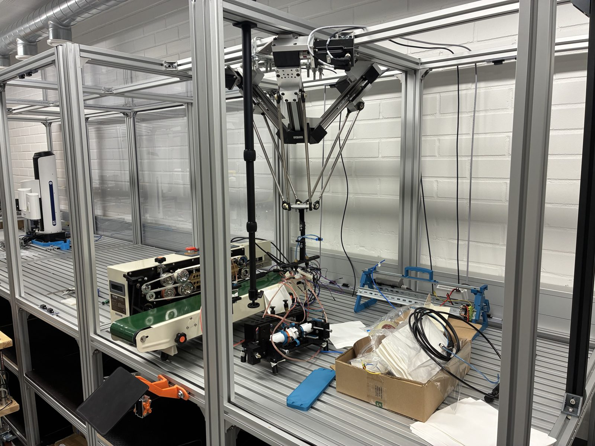</td>
    <td>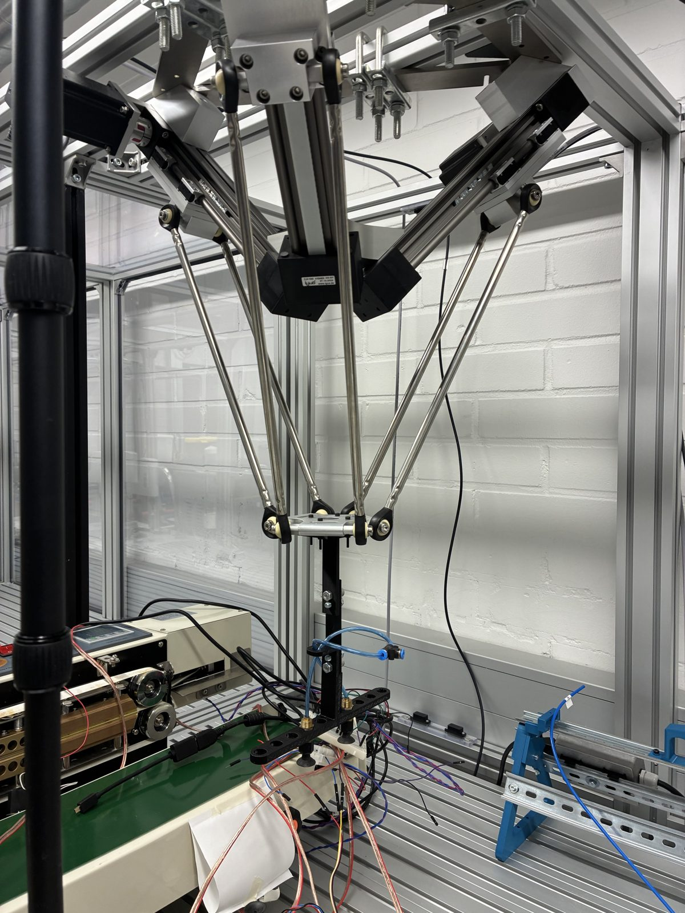</td>
  </tr>
  <tr>
    <td colspan="2">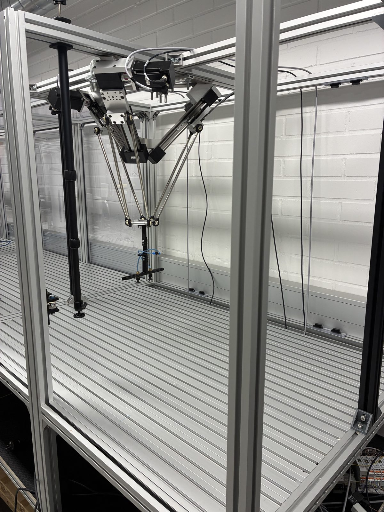</td>
  </tr>
</table>

2. As part of the second task, I checked the components connected to the system and identified the need to find a suitable vacuum gripper for the project. The currently connected components are shown in the images below.

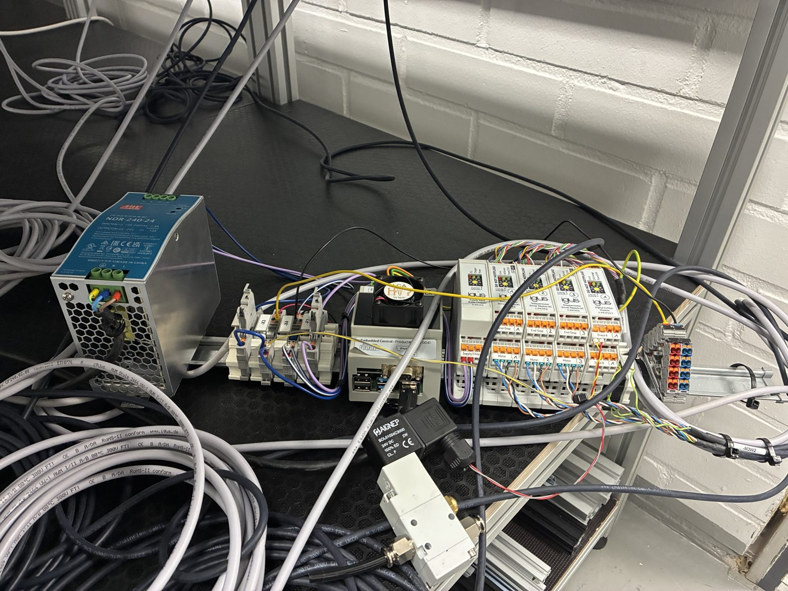

3. The system is equipped with a Mean Well NDR-240-24 power supply. The datasheet is available here [[Datasheet]](https://www.meanwellusa.com/upload/pdf/NDR-240/NDR-240-spec.pdf). It is a DIN-rail-mounted power supply that provides a 24 V DC output at 10 A and can be powered directly from a 230 V AC mains supply.
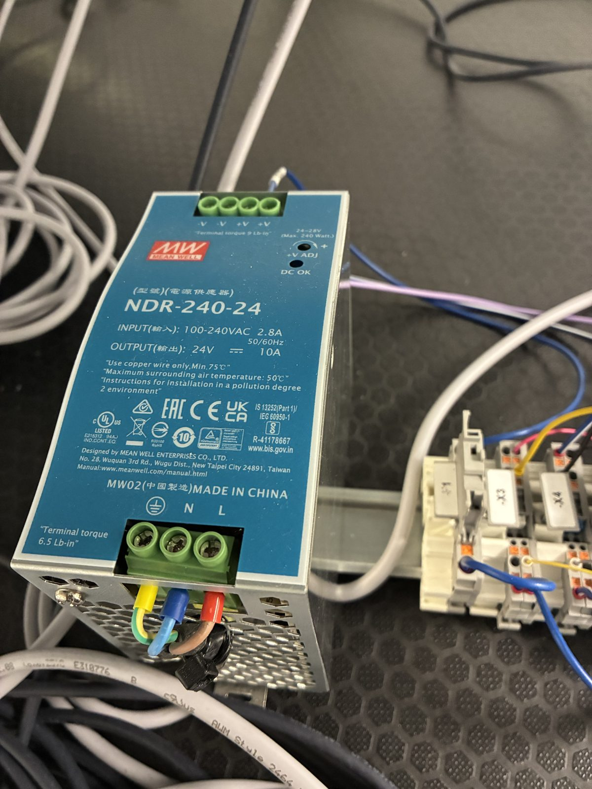

4. The main system uses a CAN bus for communication and control. The main controller is provided by Commonplace Robotics GmbH, which enables the system to be controlled and interfaced with external devices. Further information can be found on the company's website: [Commonplace Robotics GmbH ](https://rbtx.com/en-US/partners/commonplace-robotics?srsltid=AYCX9vIHU1X0zaCWwdZ6vcMMeIBXo7ZG8xxbrNf4dvCfxXfeedzNndSJ)
<table>
  <tr>
    <td>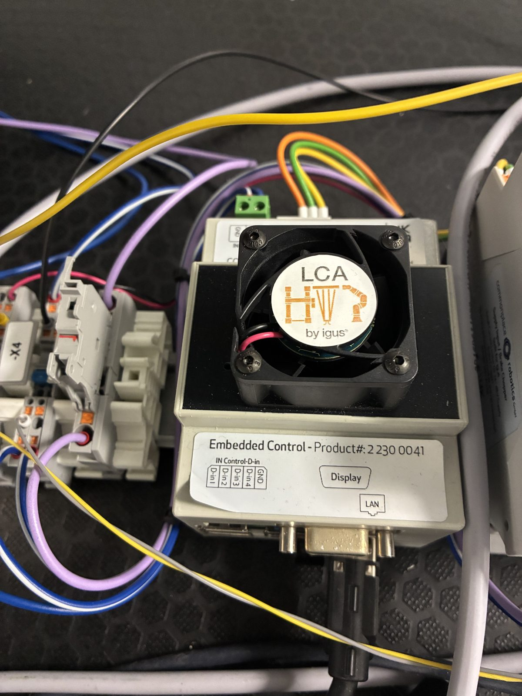</td>
    <td>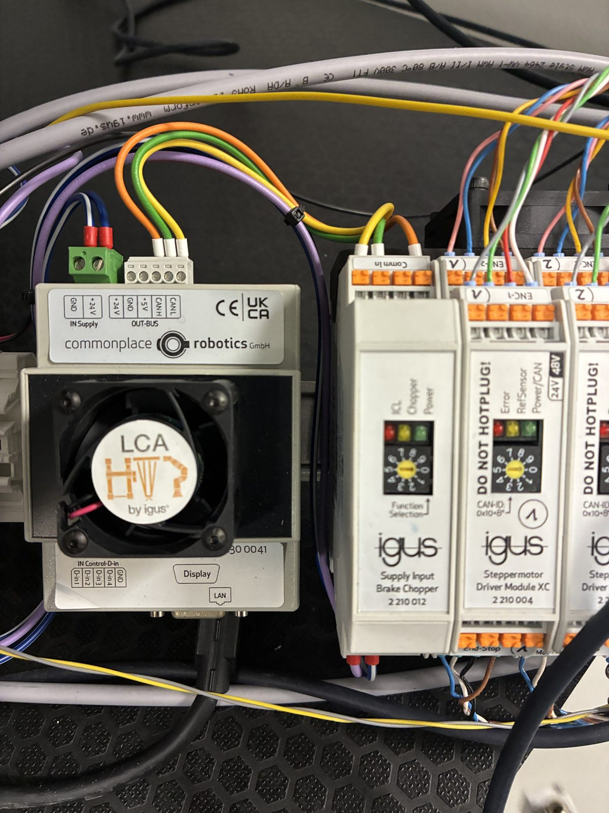</td>
  </tr>
</table>

5. the system uses digital In/Out module for external I/O
The system uses an igus stepper motor driver module as the main motor controller. The module includes a supply input and a brake chopper, which supports braking energy management. The system also uses a digital input/output (I/O) module to interface with external devices and manage digital signals.
<table>
  <tr>
    <td>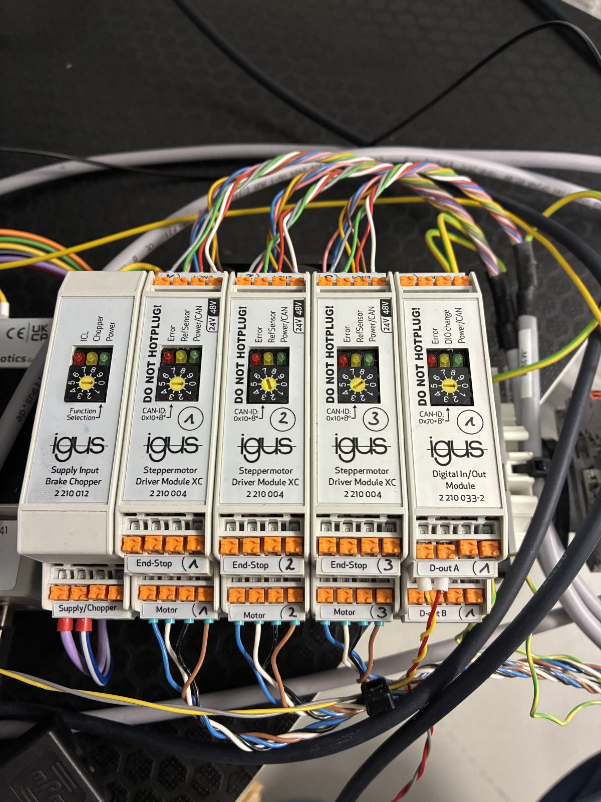</td>
    <td>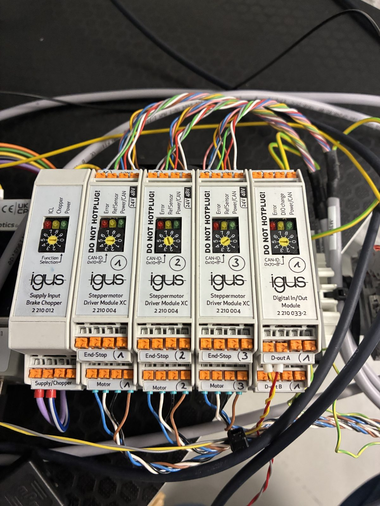</td>
  </tr>
</table>

6. The system also has a vacuum controller connected, which is used to control the vacuum system for gripping and handling objects.
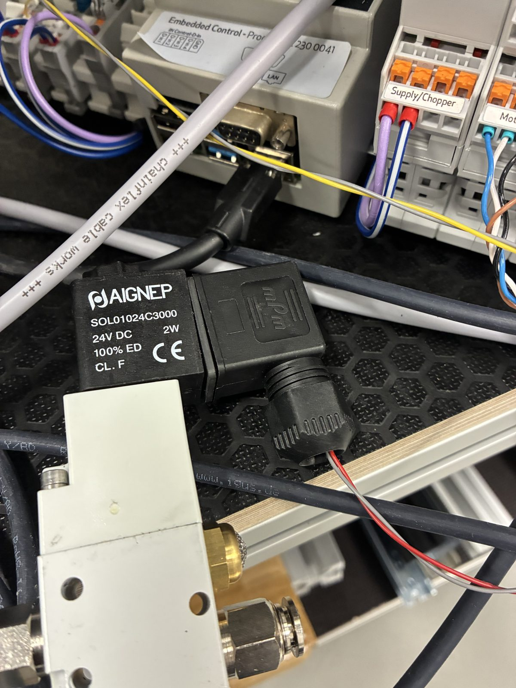

### Challenges

To be completed based on the actual challenges encountered.

### Next Steps

Begin the physical investigation of the Delta robot at HAMK and collect the technical information required for further development.

---

## 2026-10-28 – Preparation for Practical Investigation

### Objective

To prepare for the physical investigation and identify the technical information and equipment needed to understand the Delta robot.

### Activities

- Reviewed the investigation requirements for the robot's mechanical structure and workspace.
- Prepared a list of photographs and technical details to collect during the laboratory investigation.
- Identified the need to investigate the robot controller, programming software, communication interfaces, and available documentation.
- Planned how to record the robot's initial position, movement directions, workspace limitations, and end-effector configuration.

### Results

1. During the research, I found a video demonstrating a similar task performed using a vision system and a soft gripper, as shown below.
<video width="800" controls>
  <source src="https://a.storyblok.com/f/298593/x/9a2597c5e2/conveyor-placing-with-soft-gripper-and-vision.mp4" type="video/mp4">
  Your browser does not support the video tag.
</video>

2. During the research, I found the datasheet for the delta robot. 
[Datasheet of Delta](https://cpr-robots.com/download/igusRobotControl/Documentation/UserGuide_iRC_delta.pdf)

3. During the research, I have found that we will be able to control the system using the igus software which can be availabe via request. [Download Igus Software](https://www.igus.fi/automation/robot-control-system/robot-software)

4. The next challenge was to connect to the main controller. To establish the connection, I referred to the Delta user manual and found the following network configuration requirements for the PC:
- IP address: 192.168.3.1 (static)
- Subnet mask: 255.255.255.0

5. I connected my PC to the Delta controller, powered on the robot, and attempted to establish a connection to the system, as shown in the attached images. 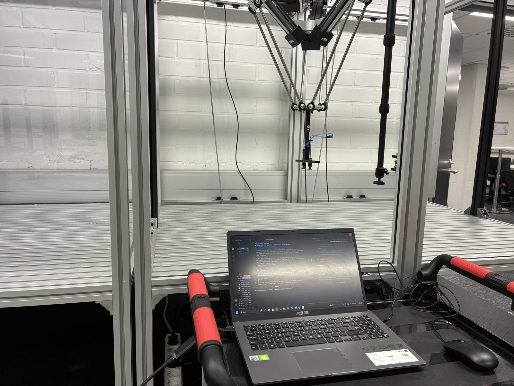

6. The connection attempt using the igus software failed, indicating that the controller's IP address might be different from the expected address. 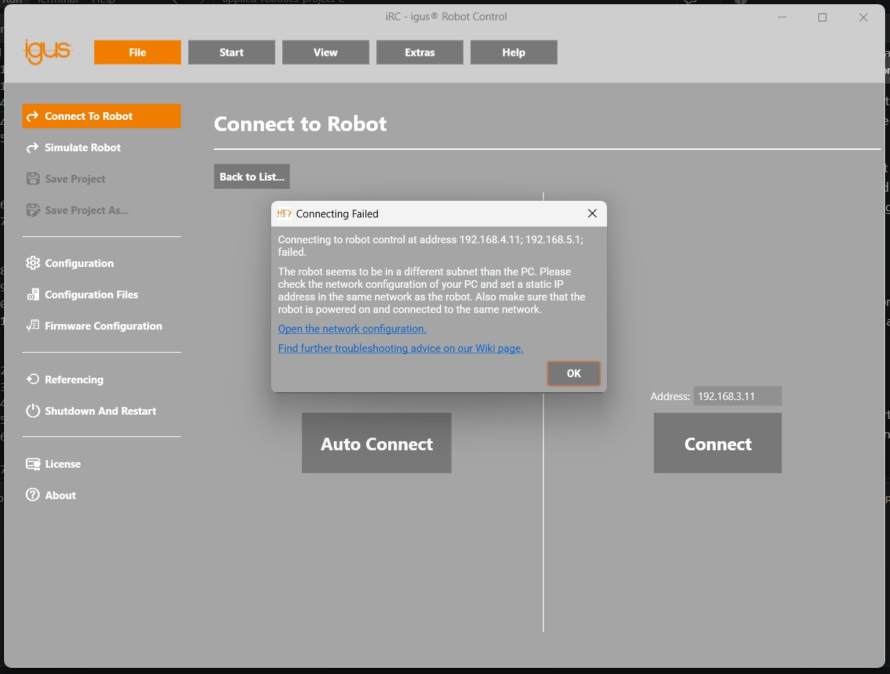


### Challenges

- In my laptop the LAN network port was not available. So I had to find and USB-LAN adaptor to connect it with my PC.

- The IP connection between the PC and the main controller failed.

### Next Steps

Visit the laboratory, identify the robot model, photograph its main components, and investigate its workspace and control system.

---

## 2026-10-29 – Delta Robot Identification and Workspace Investigation

### Objective

To examine the Delta robot available at HAMK, identify its main components, and investigate its working area and operating principles.

### Activities

- Locate and identify the Delta robot in the laboratory.
- Record the manufacturer and model from the identification label.
- Photograph the robot, mechanical structure, controller, and end effector.
- Investigate the robot's mechanical arrangement and parallel-link mechanism.
- Identify the coordinate system and movement directions.
- Find the manufacturer's workspace specifications and compare them with the physical setup.
- Investigate the available programming software and communication interfaces.
- If authorised, observe or perform basic movement tests under the appropriate laboratory safety procedures.

### Results

1. The IP address was found by using the command 

```for /L %i in (2,1,254) do @ping -n 1 -w 100 192.168.3.%i | find "TTL=" ```

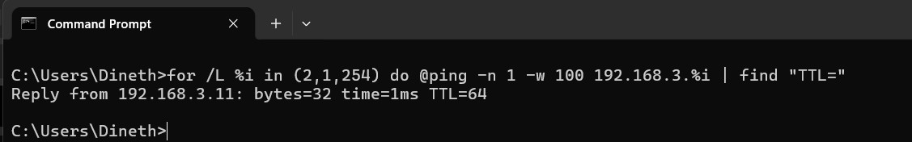

2. Using the ping command the address is confirmed. 

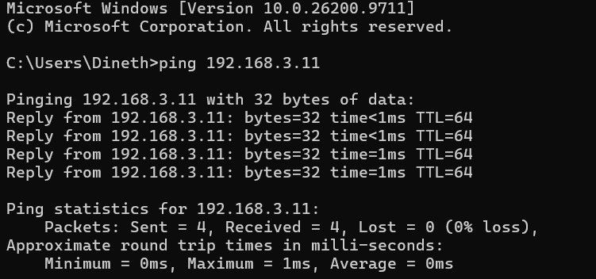

3. The Control unit software seems to be outdated so i had to look for older version software to control the Delta Robot. 
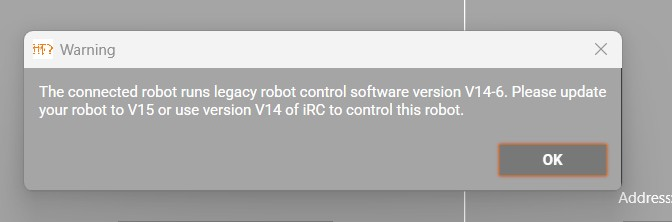

### Challenges

- The download link for the software is provided via email, and the V14 software is not available on the web. Therefore, I contacted customer service to request the V14 software and will need to wait for their response before proceeding with further testing.

### Next Steps

Use the collected information to determine which simulation software, programming method, and practical application are suitable for the robot.

---

## 2026-10-30 – Further Development – Control and Programming Investigation

### Objective

To understand how the Delta robot is controlled and identify the available methods for developing and executing robot programs.

### Planned Activities

- Examine the controller and available programming environment.
- Investigate manual jogging, coordinate-based movements, and supported motion commands.
- Determine the available communication methods between the robot and a computer.
- Review the robot's safety procedures and permitted operating modes.
- Investigate whether a suitable robot model is available in simulation software.
- Document the requirements for an initial movement or pick-and-place test.

### Results

1. The IP address able to read and the ping command was success as below, 
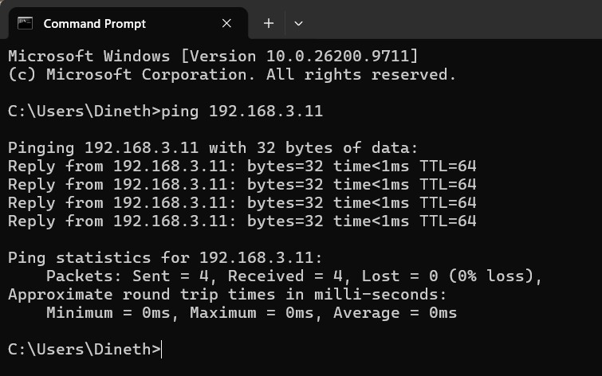

2. The igus V14 was requested through email and the customer service sent the link to download older version of V14. And now the basic manual jogging, coordinate-based movements, and supported motion commands can be accessed through the software. 
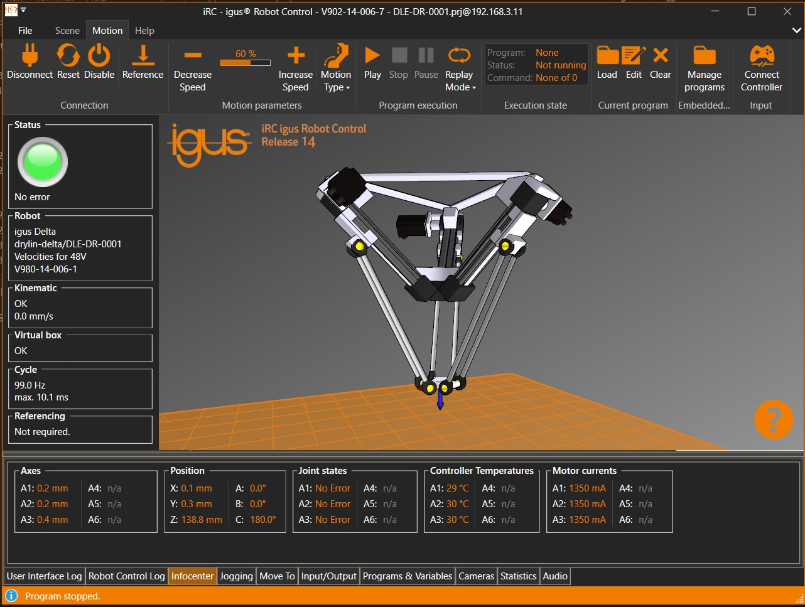

### Challenges

- The initial position will be considered the starting position, and all motors must be in the uppermost position.

### Next Steps

- Try to find a suitable GitHub repository for controlling the system using a Python-based TCP/IP control program.

---

## 2026-11-02 Further Development – Application Planning 

### Objective

To select a practical application based on the robot's workspace, speed, payload, end effector, and available laboratory equipment.

### Planned Activities

- Evaluate possible applications, such as pick-and-place, sorting, or packaging.
- Identify suitable objects and pickup and placement locations.
- Determine whether a conveyor belt, sensors, or additional equipment can be used.
- Define the initial requirements and expected results.
- Prepare a basic workflow and testing plan.

### Results

1. A Python-based GitHub reference project was found. [here](https://github.com/CommonplaceRobotics/RobotControlApps)

2. The program was updated and can now be integrated into the robot control system using Python for further development.
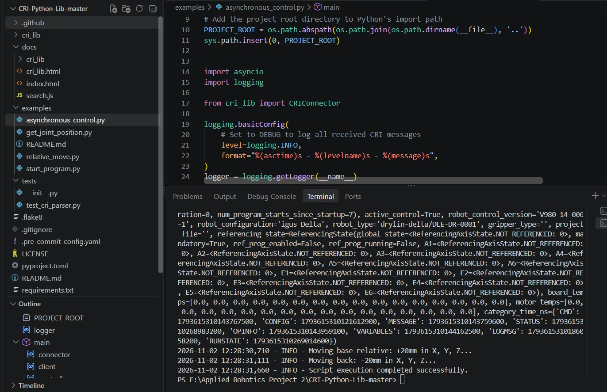

### Challenges

- The working range is smaller than expected.  

### Next Steps

Develop the selected application and prepare the robot program or simulation.

---

## Further Development – Programming, Testing and Evaluation

### Objective

To implement the selected robotic task and evaluate its performance.

### Planned Activities

- Develop the robot movement sequence.
- Define the required positions and approach movements.
- Test the sequence in simulation if suitable software is available.
- Perform physical tests after the simulation or movement sequence has been reviewed and the setup is approved.
- Record cycle time, positioning performance, repeatability, and operational limitations where measurable.
- Compare the robotic process with the equivalent manual operation.
- Identify improvements to the program and system setup.

### Results

To be completed after testing, with photographs, screenshots, measurements, and observed behaviour.

### Challenges

To be completed with the problems encountered and the solutions attempted.

### Next Steps

Improve the system, repeat the tests, and document the final results.

---

## Final Evaluation

At the end of the project, I will evaluate what I learned about Delta robot mechanics, workspace analysis, coordinate systems, robot programming, simulation, and practical automation.

I will also discuss the limitations of the developed solution, the challenges encountered, and possible improvements or future applications.

## References

- Manufacturer's technical documentation and user manual.
- HAMK laboratory documentation.
- Relevant robot programming and simulation documentation.
