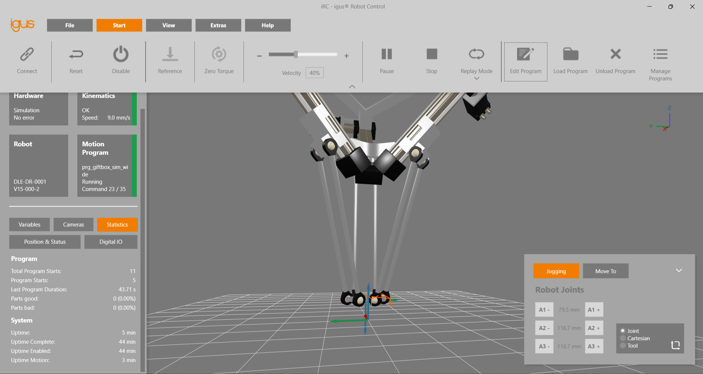
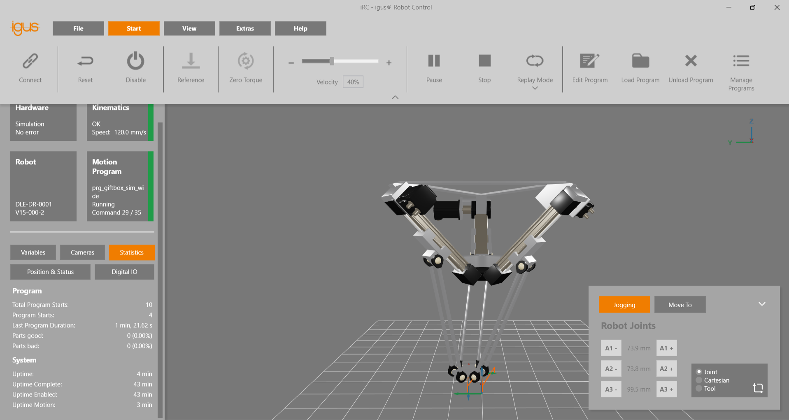
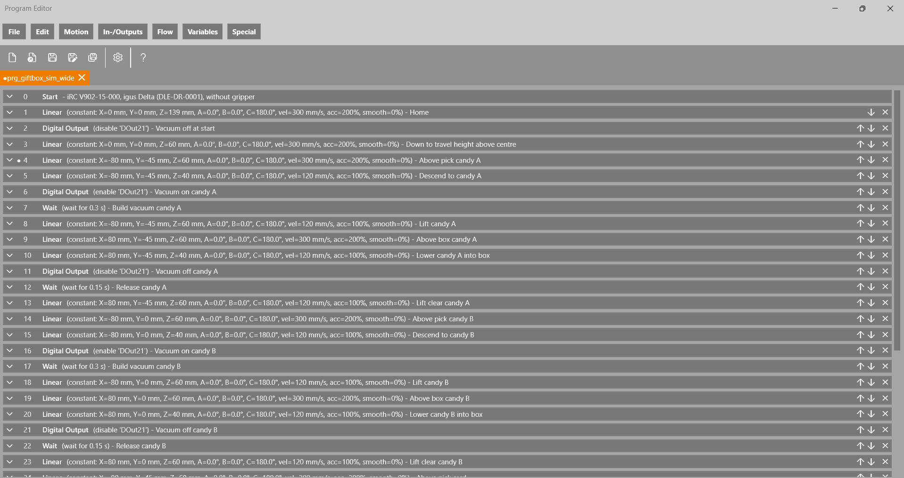

# Engineering Notebook
## Individual Robot Project 02 – T03 outputs and igus simulation report

- Name: Sazzad Ibna Mahfuz
- Project: Applied Robotics Project 02
- Start Date: 30-10-2026
- Finished Date: 01-11-2026

# Week 1: T03 outputs and igus simulation report

The scope (T01), resource list and risk register (T02) and the task table are already in project-plan.md. This file adds only what is missing or changed. Items marked **confirm** are not settled in the project files.

## Status changes since the plan (T01, T02)
- Camera: USB camera tested; the teacher's camera board was not used (Choton, 28 Oct).
- Delta robot: powered on and reached over Ethernet after finding the controller IP by ping scan on 192.168.3.x (Rashmika, 29 Oct). It cannot move yet: the controller software is outdated and V14 is requested from igus.
- Vacuum gripper: still to be selected (Rashmika, 27 Oct).
- **Confirm:** the plan lists the Dobot Nova 2.
- **Confirm:** the plan packs two candy types and one card; Choton's vision plans two cards and two candies of different colours.

## T03 block diagram

```
Operator ---- PC (igus Robot Control, Python/OpenCV)
                |-- USB ---------- RGB camera (above the table)
                |-- Ethernet ----- Robot controller (Commonplace Robotics)
                                       |-- CAN bus ------ igus stepper driver --- delta robot (3 axes)
                                       |-- Digital I/O --- vacuum controller --- vacuum gripper
24 V DC (Mean Well NDR-240-24, 10 A) <- 230 V AC
Conveyor <- control interface to be identified (T05, Week 2)
```

## T03 interface table

| Link | Signal / data | Status |
|---|---|---|
| PC to controller | Ethernet; PC static IP 192.168.3.1 / 255.255.255.0 | Reachable; record the controller IP |
| Controller to drivers | CAN bus | As described by Rashmika |
| Vacuum on / off | Digital I/O to vacuum controller | Channel to confirm (simulation uses DOut21) |
| Camera to PC | USB, camera_index 1 | Working |
| Vision to robot | Object type, colour, X and Y (mm), angle, box number | Planned; method (igus CRI or camera interface) to confirm with Rashmika |
| Conveyor to controller | Start/stop, item detection | Unknown until T05 |

Pick point is the centre of each object (suction cup). Vision positions use a table frame from a 4-point calibration (Choton); they must be recalibrated to robot coordinates once the robot moves.

## T03 measurable criteria (adds to the plan's T04, T08 and T10 criteria)
- Vision: correct type, colour and position on 10 different layouts; calibration error within 2 mm (Choton: 2 of 3 points so far).
- Simulation: the program completes five consecutive pick-and-place cycles without error, with cycle time recorded.
- Test conditions (speed, object positions, stops) to be agreed with the teacher.

## T03 schedule dates
W1 26–30 Oct, W2 2–6 Nov, W3 9–13 Nov, W4 16–20 Nov (V1 demo). T01–T03 were completed on 1 Nov.

## igus simulation report (preparation for Week 2)

**Setup:** igus Robot Control V15.0.2, Start Simulation, Delta, model DLE-DR-0001, parameters for 24 V. Status: Hardware "Simulation, no error", Kinematics OK, robot DLE-DR-0001 V15-000-2. The real robot's label is not yet checked.
**Start position:** X 0, Y 0, Z 139 mm, A 0, B 0, C 180; axes A1 to A3 at 0.0 mm.

**Programs** (saved in notebooks\week-01\Sazzad\File:)
| File | Result |
|---|---|
| prg1.xml | Failed at command 6: "minimum joint position reached (-0.0 < 0.0)". Cause: X 20 at Z 134, only 5 mm below the top of the range. |
| prg_giftbox_sim.xml | 35 commands: candy A, candy B, card from pick positions to box positions, vacuum on DOut21. Runs; (300 mm/s travel), wider (X ±80 / ±60). Test result: **add after running** |

**Findings:** near the top of the range the workspace is small, so lateral moves need lower Z. Velocity slider was 40 %; set it to 100 % for speed tests. The Reference button was not clickable after Connect; **confirm** the cause.
**Not yet done:** cycle times, vacuum channel check against the real robot, real coordinates.
**For Week 2 (T04, T05):** replace the table positions with calibrated positions; test on the real robot once V14 arrives; record five consecutive cycles.





- ## T03 proposed acceptance criteria (D1.6)

Proposed for agreement with the team and teacher. Values marked **confirm** are not settled.

| ID | Criterion | Measured by |
|---|---|---|
| **Week 4 demo (V1, conveyor stationary)** | | |
| AC4-1 | Five consecutive complete cycles: two candies and one card packed into the box, no manual correction | Checklist and video |
| AC4-2 | No item dropped; all items inside the box | Visual check after each cycle |
| AC4-3 | Vision gives the correct type, colour and position on 10 different layouts; calibration error within 2 mm (Choton: 2 of 3 points so far) | Test log |
| AC4-4 | Cycle time recorded for every cycle, as the baseline for V2 | Program log |
| AC4-5 | Emergency stop checked before the run; no unsafe condition | Check record |
| AC4-6 | Simulation completes five consecutive pick-and-place cycles without error, cycle time recorded | Simulation log |
| **Week 8 demo (final, conveyor moving)** | | |
| AC8-1 | Five consecutive complete cycles at one constant belt speed (speed: **confirm** after T05) | Checklist and video |
| AC8-2 | At least 8 of 10 attempts complete (**confirm**) | Log of all 10 attempts |
| AC8-3 | No item dropped, no unsafe condition | Video and check record |
| AC8-4 | Mean and worst cycle time reported and compared with V1 | Program log |

**Test conditions:** real box, card and the two candy types (representative objects only if the real ones are missing, and stated in the report). A failed cycle restarts the count, and every attempt is logged, failures included. Robot speed, object positions and stops are **confirm**, to be agreed with the teacher after the real-robot test. If the Week 8 criteria are not met, the stationary workflow is demonstrated and the limitation is recorded.


## References

- Manufacturer's technical documentation and user manual.
- HAMK laboratory documentation.
- Relevant robot programming and simulation documentation.


