# Engineering Notebook
## Machine Vision – Card and Candy Detection, Week 2

- Name: Choton
- Project: Applied Robotics Project 02
- Week: 2, 2–9 Nov 2026
- Task: T06 Machine vision
- Reviewer: Rashmika
- Code: [code](code/) · Test results: [test_results](test_results/)
- Week 1: [Choton.md](../../week-01/Choton/Choton.md)

## Weekly Goals

| Task ID | Expected output | Partner | Reviewer |
|---|---|---|---|
| T06 | Vision → robot: robot coordinates and an igus robot program from the camera picture | Sazzad / Rashmika | Rashmika |
| T06 | Test the Nicla Vision camera and improve its image quality (teacher feedback) | – | Teacher |
| T06 | Test and improve detection accuracy and robustness (teacher feedback) | – | Teacher |

## Code (week 2)

| Script | What it does |
|---|---|
| `01_camera_test.py` | Live camera, save photos |
| `02_hsv_tuner.py` | Find the colour ranges (HSV) |
| `03_detect.py` | Detect cards and candies, colour, position and size in mm |
| `04_calibrate.py` | Convert pixels to millimetres |
| `05_box_planner.py` | Choose which objects go into each box |
| `06_robot_program.py` | Write an igus robot program from the detected objects |
| `07_accuracy_test.py` | Accuracy and robustness test (20 frames per layout, saves results) |
| `nicla_main.py` | Program on the Nicla Vision camera: sends the picture over Wi-Fi |
| `nicla_resolution_test.py` | Tests which picture sizes fit in the Nicla's memory |

---

## 2026-11-02 – From Camera to Robot Program

### Objective

Use the detected positions to make a robot program automatically, so the robot picks the objects where they really are.

### Activities

- Read the team's updates: Rashmika got the robot software (V14) and the robot moves; Sazzad made a gift-box program for the igus simulation with fixed positions.
- Re-calibrated the camera (it had moved).
- Added the robot's working area to the camera view and robot X/Y to every object.
- Wrote `06_robot_program.py`: it detects the objects, chooses 2 cards + 2 candies, and writes an igus Robot Control program (.xml, same format as Sazzad's) with the real positions.

### Results

- The program found all 4 objects inside the robot's reach and wrote a robot program with **45 commands** (move, vacuum on/off, place in box).

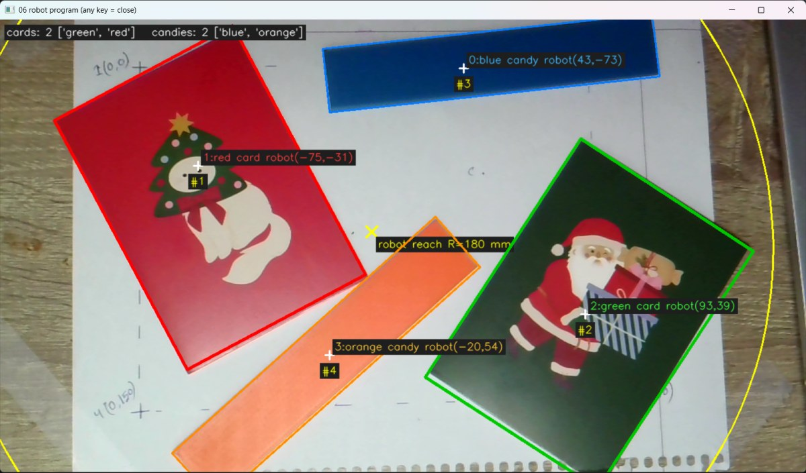

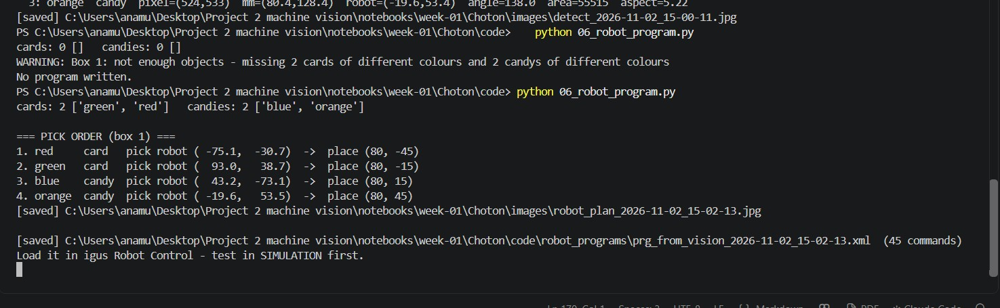

### Challenges

1. **Robot reach too small at first.** I used ±80 / ±60 mm from Sazzad's test program, but these were only his test positions. → Changed to the igus value for DLE-DR-0001: a circle of about 360 mm diameter.

   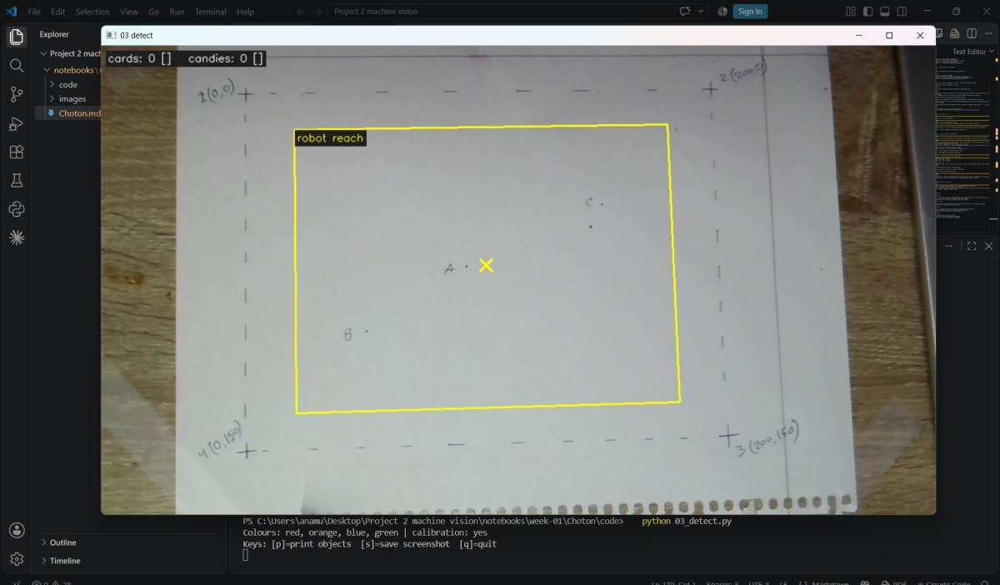

   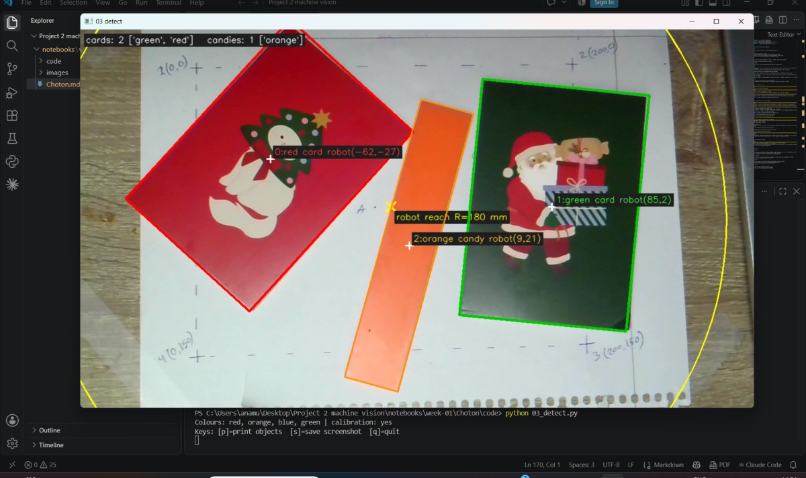

2. **No objects found when making the program.** The script used only the first camera picture, which is dark while the camera starts. → It now waits for the camera and uses the best of 10 pictures.

### Next Steps

- Sazzad tests the generated program in the igus simulation.
- The robot positions are temporary (robot centre = middle of the paper). Calibrate again with the robot tip when the camera is mounted at the robot.

---

## 2026-11-04 – Nicla Vision Camera

### Objective

Use the small Nicla Vision camera (suggested by Rashmika) instead of the USB camera, so it can later be mounted at the robot.

### Activities

- Identified the board as an **Arduino Nicla Vision** (GC2145 sensor) with OpenMV IDE and updated its firmware to 5.0.1.
- Wrote `nicla_main.py`: the Nicla sends its picture over Wi-Fi (iPhone hotspot) and our Python code reads it like a normal camera.
- Gave the Nicla its own colour ranges and calibration, so the USB camera settings are kept.
- Tested detection and the robot program with the Nicla picture.

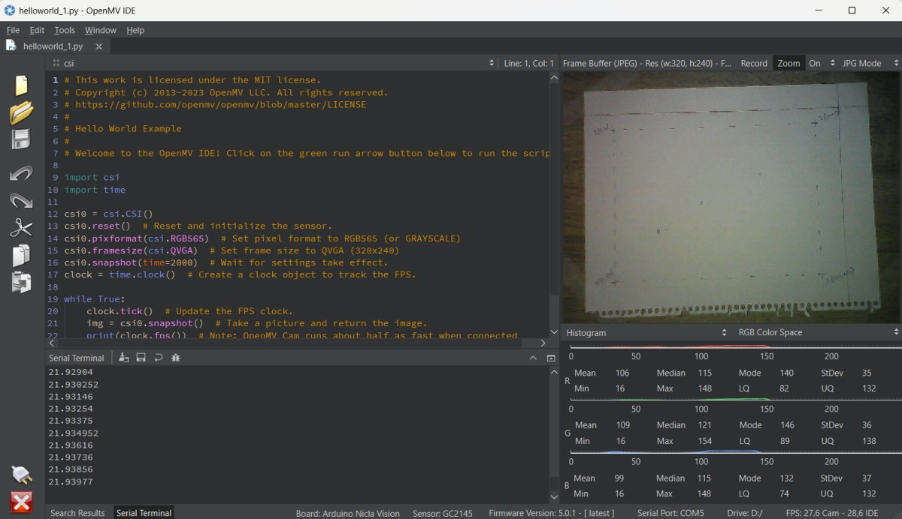

### Results

- The Nicla picture reaches our Python code over Wi-Fi at **480 × 320**.
- Detection finds **2 cards + 2 candies** correctly (live and on 3 test photos), and the robot program is written from the Nicla picture.

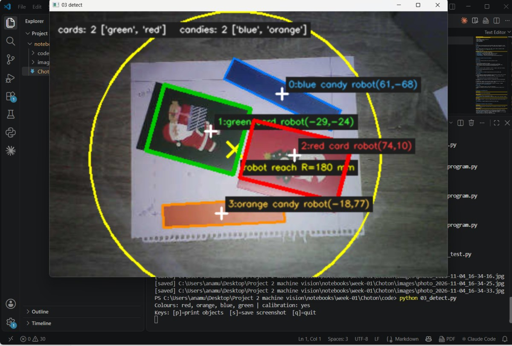

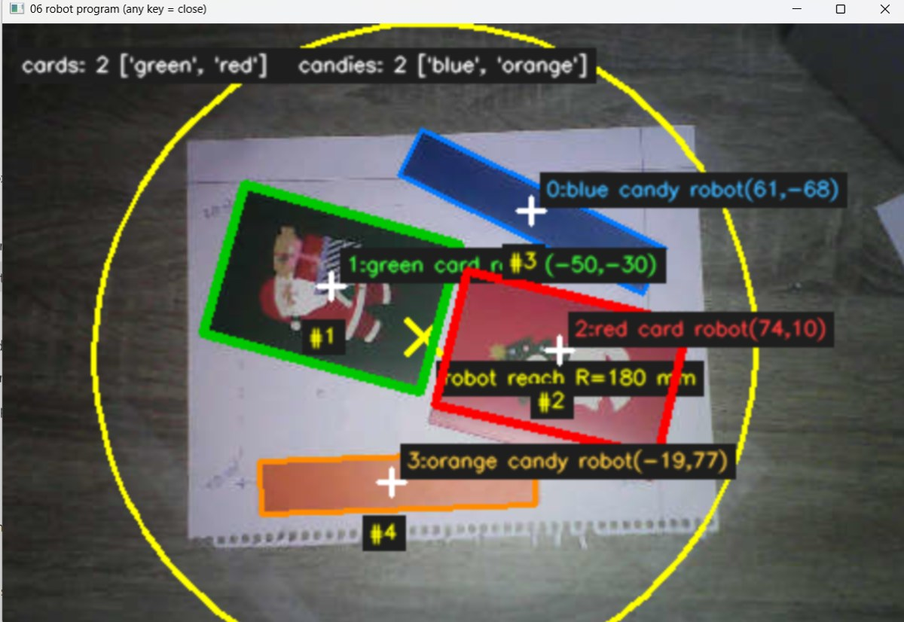

### Challenges

1. **USB cable without data.** Windows did not see the board. → Used another cable.
2. **Wi-Fi chip errors** (`CYW43 hdr mismatch`, `sdio timeout`) right after connecting. → Turned off the Wi-Fi power saving and ran the program on the board without the IDE.

   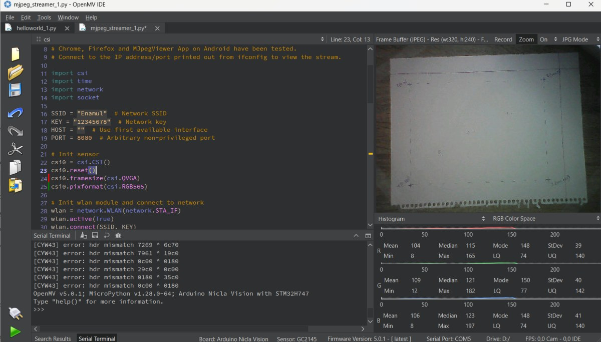

3. **Low picture quality and greenish colours.** 640 × 480 did not fit in the Nicla's memory. → Used 480 × 320, better JPEG quality and locked the white balance.

   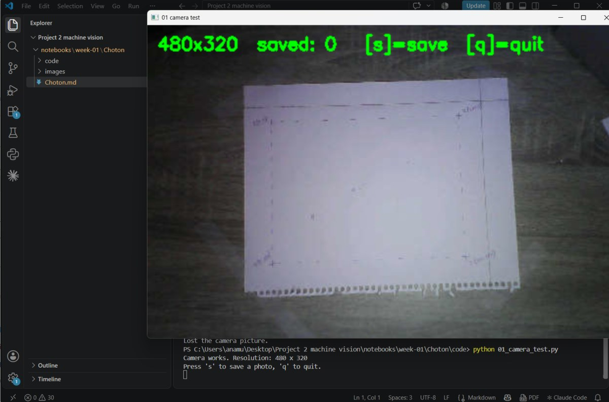

4. **Glare** from the lamp made the green card look grey. → Light from the side; new colour ranges for the Nicla.

### Next Steps

- Check the calibration accuracy with the Nicla (dots A, B, C).
- Copy `nicla_main.py` to the Nicla as `main.py` so it starts by itself in the lab.
- Decide with the team: Nicla (small, wireless) or USB camera (better picture, more stable).

---

## 2026-11-06 – Nicla Vision Image Quality

### Objective

Improve the Nicla Vision image quality (teacher feedback) or decide on another camera.

### Activities

- Read the Nicla Vision datasheet: the GC2145 sensor is 2 MP (1600 × 1200), but the board has only about 1 MB RAM and no extra picture memory.
- Wrote `nicla_resolution_test.py` to test larger picture sizes on the board.

### Results

| Setting | Result |
|---|---|
| 320 × 240 | works |
| 480 × 320 | works, 8 fps |
| 560 × 400 (cropped from 640 × 480) | works, 25 fps – best possible |
| 640 × 480 and larger | fails: "Frame buffer overflow" |

- The sensor cannot make JPEG itself, so the board must compress every picture for Wi-Fi, which lowers the quality further.
- The USB RGB camera gives 1280 × 720 with a much sharper picture.

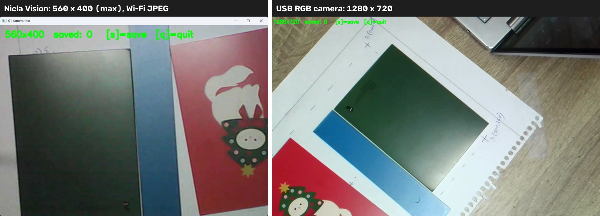

### Decision

The teacher agreed to use the **USB RGB camera**. The Nicla setup is kept (`settings_nicla.json`) in case it is needed later.

---

## 2026-11-09 – Accuracy and Robustness Tests

### Objective

Test the detection under different conditions and improve its accuracy and robustness (teacher feedback).

### Activities

- Wrote `07_accuracy_test.py`: for each layout it checks 20 frames, whether the result is correct, and how much the positions move (jitter). Results are saved in `test_results/`.
- Tested 6 conditions, about 10 layouts each: bright light, dim light, side lamp, touching objects, overlapping objects, extra objects (distractors).
- Measured the real sizes: card 125 × 87 mm, test candy 150 × 28 mm.

### Improvements made

1. **Camera settings:** auto exposure and white balance are reset at start (a stuck setting made the picture too white); only the focus is locked.
2. **Stable detection:** the result uses 15–20 frames and the median position, so single bad frames are ignored.
3. **Size check in mm:** objects that are not the size of a card or candy (mouse, phone, 3D part) are ignored.
4. **Edge and covered check:** objects partly outside the picture or under another object are marked; the robot does not use objects at the edge and picks covered ones last.
5. **Red colour range** widened, because the red card looks pink in bright light.

### Results

| Condition | Before fixes | After fixes |
|---|---|---|
| Bright light | 0 / 10 | **8 / 11** (all objects found in 11 / 11; 3 failures = object touching the picture edge) |
| Dim light | 10 / 10 | – |
| Side lamp (glare) | 10 / 10 | – |
| Touching objects | 10 / 12 | – |
| Overlapping objects | 9 / 11 | – |
| Distractor objects | 4 / 13 | **11 / 12** |

- **Size accuracy:** measured candy 150 × 28 mm (real 150 × 28), card 126 × 86 mm (real 125 × 87) → within 1–2 mm.
- **Position jitter:** 0.2–0.7 mm on average.

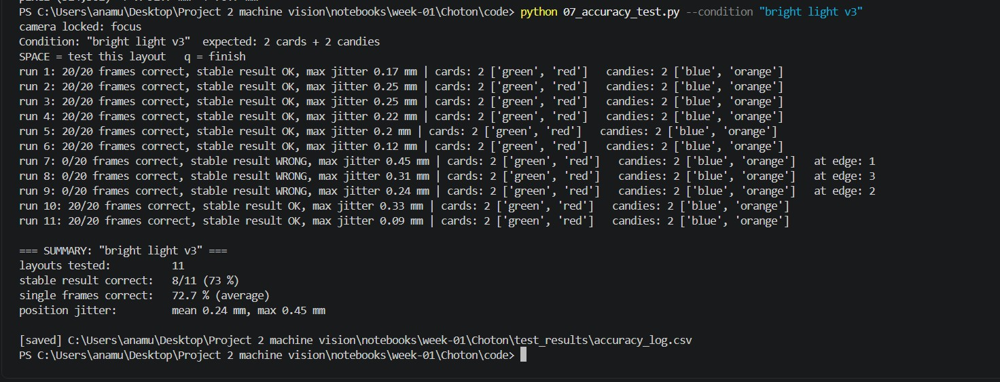

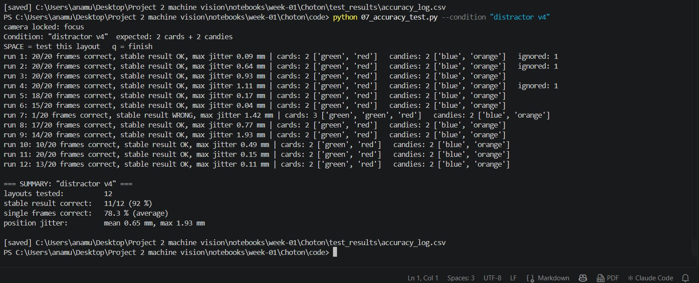

### Challenges

- Bright light made the picture too white: the camera kept an old manual exposure setting → reset to automatic at every start.
- Objects touching the picture edge and hands in the picture caused failures → keep objects fully inside the picture and hands out.
- A card with two objects on top falls apart into pieces → the robot must pick the top objects first and take a new picture.
- A distractor of the same colour and size can still be taken as a card or candy → keep the work area clear.

### Next Steps

- Measure the real candies when they arrive and update the size (and colours if needed).
- Mark the work area on the table so all objects stay inside the picture.
- Mount the camera at the robot and calibrate with the robot tip.

---

## Weekly Reflection

### Done this week

- The camera now writes an igus robot program (45 commands) from the detected objects.
- Nicla Vision tested: best possible picture 560 × 400; too low for reliable detection → USB RGB camera chosen with the teacher.
- Accuracy and robustness tested in 6 conditions; after the fixes: bright light 8/11 (all objects found 11/11), distractors 11/12, size within 1–2 mm, jitter 0.2–0.7 mm.

### Not done / open

- Robot coordinates are still temporary: calibration with the robot tip waits for the camera mount at the robot.
- Real candies not yet tested.

### What I learned

- A test tool with numbers shows problems that are invisible in single screenshots (e.g. the stuck camera exposure).
- Camera settings (exposure, white balance, focus) matter as much as the detection code.
- Small boards like the Nicla are limited by memory, not only by the sensor.

### Plan for Week 3

- Mount the camera above the robot work area and calibrate with the robot tip.
- Test the generated robot program in the simulation and on the robot with Sazzad and Rashmika.
- Update sizes and colours for the real candies.
