# Week 46 -- Rashmika Dineth Ruwanpathirana

**Dates:** 6, 7, 9 and 10 November 2026\
**Student:** Rashmika Dineth Ruwanpathirana

## Weekly Goals

The main goal of this week was to inspect the DOBOT M1 SCARA robot hardware and installation, identify its 16 digital inputs and 16 digital outputs, and establish LAN communication with the robot. The work also focused on investigating compatible DOBOTStudio Pro software versions, testing robot movement through joint and Cartesian jogging, and developing an initial block-based control program. The estimated personal working time for this task (M1-01) was 16 hours. The project partner and reviewer are yet to be confirmed.                        

  ----------------------------------------------------------------------------

## 2026-11-06 First Part 

-   **Task ID and actual time:** M1-01 -- 4 hours.
-   **Working partner and reviewer:** To be confirmed.
-   **My contribution and work completed:**
    -   Inspected the DOBOT M1 SCARA robot and its hardware
        installation.
<table>
  <tr>
    <td>
      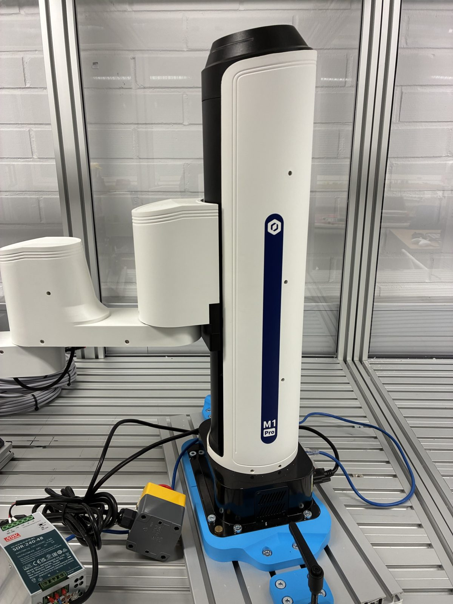
    </td>
    <td>
      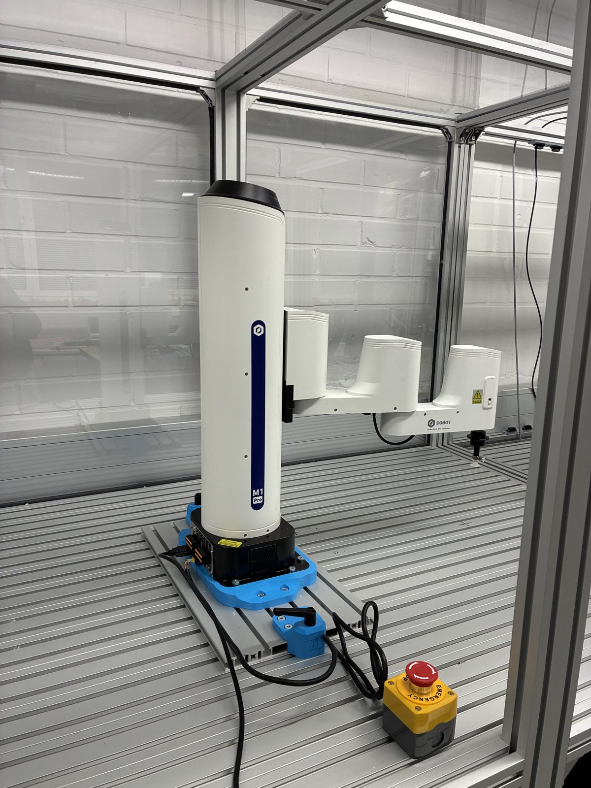
    </td>
  </tr>
</table>
    -   Reviewed the robot's available connections and controller
        interface. The power supply is 48V and 5A power supply.  
    -   Identified that the system provides 16 digital inputs and 16
        digital outputs.
<table>
  <tr>
    <td>
      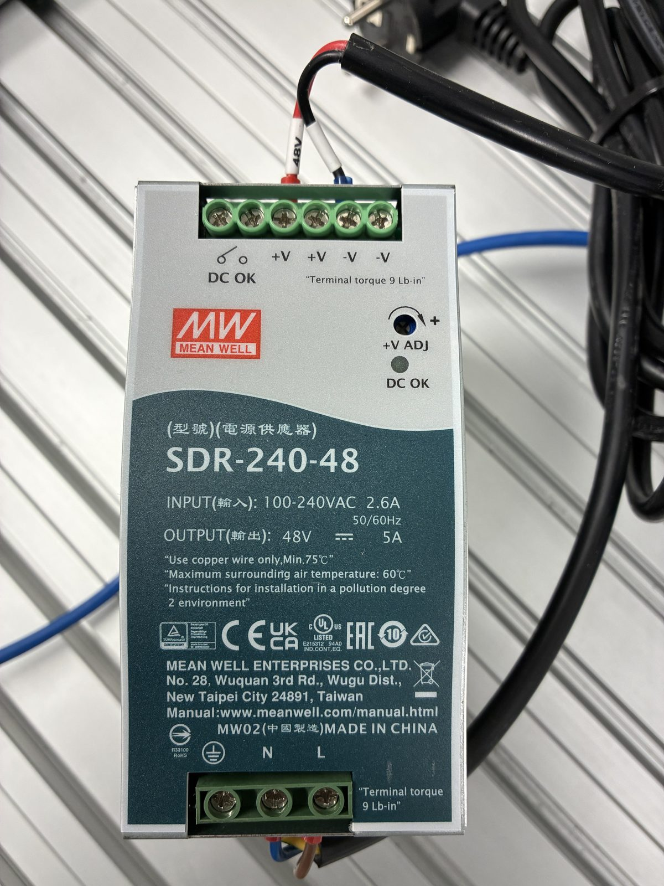
    </td>
    <td>
      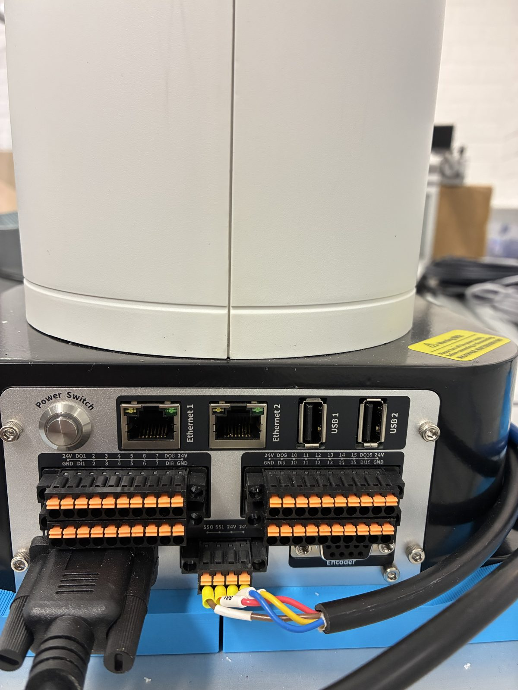
    </td>
  </tr>
</table>
    -   Checked the robot's LAN connection and its fixed IP address:
        `192.168.1.6`.
  
### **Decisions and reasons:**
  
-   Used a wired LAN connection for communication because the robot is configured with the fixed IP address `192.168.1.6`. The ping connection was return success. 

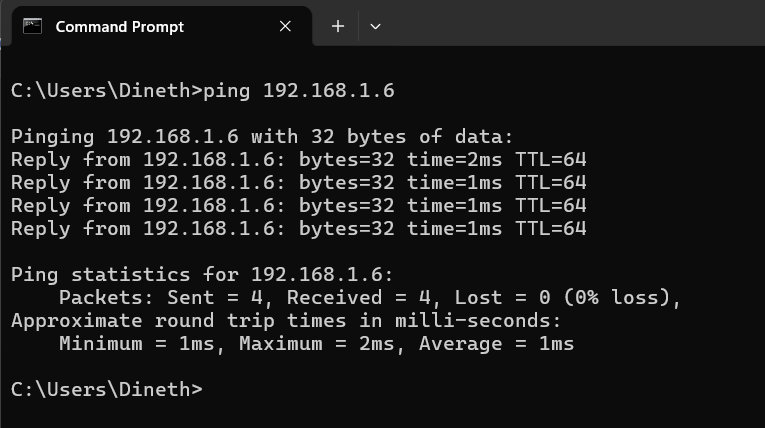

-   Recorded the digital I/O configuration as a reference for future control-program development.

**Evidence links and actual results are attached. 

### **Failures, blockers, or help needed:**

-   The correct DOBOTStudio Pro software version for the M1 needed to be identified.
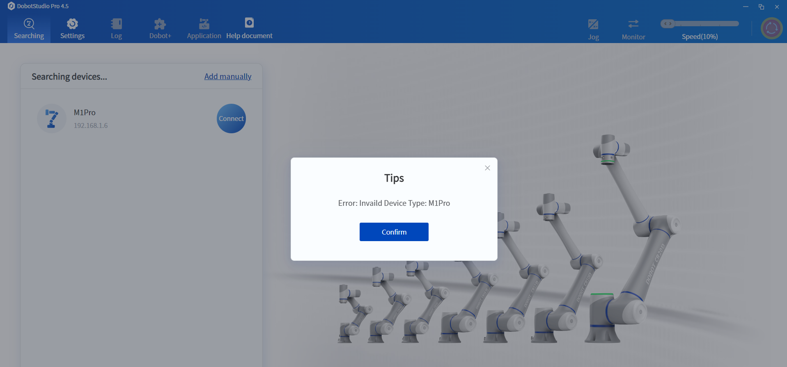

### **Next action:**
-   Test network communication and check which DOBOTStudio Pro version is compatible with the robot.

## 2026-11-06 Second Part 

-   **Task ID and actual time:** M1-01 -- 4 hours.
-   **Working partner and reviewer:** To be confirmed.
-   **My contribution and work completed:**
    -   Connected the computer to the DOBOT M1 through a LAN cable.
    -   Tested network connectivity using the `ping 192.168.1.6`
        command.
    -   Checked the compatibility of different DOBOTStudio Pro versions
        with the M1.
    -   Tested version 4.5, followed by version 4.6. Neither version
        worked correctly with the M1.
    -   Tested the older DOBOTStudio Pro version 2.8.1, which supported
        the robot.

-   **Decisions and reasons:**
    -   Selected DOBOTStudio Pro 2.8.1 for further testing because the
        newer versions tested (4.5 and 4.6) did not support the M1
        correctly.
    -   Used the ping test to verify basic communication with the robot
        before proceeding with software-level control.

-   **Evidence links and actual results are attached. 

-   **Failures, blockers, or help needed:**
    -   Software-version compatibility required testing several
        versions.
    -   The newer software versions could not be used for the required
        M1 operation.

-   **Next action:**
    -   Continue testing the robot using DOBOTStudio Pro 2.8.1 and
        investigate its jogging functions.

## 2026-11-09

-   **Task ID and actual time:** M1-01 -- 6 hours.
-   **Working partner and reviewer:** To be confirmed.
-   **My contribution and work completed:**
    -   Tested the manual jogging functions of the DOBOT M1.
    -   Found that joint-movement jogging worked, but Cartesian X, Y and
        Z jogging produced inverse-kinematics errors.
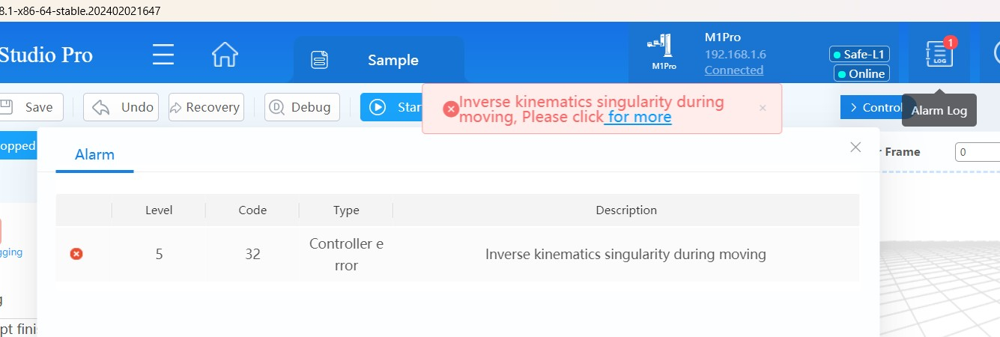

    -   Investigated an alternative way to operate the robot through a
        block-based program.

    -   Started creating a block-based program to control the DOBOT M1
        because the Cartesian jogging functions were not operating as
        expected.
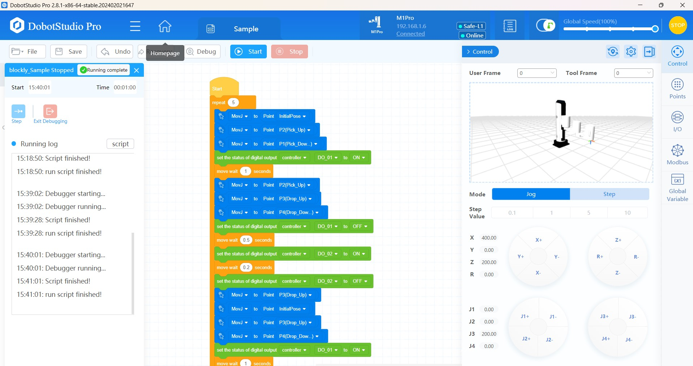

-   **Decisions and reasons:**
    -   Used joint jogging as the working manual movement method during
        testing.
    -   Decided to investigate block-based programming as an alternative
        to Cartesian manual jogging, which was returning
        inverse-kinematics errors.
    -   Further testing is required before considering the block-based
        program complete.

-   **Evidence links and actual results:**
    -   Jogging test screenshots or photographs: add the relevant
        evidence.
    -   Block-based program screenshot: add a screenshot of the program
        under development.
    -   Joint-movement jogging operated successfully during the test.
    -   X, Y and Z Cartesian jogging generated inverse-kinematics
        errors.
    -   An initial block-based control program was started; its
        operation still needs to be tested and verified.

-   **Failures, blockers, or help needed:**
    -   Cartesian jogging remains unresolved because of
        inverse-kinematics errors.
    -   The cause of the inverse-kinematics errors has not yet been
        confirmed.
    -   The block-based program requires further development and
        testing.

-   **Next action:**
    -   Check the robot's coordinate system, current pose, movement
        limits and jogging settings.
    -   Test the block-based program with safe, limited movements.
    -   Record the results and investigate the cause of the Cartesian
        jogging errors.

## 2026-11-10

- **Task ID and actual time:** M1-01 -- 6 hours.
- **Working partner and reviewer:** To be confirmed.
- **My contribution and work completed:**
    - Tested sample pick-up operations using two different types of grippers to pick up small candies covered with plastic wrapping.
    - Found that the candies could not be picked up successfully because the available vacuum gripper did not provide sufficient suction power or because of the uneven surface the gripper unable to pickup the candies.
<table>
  <tr>
    <td>
      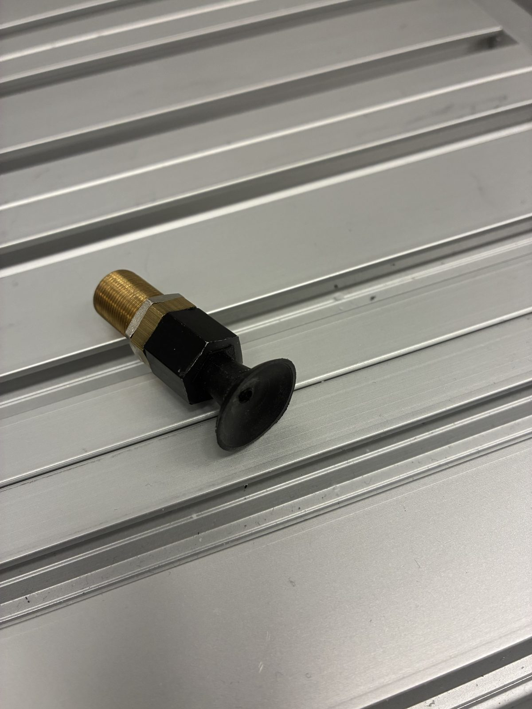
    </td>
    <td>
      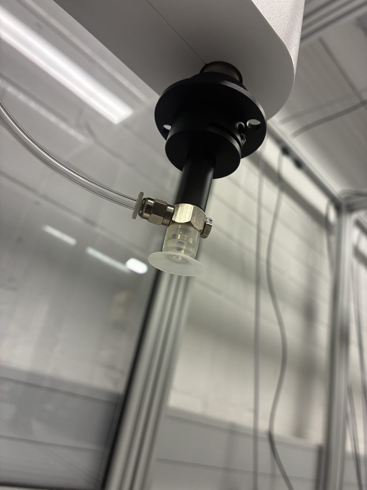
    </td>
  </tr>
</table>
    - Investigated alternative pick-up tools or gripper solutions suitable for handling the candies.
    - Searched for a Python-based TCP/IP control program for the DOBOT M1.
    - Found the official DOBOT GitHub repository containing a Python-based TCP/IP example:
      [DOBOT TCP-IP 4Axis Python](https://github.com/Dobot-Arm/TCP-IP-4Axis-Python.git).

- **Decisions and reasons:**
    - Decided to investigate alternative gripper solutions because the existing grippers could not reliably pick up the wrapped candies.
    - Selected the official DOBOT Python TCP/IP example as a potential solution for programmatic robot control.
    - Decided to test Python-based TCP/IP communication as an alternative approach to controlling the DOBOT M1.

- **Evidence links and actual results:**
    - Candy pick-up test photographs: add relevant photographs.
    - Official DOBOT TCP/IP Python repository: [GitHub repository](https://github.com/Dobot-Arm/TCP-IP-4Axis-Python.git).

- **Failures, blockers, or help needed:**
    - The existing vacuum gripper does not provide sufficient suction power for reliable candy pick-up.
    - A suitable alternative gripper or pick-up mechanism needs to be identified.
    - The Python TCP/IP example has not yet been executed or tested.

- **Next action:**
    - Investigate and test alternative grippers suitable for picking up the wrapped candies.
    - Download and configure the official DOBOT TCP/IP Python example.
    - Test TCP/IP communication between the computer and the DOBOT M1.
    - Execute basic robot movement commands using Python.
    - Record the test results and identify any communication or control issues.

The Dobot M1 Pro can be controlled with python with TCP/IP configuration. And the sample code run successfully. 
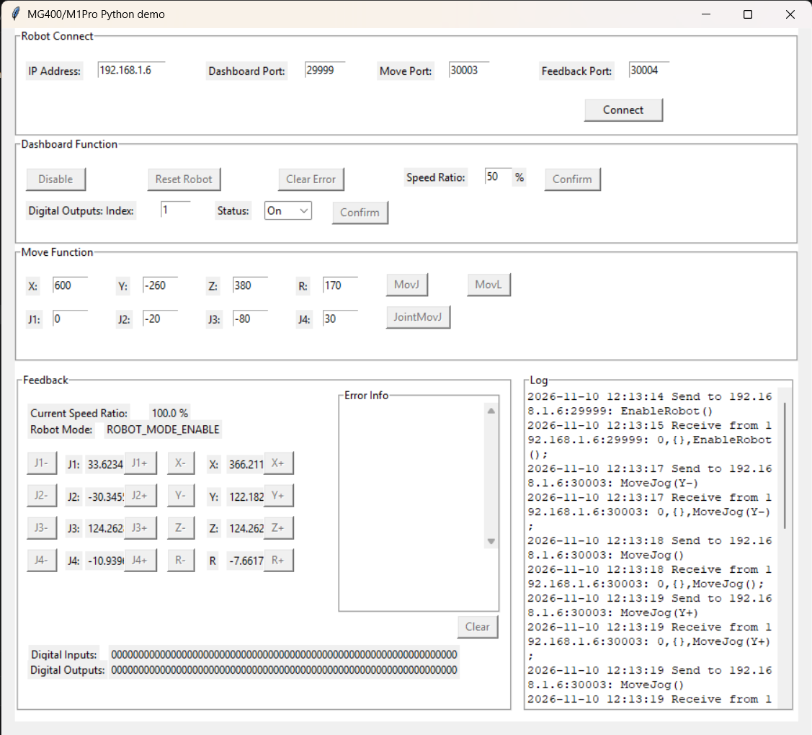

## Weekly Reflection

- **Planned versus completed work and actual total hours:**
    - Planned: inspect the hardware and installation, identify the I/O configuration, establish LAN communication, find a compatible software version, test jogging, investigate alternative control methods and test sample pick-up operations.
    - Completed: hardware inspection, identification of 16 digital inputs and 16 digital outputs, LAN connectivity test, software-version compatibility testing, joint-jogging test, initial block-based program development and sample pick-up tests using two different types of grippers.
    - Partially completed: Cartesian jogging investigation, block-based control-program development, alternative gripper investigation and Python-based TCP/IP control evaluation.
    - Identified the official DOBOT TCP/IP Python example on GitHub for further testing.
    - The team agreed to move with NOVA 2 due to its moving speed and the large working area. 
    - **Recorded working time: 20 hours**

- **Checkpoint status and evidence:**
    - Hardware inspection: completed.
    - Digital I/O identification: completed; 16 digital inputs and 16 digital outputs identified.
    - LAN communication: basic connectivity confirmed by successful ping replies to `192.168.1.6`.
    - Software compatibility: DOBOTStudio Pro 2.8.1 supported the M1 in testing; versions 4.5 and 4.6 did not.
    - Jogging: joint movement worked; Cartesian X, Y and Z jogging returned inverse-kinematics errors.
    - Alternative control: initial block-based program started; further testing is required.
    - Gripper testing: two different types of grippers were tested, but neither successfully picked up the wrapped candies. The available vacuum suction power was insufficient.
    - Alternative pick-up solution: further investigation is required to identify a suitable gripper or pick-up mechanism.
    - Python TCP/IP control: official DOBOT Python example identified from GitHub; downloading, execution and communication testing are still pending.

#### Robot Demonstration VIDEO 
[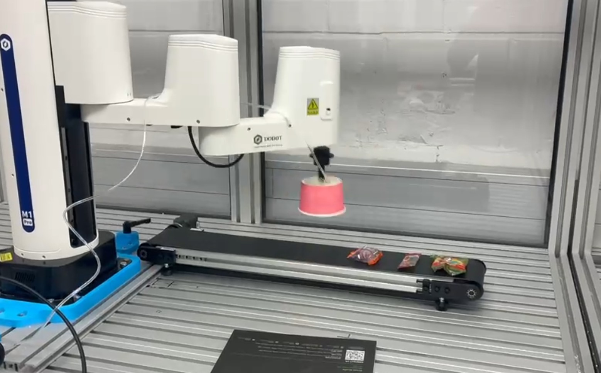](./Videos/Video1.mp4)

[▶ Watch Robot Demonstration](./Videos/Video1.mp4)

-   **What I learned from working with my partner:**
    -   TBD on next meeting day

-   **Reviewer feedback and action taken:**
    -   No reviewer feedback has been recorded in this entry.

-   **Unfinished work, reasons, and next steps:**
    -   Identify and resolve the cause of the inverse-kinematics errors during X, Y and Z jogging.

    -   Complete and test the block-based control program.
    
    -   Verify safe movement, coordinate settings and operating limits before carrying out further motion tests.
    
    - Investigate available Python-based SDK libraries for TCP/IP communication and robot control in the next stages of the project.

Compared to specifications the Nova 2 is faster than Dobot M1 Pro. 

<table>
  <tr>
    <td>
      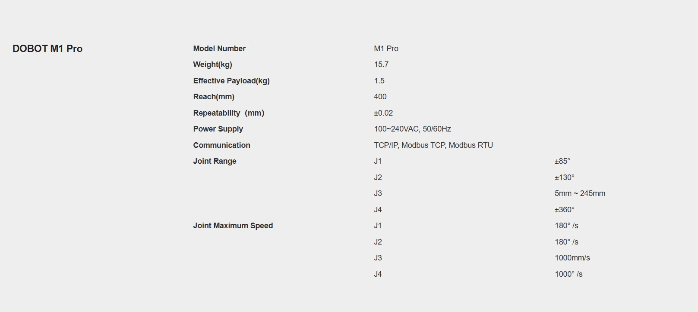
    </td>
   </tr>
   <tr>
    <td>
      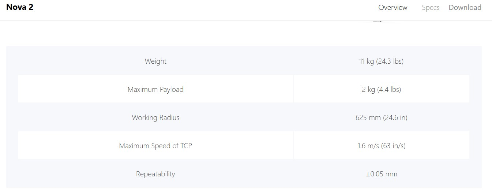
    </td>
  </tr>
</table>