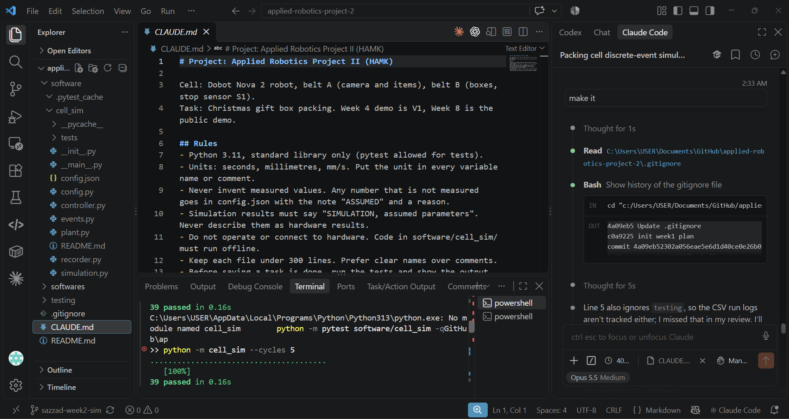
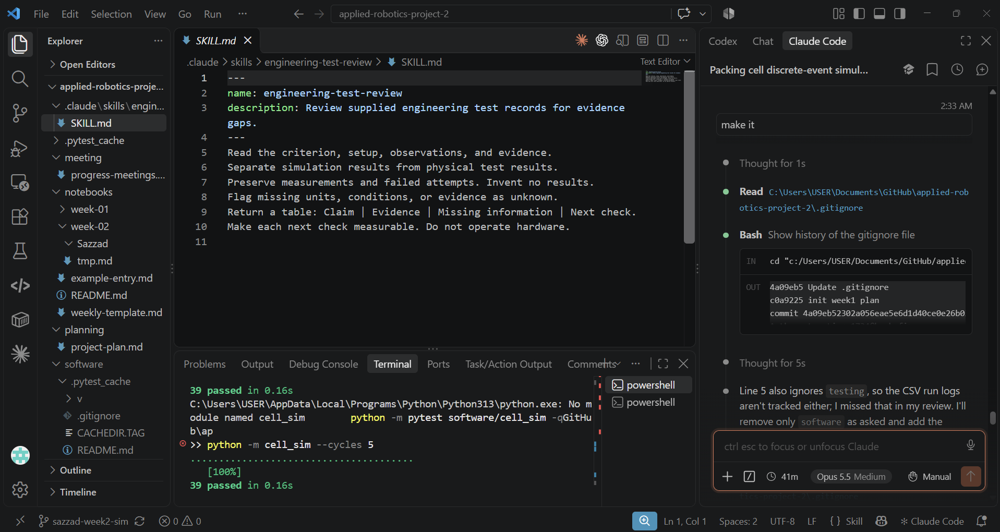
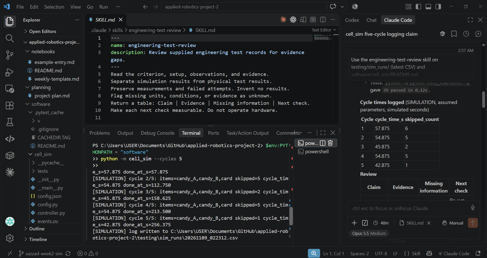
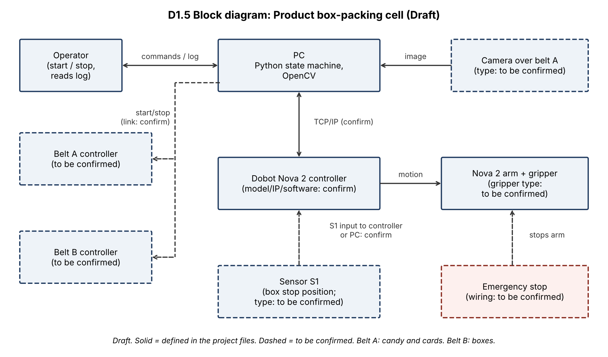

# Engineering Notebook
## Individual Robot Project 02, Week 2

- Name: Sazzad Ibna Mahfuz
- Project: Applied Robotics Project 02
- Week: 2 (continued into W3), 2–9 Nov 2026

## Weekly Goals

| Task ID | Expected output | Partner | Reviewer | Estimated personal hours |
|---|---|---|---|---|
| T03 | Python simulation of the cell (D2.3), run instructions, cycle-time log | Choton / Rashmika | Choton | [5] |
| T03 | Interface definitions draft (D2.4), block diagram (D1.5) | Rashmika | Choton | [4] |
| T05 | Conveyor test plan and record sheet, ready for the lab (tests done next lab session) | Rashmika | Choton | [2] |

## 2026-11-07

- Task ID / actual time: T03 (D2.3), [5] h. Claude Code session about 01:42–05:37.
- Working partner / reviewer: worked alone with Claude Code; reviewer Choton.
- My contribution:
  1. Tried the cell simulation in Visual Components. It failed with "error connecting with server with the provided license". Fallback: Python simulation.
  2. Created the repo folders and `CLAUDE.md` in the project root, then opened Claude Code in VS Code in Manual permission mode.
  3. Gave Claude Code the task in /plan mode: state machine for Belt A, camera detection, Nova 2 pick, Belt B box stop at the sensor, place, release, cycle log. I reviewed the plan before approving it.
  4. Let it build the `cell_sim` package (states INIT, READY, FEED_ITEM, ITEM_DETECTED, PICK, BRING_BOX, PLACE, RELEASE_BOX, CYCLE_DONE, FAULT), `config.json` and tests.
  5. Checked each diff in Source Control before accepting it.
  6. Ran the tests and the simulation (results below).
 
- Decisions and reasons:
  - Python simulation instead of waiting for the licence: it covers D2.3 and the logic can be rebuilt in Visual Components later.
  - All timing values live in `config.json` and are labelled ASSUMED, so they can be replaced after the T05 measurements.
  - Folders `software`, `testing`, `.claude` stay in the repo root. Moving them into the notebook folder broke `python -m pytest` and `python -m cell_sim`, so I moved them back.
- Evidence links and actual results:
  - `python -m pytest software/cell_sim -q`: 39 passed.
  - `python -m cell_sim --cycles 5` (SIMULATION, assumed parameters):

    | Cycle | cycle_time_s | skipped_count |
    |---|---|---|
    | 1 | 57.875 | 6 |
    | 2 | 54.875 | 5 |
    | 3 | 45.875 | 2 |
    | 4 | 54.875 | 5 |
    | 5 | 42.875 | 1 |

    Total 256.375 s, mean 51.275 s. Log: `testing/sim_runs/20261109_022312.csv`.
  - Screenshots: 
    

    

    
    
- AI use: Claude Code wrote the code and tests from my spec. I reviewed the plan and diffs. 
- The simulation does not prove that real timing, camera detection or robot reach work.
- Next action: lab session, run the T05 conveyor tests and replace the assumed values in `config.json` with measured ones.

## D1.5 Block diagram (draft)

## D2.4 Interface definitions (draft)

| Link | Signal / data | Direction | Status |
|---|---|---|---|
| PC to Nova 2 controller | Motion commands, status, I/O (Dobot TCP/IP remote control, Python) | both | Method, IP and port **confirm** (lab) |
| PC to camera | Image frames (USB or board link) | camera to PC | Camera type **confirm** with Choton |
| Vision to robot | Item type, colour, X, Y (mm), angle, box number | PC to robot | Planned; frame calibration needed |
| Gripper | Close / open (two-finger seen in photo; plan says vacuum) | controller to gripper | Type and I/O channel **confirm** |
| Belt A | Start / stop | PC or controller to belt | Control unit **confirm** |
| Belt B | Start / stop | PC or controller to belt | Control unit **confirm** |
| Sensor S1 | Box present at stop position (digital) | sensor to controller or PC | Type, voltage, wiring **confirm** |
| Emergency stop | Cuts robot and belts | operator to system | Wiring **confirm** |

Simulation names used so far: states as listed above; events are item detected, box at S1, pick done, place done, fault. Real signal names replace these after the lab.

## D1.6 Proposed acceptance criteria (updated for Nova 2 and two belts)

Proposed for agreement with the team and teacher. **Confirm** the Week 4 belt state with the teacher.

| ID | Criterion | Measured by |
|---|---|---|
| **Week 4 demo (V1)** | | |
| AC4-1 | Five consecutive complete cycles, each packing the agreed items into the box without manual correction (item mix **confirm**) | Checklist and video |
| AC4-2 | No item dropped; all items inside the box | Visual check each cycle |
| AC4-3 | Belt B stops the box at S1 within a tolerance of ±[X] mm in 10 of 10 runs (X from T05-4) | Calliper log |
| AC4-4 | Cycle time recorded for every cycle | Program log |
| AC4-5 | Emergency stop checked before the run; no unsafe condition | Check record |
| AC4-6 | Simulation completes five consecutive cycles without error, cycle time logged | Simulation log |
| **Week 8 demo (final)** | | |
| AC8-1 | Five consecutive complete cycles with both belts running at one constant speed (speed from T05-2) | Checklist and video |
| AC8-2 | At least 8 of 10 attempts complete (**confirm**) | Log of all attempts |
| AC8-3 | No item dropped, no unsafe condition | Video and check record |
| AC8-4 | Mean and worst cycle time reported and compared with V1 | Program log |

Test conditions: real box, card and candies; every attempt logged, failures included; a failed cycle restarts the count. If Week 8 criteria are not met, the Week 4 workflow is demonstrated and the limitation is recorded.

## D1.7 Task plan with dates

Proposed. Dates marked * differ from project-plan.md and need team agreement.

| Task | Lead | Dates | Output |
|---|---|---|---|
| T03 Remote control setup, simulation, interfaces | Sazzad | 28 Oct – 13 Nov* | D2.3, D2.4, D1.5; remote control check in the lab |
| T04 Camera / vision | Rashmika, partner Choton | 2–4 Nov (status: confirm) | Vision test results |
| T05 Conveyor tests | Sazzad, partner Rashmika | next lab session* | Filled test record |
| T06 Integration | Choton / Sazzad | 9–12 Nov | Robot + belts + camera sequence |
| T07 Dry run and fixes | team | 11–13 Nov | Five-cycle rehearsal |
| T08 V1 demo | team | 16–20 Nov | Demo and report |

## Weekly Reflection

- What went well: the simulation was built, tested (39 passed) and merged, and gave a first baseline of five cycle times.
- What did not: Visual Components could not start, so no 3D simulation. The folder move cost time.
- What the numbers do not show: they come from assumed parameters, not from the real robot or belts.
- Next week: run T05, replace assumed values, test remote control, agree the open questions with the team.
