# Engineering Notebook
## Machine Vision – Card and Candy Detection, Week 3

- Name: Choton
- Project: Applied Robotics Project 02
- Week: 3, 10–14 Nov 2026
- Task: T06 Machine vision
- Reviewer: Rashmika
- Code: [code](code/) · Model: [models](models/) · Pictures: [dataset](dataset/raw/)
- Week 2: [Choton_Week2_Notebook.md](../../week-02/Choton/Choton_Week2_Notebook.md)

## Weekly Goals

| Task ID | Expected output | Partner | Reviewer |
|---|---|---|---|
| T06 | New vision pipeline with a trained YOLO model, so any kind of candy is detected (teacher feedback) | – | Teacher |
| T06 | Training pictures, labels and a first trained model with test results | – | Rashmika |
| T06 | Vision connected to the Dobot M1 Pro: calibration, robot points and the pick-and-place program | Rashmika | Rashmika |
| T06 | First working prototype on the real robot: 1 card + 2 candies picked and placed in the box | Rashmika | Teacher |
| T06 | Next version: box and lid detection, objects turned straight, box closed with the lid, conveyor stopped by the camera | Team | Rashmika |

## Code (week 3)

Final working code: [code](code/). How to run it and all values for the team: [code/README.md](code/README.md).

| Script | What it does |
|---|---|
| `00_check.py` | Checks that everything is ready before a run (camera, model, calibration, robot) |
| `10_collect_images.py` | Takes training pictures, one folder per session |
| `11_label.py` | Labelling tool: draws a box around each object, I mark it card, candy, box or lid |
| `12_train.py` | Trains the YOLO model on the labelled pictures and prints the scores |
| `13_yolo_detect.py` | Live detection with the trained model (or on a folder of pictures), with the angle of each object |
| `15_robot_setup.py` | Robot setup: calibration camera → robot, robot heights, box and lid positions, suction test |
| `14_pick_and_place.py` | The full program: box arrives → conveyor → detect → pick → turn straight → place in the box → lid |
| `vision_lib.py`, `yolo_lib.py`, `robot_lib.py` | Shared functions for camera, YOLO and robot |
| `dobot_api.py`, `files/` | Official Dobot TCP/IP library and the alarm lists (same as in Rashmika's robot control folder) |
| `find_camera.py`, `robot_check.py` | Helpers: find the USB camera number; check the robot connection and alarms |
| `robot_move_test.py`, `robot_arm_left.py` | Helpers used to find the robot alarm problem (12 Nov) |

---

## 2026-11-10 – New Vision Pipeline with YOLO

### Objective

The teacher asked us to change the vision from colour rules to a trained model ("label training pictures, so different candies are detected as candy automatically"), as in the week 3 lecture *"From one neuron to a local YOLO detector"*.

### Activities

- Read the week 3 lecture. Main points I used:
  - fine-tune a small pretrained YOLO model on our own labelled pictures,
  - split the pictures **by session** into training and validation (not neighbouring frames),
  - use a confidence threshold to remove weak detections.
- Compared with my week 2 detection: the colour rules worked for the test cards and 3D-printed candies, but every new candy would need new colour ranges.
- Planned the new pipeline: **take pictures → label → train → detect → robot**.
- Wrote the scripts 10–14 (table above). The camera and calibration code from week 2 is reused.
- Read Rashmika's robot update and her DobotStudio program: **DO1 = suction**, **DO2 = blow-off** (0.2 s), and her pick and drop positions. I used them as start values.
- Team decision: each box gets **1 card + 2 candies**.

### Decisions

- **YOLO11n** (the smallest YOLO, 2.6 million parameters): trains on the laptop CPU, no graphics card needed.
- **2 classes:** card and candy.
- The robot picks at the **centre of the box** that YOLO draws around the object.
- The colour of each object is still measured, for the rule "different colours in one box".

### Next Steps

- Take training pictures. The USB camera was left at the university, so the first pictures are taken at home with the Nicla Vision.

---

## 2026-11-11 – Training Pictures

### Objective

Take pictures of cards and candies for training, from different sessions.

### Activities

- Installed YOLO on the laptop (`ultralytics 8.4.210`, `torch 2.15`).
- Started the Nicla Vision over Wi-Fi and used a **black cloth** as background (like the black conveyor belt).
- Took pictures with `10_collect_images.py`: first the empty background (key `b`), then one picture per layout (SPACE). Between pictures I moved, rotated and mixed the objects, used all my different candies, let objects touch, and put some partly outside the picture.
- Took a second Nicla session with brighter light.
- Took a third session with my **phone** (different camera, different size). It is used only for testing the model.

### Results

| Session | Camera | Pictures | Cards | Candies | Used for |
|---|---|---|---|---|---|
| home_nicla_1 | Nicla, dark light | 51 | 38 | 58 | training |
| home_nicla_2 | Nicla, bright light | 50 | 0 | 50 | training |
| phone_2026-11-10 | Phone, real belt | 1 | 0 | 9 | training |
| home_phone_1 | Phone | 17 | 17 | 49 | **validation (test)** |
| **Total** | | **119** | **55** | **166** | |

More sessions were added at the university on 12 Nov (see below): belt_usb_1 (15), belt_usb_1_test (5) and belt_usb_2 (30, with box and lid).

Candies: KitKat, Kinder Maxi, Geisha, Brunberg, Hubba Bubba, Extra (2 flavours), Fazer. Cards: envelopes in 5 colours.

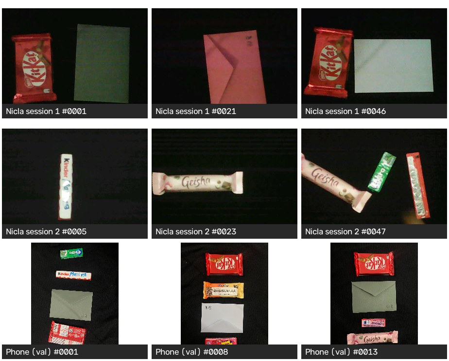

### Challenges

1. **The Nicla did not start the stream.** The file on the Nicla was named `main.py.py` (Windows hides the ending), so the board did not run it. → Renamed it to `main.py`.

   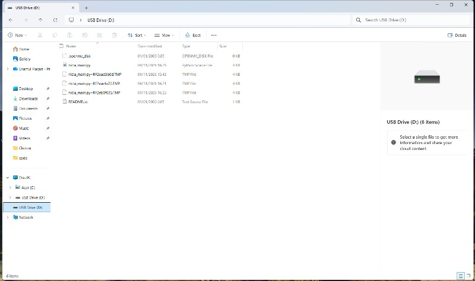

2. **The Nicla sees only a small area** (about 15 × 10 cm). → Only 1–2 objects per picture. This is fine for training, because YOLO learns what an object looks like, not where it is.

   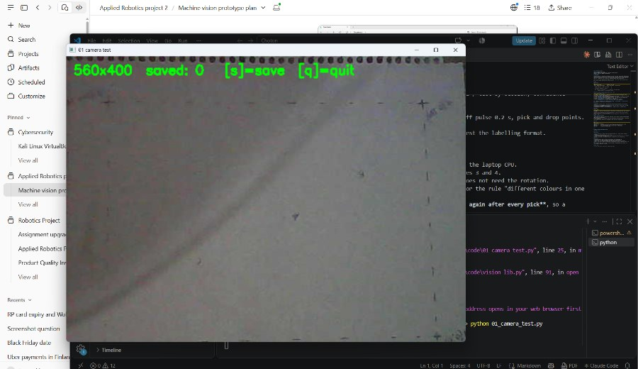

3. **The Wi-Fi stream dropped** when the iPhone hotspot went to sleep. All pictures taken before were saved. → Restarted the hotspot and the Nicla; for the third session I used the phone camera instead.

---

## 2026-11-11 – Labelling

### Objective

Mark every card and candy in every picture, so YOLO can learn from them.

### Activities

- Labelled all 119 pictures with `11_label.py`. The tool compares each picture with the empty background and **draws the boxes automatically**; I checked each picture and corrected it.
- Rules: every card and candy gets one tight box, also when only partly visible; nothing else gets a box.
- The labels are saved next to each picture as a `.txt` file (class, centre, width, height).

### Results

- **221 boxes** in 119 pictures: 55 cards and 166 candies.

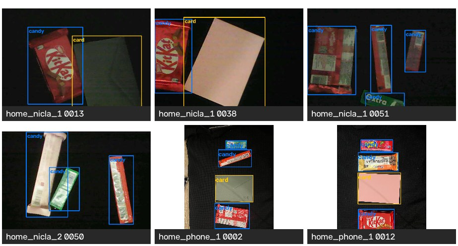
*Yellow = card, blue = candy.*

### Challenges

1. **Touching objects got one box together** (e.g. KitKat lying on a card). → Split them by hand into two boxes (6 pictures); improved the tool so it separates objects that only touch.
2. **The tool guessed wide candies as cards** (KitKat has a card-like shape). → The tool now guesses from the printing on the wrapper (candies have a lot of print, cards almost none); I checked every guess.
3. **Two false boxes on the wooden floor** at the edge of one phone photo. → Removed.

---

## 2026-11-11 – Training and Test Results

### Objective

Train the first YOLO model and test it on pictures it has never seen.

### Activities

- Trained with `python 12_train.py --val home_phone_1`:
  - training: the 102 Nicla and belt pictures,
  - validation (test): the 17 phone photos – a different session **and** a different camera,
  - 50 epochs, about **15 minutes** on the laptop CPU.
- Checked the model on the test photos with `13_yolo_detect.py --folder`.

### Results

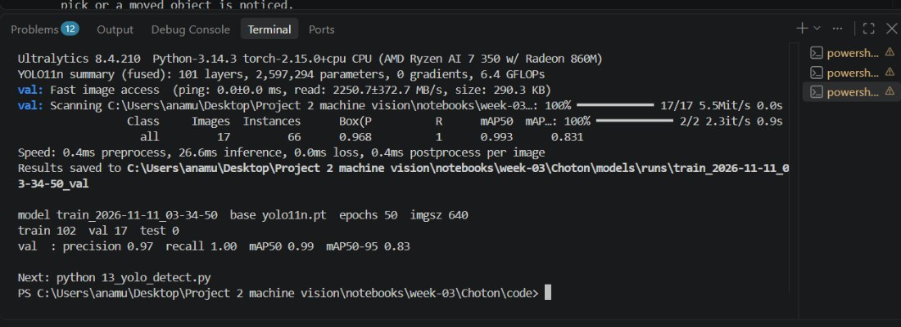

| Result on the 17 test photos (66 objects) | Value | Meaning |
|---|---|---|
| Precision | **0.97** | 97 % of the boxes the model draws are real objects |
| Recall | **1.00** | every card and candy was found (66 / 66) |
| mAP50 | **0.99** | right class and roughly right box |
| mAP50-95 | **0.83** | the boxes are also tight |
| Speed | **27 ms** per picture | fast enough for live video |

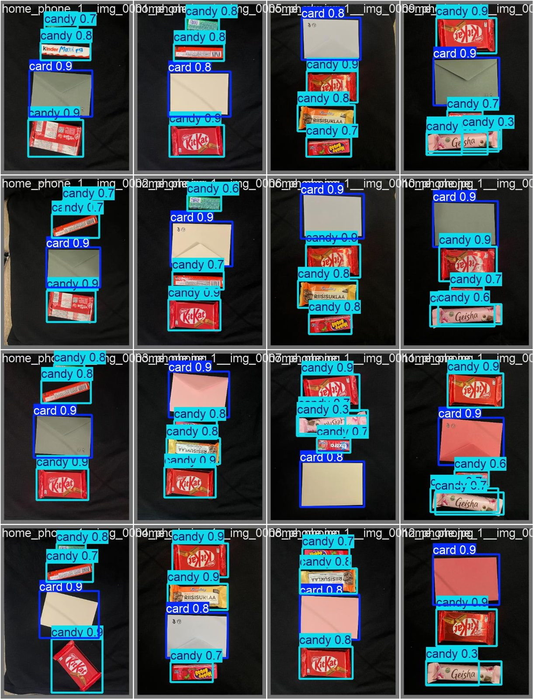
*The model on the test photos (never used in training).*

- **Cards and candies were never mixed up** (17 / 17 cards, 49 / 49 candies).
- The few mistakes are extra weak boxes (score 0.3) on one Geisha bar. Our programs use only boxes with a score of **0.5 or more**, so these are ignored.
- Candies that were not in the Nicla training pictures (e.g. Hubba Bubba, Kinder Maxi) were also found as **candy**. This is exactly what the teacher asked for.

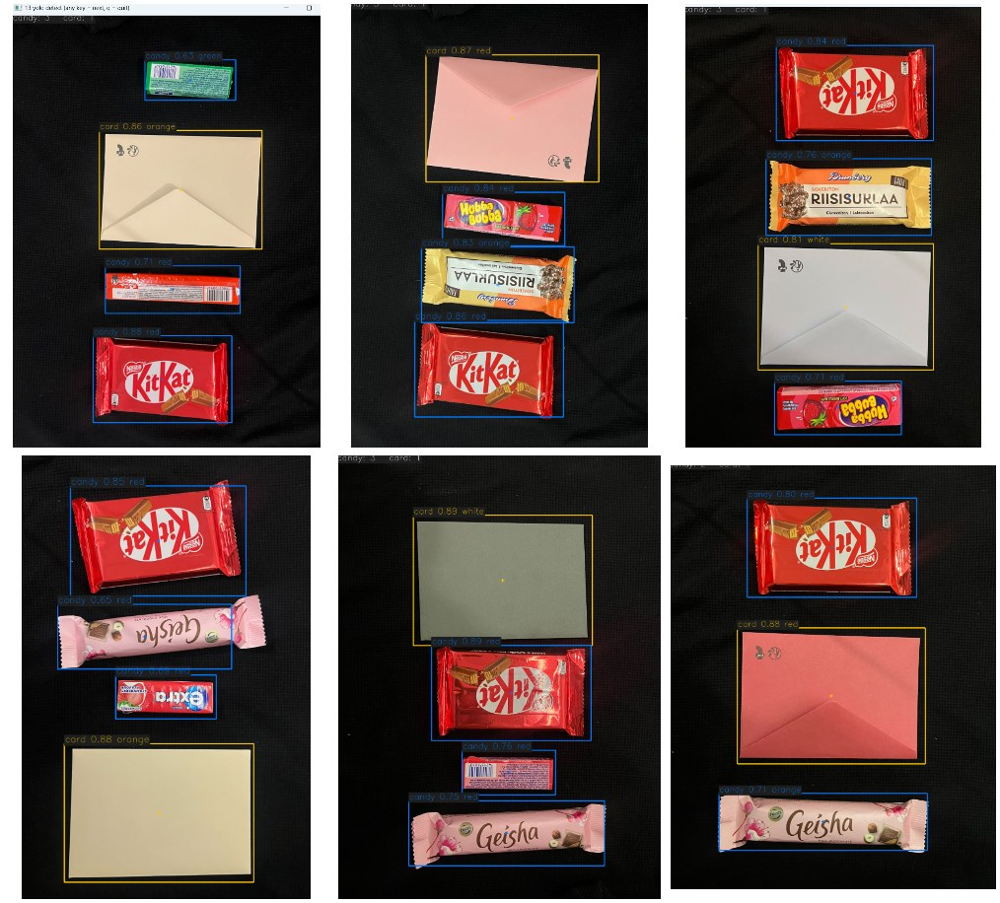
*`13_yolo_detect.py` on the test photos: class, score and colour of each object.*

### Challenges

1. **Robot positions were shown on the phone photos** ("OUT OF REACH"), because the Nicla calibration was used for a different camera. → Robot positions are now only shown for the live camera.
2. **Tall phone photos did not fit on the screen.** → The window now shrinks big pictures and draws bigger labels.
3. The test is small and at home. → The real test is with the USB camera on the conveyor belt (next university day).

---

## 2026-11-11 – Connecting the Vision to the Robot

### Objective

Prepare everything for the Dobot M1 Pro, so at the university I only need to connect the laptop, calibrate and run.

### Activities

- Checked the robot control folder from Rashmika (official Dobot `TCP-IP-4Axis-Python`). Our code uses the **same `dobot_api.py`**, so my scripts control the robot directly over the network (ports 29999 and 30003).
- Wrote `14_pick_and_place.py`, the full program:

  1. waits for the box (box sensor on conveyor 2, or ENTER),
  2. moves the robot out of the camera view and takes 8 pictures,
  3. chooses the next object (1 card, then 2 candies of different colours),
  4. converts the object centre from pixels to robot X, Y (calibration),
  5. moves above it, goes down, switches the suction on (DO1), lifts it,
  6. moves above the box, goes down, switches the suction off and gives a blow-off puff (DO2),
  7. takes a new picture and repeats until the box is complete.

- Wrote `15_robot_setup.py` to set up the robot at the university in one window:
  - **Calibration:** I click 5–6 tape crosses in the camera picture and put the suction cup on each cross; the robot tells its position, and the script calculates pixel → robot X, Y. No ruler needed.
  - **Heights and positions:** I move the robot and press a key to save home, travel height, card height, candy height and the box position.
  - **Inputs/outputs:** test suction (DO1) and blow-off (DO2), and find which robot input the box sensor is wired to.
- Added separate pick heights for cards and candies (a candy is about 15 mm thicker than a card).
- Wrote `00_check.py` to check everything before a run, and a **practice mode** (`--sim`) with a simulated robot to test the programs at home.

### Results (with the simulated robot)

| Test | Result |
|---|---|
| Calibration with 5 crosses | error **0.3 mm**; a test click moved the robot to (449.7, 200.3) mm, the right point was (450, 200) |
| Full cycle | waited for the box sensor → picked the card, a red candy and an orange candy (skipped the second red candy, different colours rule) → all outputs off at the end |

Robot commands printed for one card:

```
MovJ (464.8, 50.6, 200.0)    above the card
MovL (464.8, 50.6, 106.8)    down to the card
DO(1,1)                      suction ON
MovL (464.8, 50.6, 200.0)    lift
MovJ (369.0, -133.0, 200.0)  above the box
MovL (369.0, -133.0, 120.0)  down into the box
DO(1,0)  DO(2,1)  DO(2,0)    suction OFF, blow-off puff
MovL (369.0, -133.0, 200.0)  lift, back home, take a new picture
```

### Challenges

1. **No robot at home.** → Tested the full program with a simulated robot; values from the practice mode are marked and the real robot refuses them.
2. **Not tested yet on the real robot and the USB camera on the belt.**
3. **Wrapped candies and the suction cup:** Rashmika's test showed that the suction cup could not hold small wrapped candies. → Test the suction on each candy first at the university.

### Next Steps

- USB camera on the conveyor belt: live test, take belt pictures and train again if needed.
- `15_robot_setup.py` on the real robot: calibration, heights, box position, suction test.
- First real picks at 10 % speed with one card, then a full box (1 card + 2 candies).
- Test 10 boxes and record the results and a video for the presentation.

---

## 2026-11-12 – University: First Working Prototype on the Real Robot

### Objective

Connect the laptop to the Dobot M1 Pro and the USB camera at the conveyor, calibrate, teach the robot points, and pick **1 card + 2 candies** into the box.

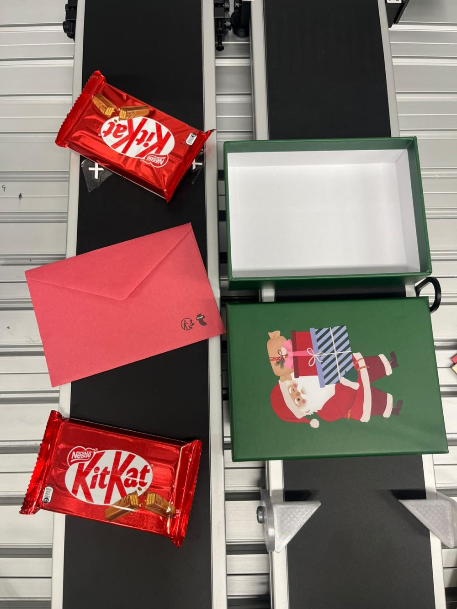
*The two conveyors: objects (left), box and lid (right).*

### Activities

**1. Connection and camera**
- Laptop Ethernet set to a fixed address in the robot network; `ping 192.168.1.6` and `robot_check.py` OK (robot mode 4 → 5, no alarms).
- The USB camera opened the laptop's front camera → wrote `find_camera.py` (shows cameras 0–3 side by side, saves the right number).

**2. Detection on the belt**
- First live test: KitKats found, but a Kinder Maxi was missed.

  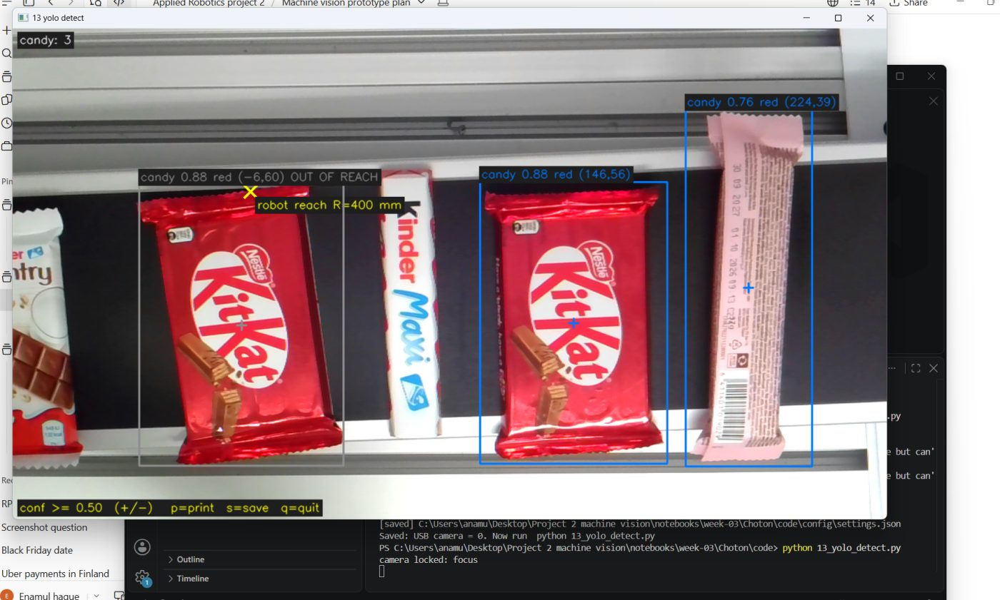

- Took 15 + 5 belt pictures (`belt_usb_1`, `belt_usb_1_test`), labelled them and trained again. The belt pictures were used 3 times in training (`--repeat`), because they show the real setup.
- New model, tested on 22 pictures it never saw: **precision 0.97, recall 0.90, mAP50 0.98, mAP50-95 0.85**.

**3. Moving the robot from Python**
- My setup window `15_robot_setup.py` moves the robot with the keyboard (w/s = X, a/d = Y, r/f = Z). At first the robot **turned red (alarm) at every key** – see Challenges 1–4.
- The official Dobot Python demo (in Rashmika's robot folder) showed the right jog command (`MoveJog`), so I used the same one.

  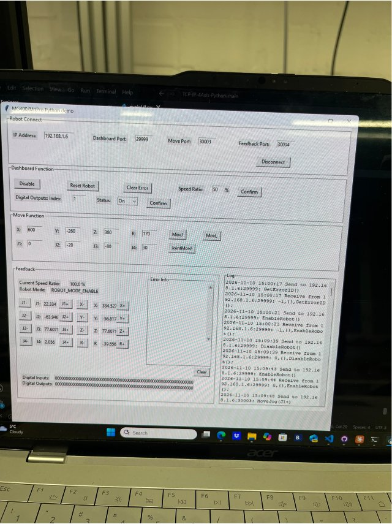

**4. Calibration camera → robot (no ruler)**
- 5 tape crosses on the belt. In the frozen camera picture I clicked the 5 crosses (key `k`).
- Then I moved the suction cup exactly onto each cross and pressed `c`; the robot reports its X, Y. From the 5 pixel ↔ robot pairs the program calculates the homography (pixel → robot mm).
- Test: key `x` + click on the picture → the robot goes above that spot. It stopped **right above the crosses** every time.

  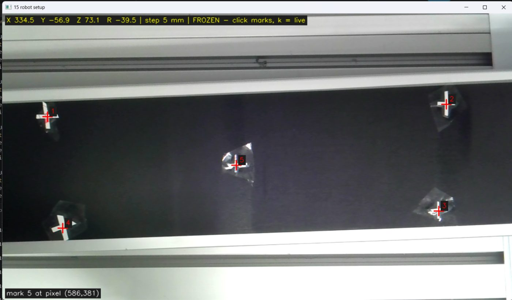
  *The 5 crosses clicked in the camera picture.*

  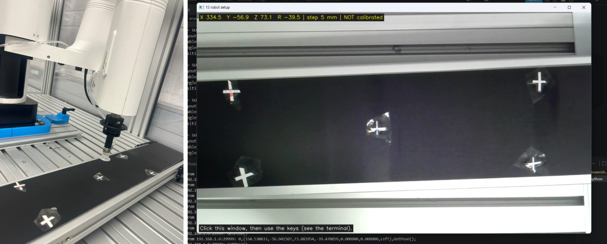
  *Left: the suction cup on a cross. Right: the crosses in the camera view.*

**5. Teaching heights and positions (keys in `15_robot_setup.py`)**

| Key | Point | Final value |
|---|---|---|
| `t` | Safe travel height (the vacuum hose limits the height) | Z 104.7 |
| `p` | Pick height card (cup just touches the card) | Z 63.7 |
| `o` | Pick height candy (KitKat) | Z 72.1 |
| `b` | Box: middle of the box, drop height | X 369.6, Y 17.1, Z 131.7 |
| `h` | Home: out of the camera view | X 291.5, Y 151.0, Z 135.7 |

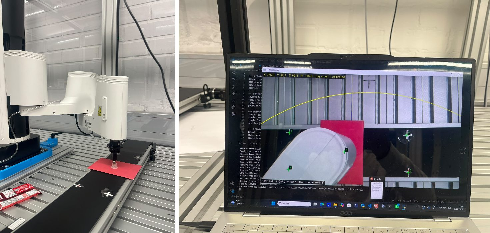
*Left: cup on the card. Right: the setup window saves "PICK height CARD = 69.3" (first value, later taught again).*

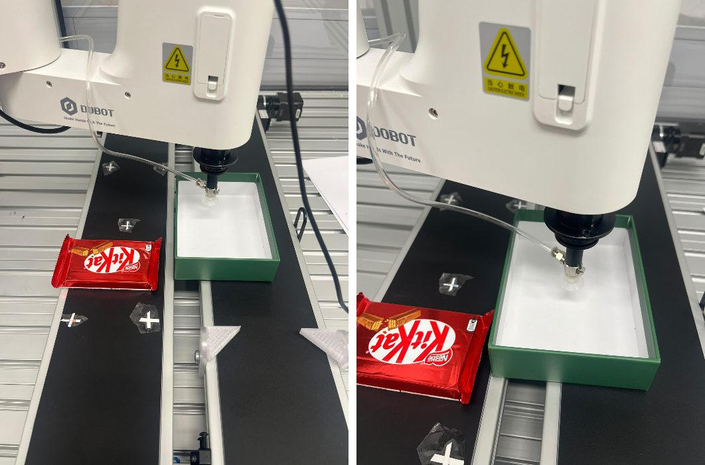
*The cup above the middle of the box (key `b`).*

**6. Inputs/outputs:** suction (DO1) and blow-off (DO2) tested with keys `v` and `g`: the card and the KitKat hold on the cup and drop with the blow-off.

**7. Full program `14_pick_and_place.py`**
- Dry run first (robot does not move, commands are printed), then `--run --speed 10`, then `--speed 30`.
- Changed after the first runs: **one picture per box** (robot goes home once, then picks card → candy → candy without going home each time).

### Results

- **The robot picks 1 card + 2 KitKats and places them in the box.**
- Calibration error: **0.27 mm** (final calibration, 5 crosses).
- Speed 30 % works; the objects stay on the suction cup.

 (robot picking 1 card + 2 candies into the box)


https://github.com/user-attachments/assets/b9dbb0d0-b75b-49dd-9db5-dcd18971e415


### Challenges

| # | Problem | Cause | Solution |
|---|---|---|---|
| 1 | Robot turned red at every key press | My jog used a straight-line move that also changed the tool angle R | Jog with `MoveJog`, the same command as the Dobot demo; keep the current R |
| 2 | The alarm text was not readable | The robot answers the error code over several lines | Fixed the reader; alarms are now shown in words (from Dobot's alarm list), key `e` clears them |
| 3 | Arm switched from **Left** to **Right** (elbow flipped) after a `MovJ` | `MovJ` may choose the other arm side | All moves use `MovL` (keeps the arm side); `robot_arm_left.py` put the arm back to Left; arm side is set to Left at start |
| 4 | Alarm 32 "Inverse kinematics singularity" | Arm was fully stretched (X 399.8 mm, the arm is 400 mm long) | Jogging is blocked beyond 375 mm from the base |
| 5 | "Joint 3 drive alarm" (Z motor), robot did not switch on | Z motor fault, probably because the arm was moved by hand while switched on | Controller off 15 s and on again; never push the arm while it is on |
| 6 | Robot could not reach the middle of the box | Conveyors too far from the robot | Moved the conveyor closer and calibrated again. Calibration errors: 2.0, 0.2, 0.3 mm, and 0.27 mm after the camera was moved |
| 7 | Box drop height (111.8) above the safe height (104.7) | The vacuum hose does not allow a higher travel height | The robot flies to the box at the higher of the two heights |
| 8 | The card was put on the candy, not in the box | Key `b` was pressed by mistake above the belt → wrong box position | Restored the box position; check the saved values after teaching |
| 9 | The box on the other conveyor was detected as a card | The camera also sees the box conveyor | **Pick area** = area of the calibration crosses + 20 mm; everything outside is "NOT ON BELT" |
| 10 | Red card not found at score limit 0.5 | Lighting and size different from the training pictures | Test with 0.30: real objects 0.64–1.00, false boxes on rail screws 0.34–0.41 → limit set to **0.45** |
| 11 | Card ignored ("EDGE") | Part of the card was outside the picture | Put objects fully in the picture (the centre of a cut object is wrong) |
| 12 | Only 1 KitKat picked, then "need 1 more candy" | Rule "different colours in one box" – both KitKats are red | Rule switched off (`require_different_colors: false`) |
| 13 | Different candies have different heights | One pick height per class | For now only KitKat is used (candy height 72.1) |
| 14 | Slow: robot went home after every pick | A new picture was taken before every pick | One picture per box |

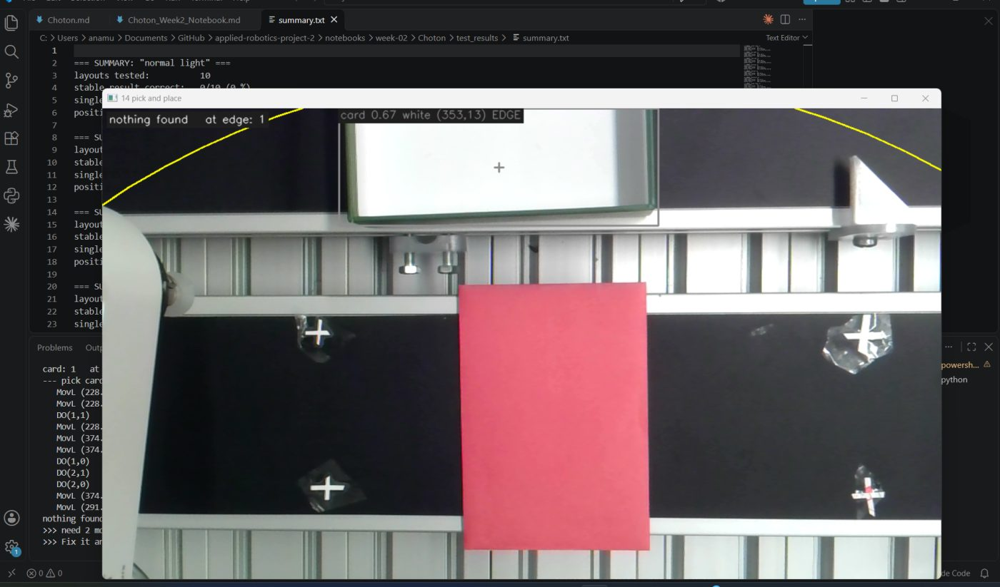
*Problem 9: the box (top) detected as "card", marked "NOT ON BELT" after the fix.*

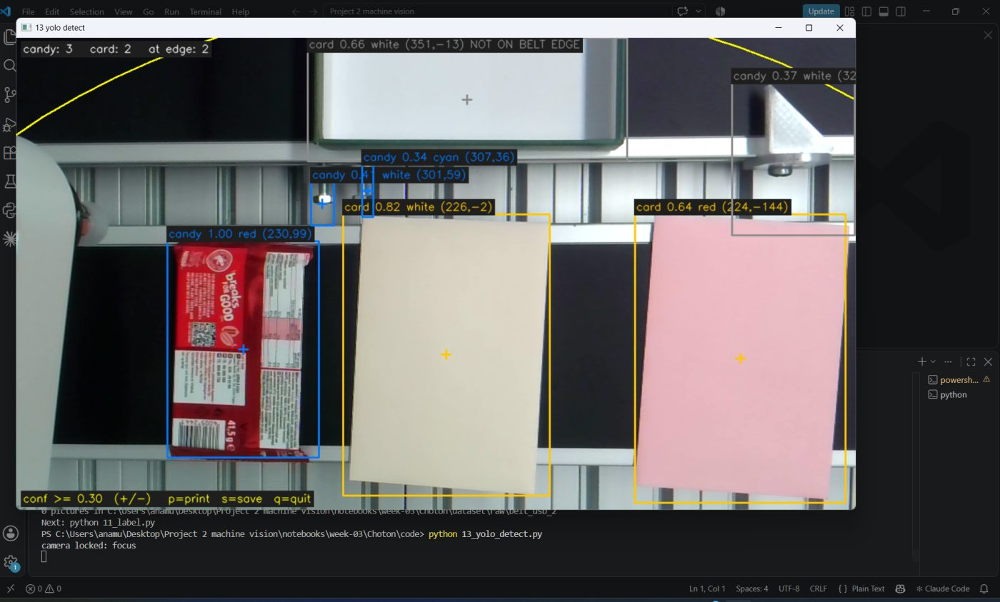
*Problem 10: with score limit 0.30 the cards are found (0.82, 0.64), but also weak false boxes on the rail screws (0.34, 0.41).*

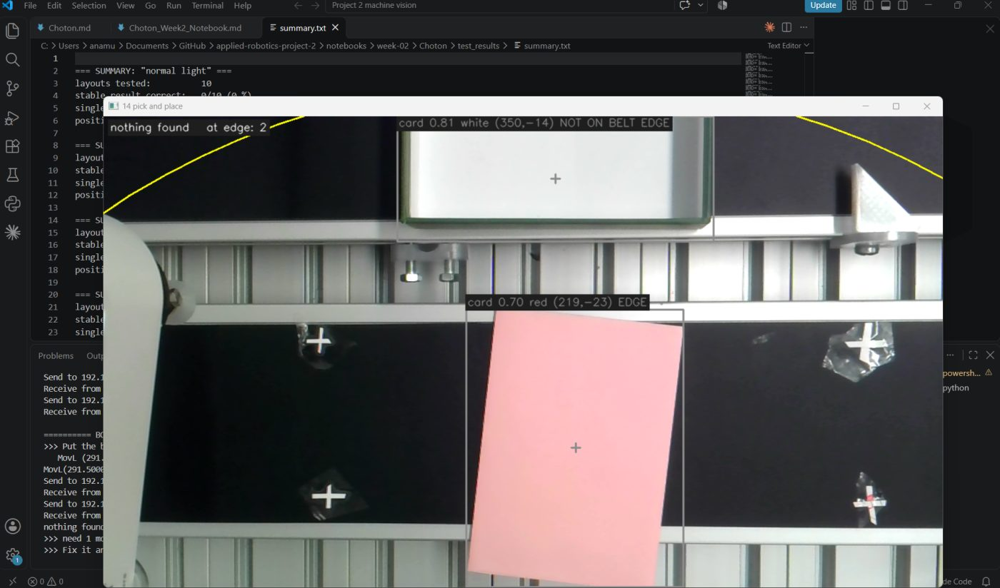
*Problem 11: the pink card is cut by the picture edge → "EDGE", not picked.*

### Next Steps

- Team plan (below): box and lid detected by the camera, objects turned straight, box closed with the lid, object conveyor stopped by the camera.

---

## 2026-11-12 – New Plan with the Team and Pictures for Box and Lid

### Objective

Agree on the final system and take training pictures for the new classes **box** and **lid**.

### Activities

- Team plan (wiring sketch below):
  - **Box conveyor (CB1):** the sensor stops the box. Sensor and motor are connected to an **Arduino Nano** – it works by itself.
  - **Object conveyor (CB2):** robot output **DO3 → relay → Nano → motor**. Our program switches it on and off.
  - **Camera:** detects card, candy, **box and lid**. When 1 card + 2 candies are in the pick area, the program stops conveyor 2.
  - **Robot:** picks each object, **turns it straight**, places it in the box and **closes the box with the lid**.

  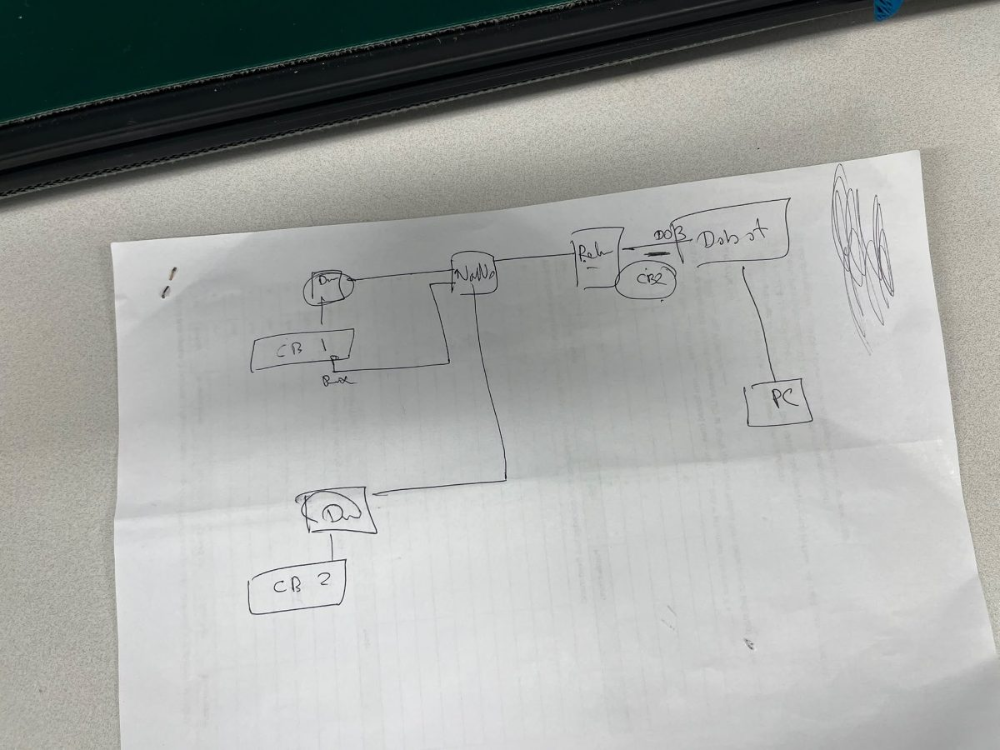

- Moved the camera so it sees **both conveyors**, calibrated again (0.27 mm).
- Took 32 pictures (`belt_usb_2`): cards and KitKats at different places and angles, box open and lid beside it in different positions, sometimes the lid on the box. 2 pictures with my hand were removed → **30 pictures**.

---

## 2026-11-14 – Box and Lid Detection, Turning Objects Straight, Closing the Box, Conveyor Control

### Objective

Prepare the next version at home: train the model with 4 classes and write the code for the team plan.

### Activities

**1. Labels for box and lid**
- Labelled the 30 lab pictures with 4 classes: card, candy, **box**, **lid**. The current model drew the card and candy boxes; box (white inside) and lid (green) were found by colour; every picture was checked.
- **90 objects** (30 cards, 60 KitKats), **25 boxes, 30 lids**. When the lid is on the box, only the lid is labelled.

  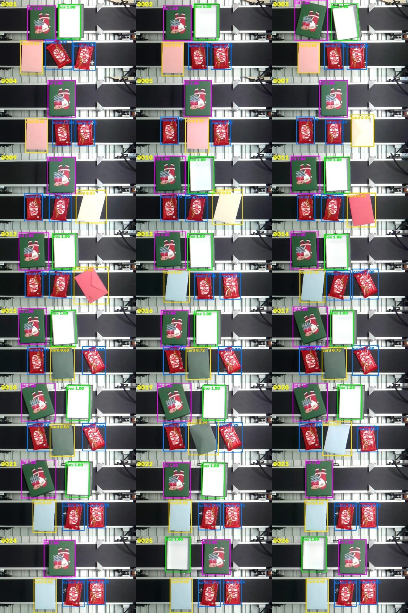
  *Yellow = card, blue = candy, green = box, pink = lid.*

**2. Training with 4 classes:** `python 12_train.py --val belt_usb_1_test home_phone_1 --repeat belt_usb_2=3 belt_usb_1=2` (50 epochs, about 35 min on the laptop CPU). The lab pictures were used 3 times because they show the final setup.

**3. Turning objects straight (angle)**
- YOLO only gives a straight box. Inside that box the program separates the object from the belt (OpenCV GrabCut) and fits a **turned rectangle** → angle of the long side (about 0.07 s per object).
- With the calibration the angle is converted to robot coordinates. The robot turns its tool (R axis) by **box angle − object angle** while it flies to the box, so the object lands straight.

  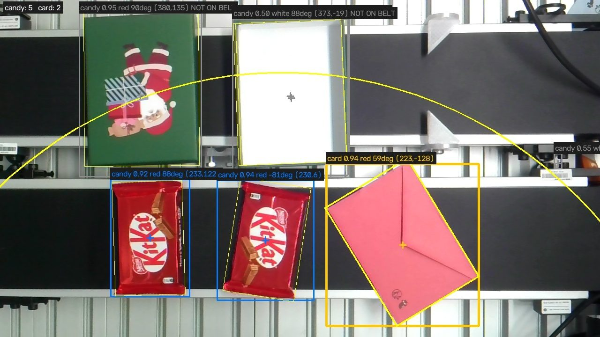
  *The turned rectangles and angles (e.g. pink card 59°). Practice run: the robot turns the card −30°, the KitKats +9° and −3°.*

**4. Closing the box:** after 1 card + 2 candies the robot picks the lid (found by the camera), turns it to the box angle and puts it on the box. New keys in `15_robot_setup.py`: `l` = lid pick height, `j` = lid close height.

**5. Conveyor control:** the program waits until the camera sees an open box standing still, switches **DO3** on (object conveyor runs), watches live, and switches DO3 off when 1 card + 2 candies are fully in the pick area (3 pictures in a row). No objects for 60 s → conveyor stops and asks for more.

### Results

- 30 lab pictures labelled with 4 classes: 145 labels.
- Angle measurement worked on all objects in the 30 lab pictures.
- Practice runs (`--sim`): straightening and closing the box give the expected robot commands.
- **Training result (4 classes):** 147 training pictures, tested on 22 pictures it never saw (89 objects):

  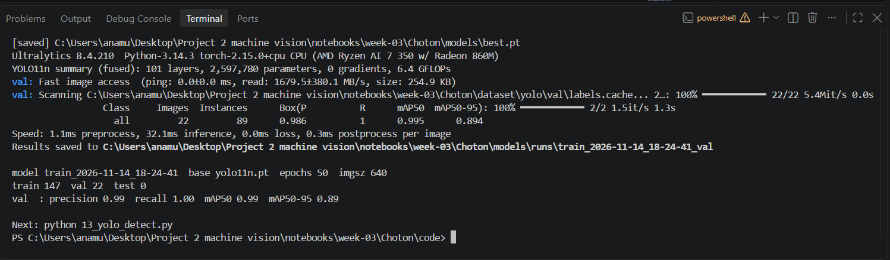


| | Precision | Recall | mAP50 | mAP50-95 |
|---|---|---|---|---|
| Model 11 Nov (2 classes) | 0.97 | 1.00 | 0.99 | 0.83 |
| Model 12 Nov (+ belt pictures) | 0.97 | 0.90 | 0.98 | 0.85 |
| **Model 14 Nov (4 classes)** | **0.99** | **1.00** | **0.99** | **0.89** |

  The test pictures have no box or lid, so these numbers are for card and candy. Box and lid are tested live at the university.

  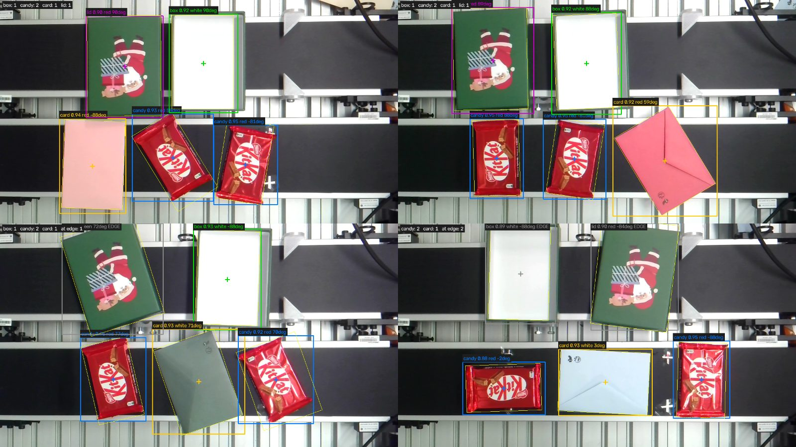
  *New model on lab pictures: card, candy, box and lid with their angles. Objects cut by the picture edge are grey (EDGE, not used).*

- Practice run with the new model: the camera found the box (−2°), and the robot turns the card −21° and the KitKats −16° and −26° so they lie along the box.

### Next Steps (at the university)

- Check which way R+ turns the tool: a crooked card must land straight (otherwise `r_sign: -1`).
- Teach the lid heights (`l`, `j`); check that the robot can carry the lid over the box edge (the hose).
- The lid must lie **inside the robot reach** (less than about 375 mm from the robot base) and fully in the picture. In some lab pictures the lid was 390–405 mm away.
- The box and lid are higher than the belt, so their X/Y from the belt calibration is a few mm off. If needed: a second calibration with crosses on the box conveyor.
- Check DO3: ON = conveyor runs? How does the full box leave (Nano)?
- Test 10 boxes and record the results.

---

## Information for the Team (UI and simulation)

All values are in `code/config/settings.json` (robot section) and `code/config/homography.json`. Details: [code/README.md](code/README.md).

| Item | Value |
|---|---|
| Robot | Dobot M1 Pro, IP 192.168.1.6, TCP/IP: dashboard port 29999, move port 30003 (only one program connected at a time) |
| Arm side | Left (`SetArmOrientation(0)`), all moves `MovL` |
| DO1 | Suction cup |
| DO2 | Blow-off pulse (0.2 s) |
| DO3 | Relay → Arduino Nano → object conveyor (CB2) |
| Box conveyor (CB1) | Sensor + motor on the Arduino Nano (not connected to the robot) |
| Camera | USB camera 1280 × 720, above both conveyors |
| Calibration | Homography pixel → robot X/Y (mm), 5 crosses, error 0.27 mm |
| Heights (Z, mm) | travel 104.7, card 63.7, candy 72.1, box drop 131.7 |
| Box (X, Y) | 369.6, 17.1 |
| Home (X, Y, Z, R) | 291.5, 151.0, 135.7, −13.5 |
| Model | YOLO11n, classes card / candy / box / lid, score limit 0.45 (`models/best.pt`, 14 Nov) |
| Box contents | 1 card + 2 candies |

**One box cycle:** wait for the box (camera) → conveyor 2 on → camera sees 1 card + 2 candies → conveyor 2 off → robot home, 8 pictures → for each object: above it → down → suction on → up → fly to the box (tool turned) → down → suction off + blow → up → lid → home.
