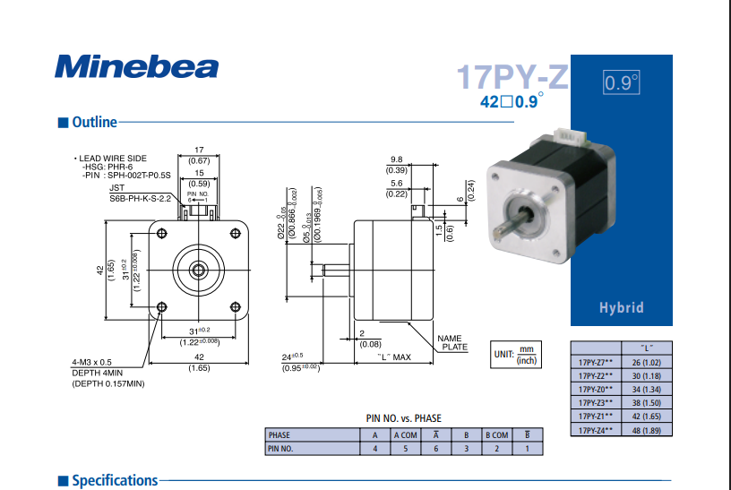
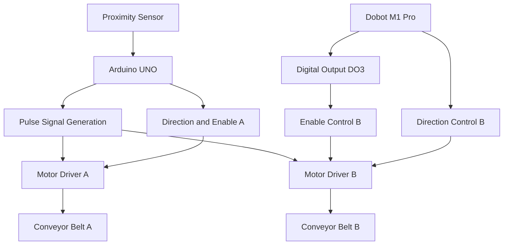
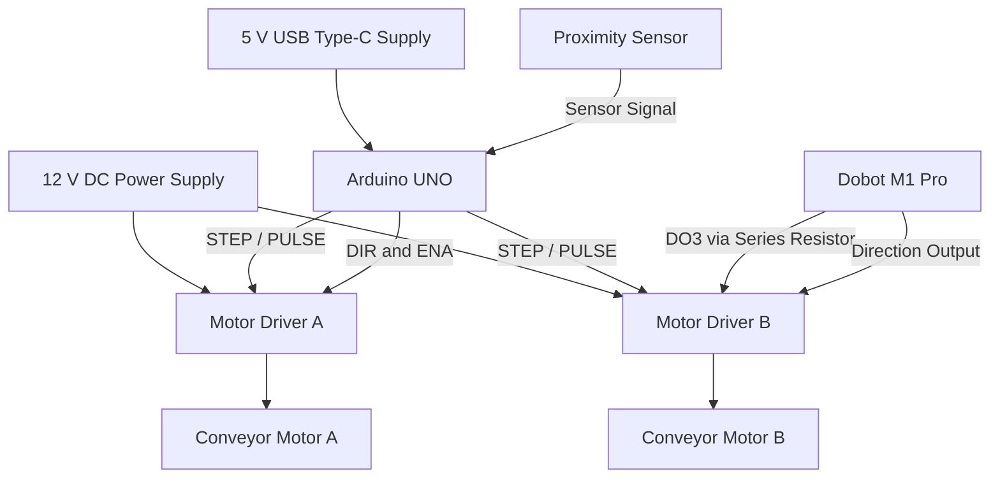
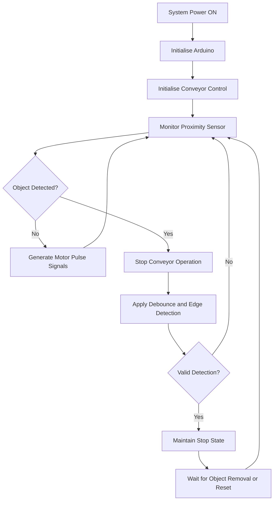

# November 11–12, 2026 – Conveyor Belt Control and Proximity Sensor Integration

**Student:** Rashmika Dineth Ruwanpathirana  
**Project:** Conveyor Belt Automation and Dobot Robot Integration  
**Dates:** 11–18 November 2026

---

## Day 1 – November 11, 2026

### Objective

The main objective was to investigate and establish stepper motor control for the conveyor belt using an Arduino development board and a HANPOSE CL57stepper motor driver.

### Activities Performed

1. Examined the HANPOSE CL57stepper motor driver and its control interfaces.
.jpg)
2. Prepared an Arduino program to control the stepper motor using STEP (PUL), DIR and ENABLE (ENA) signals.
.jpg)
3. Configured the Arduino digital output pins:
   - ENABLE (ENA): Digital pin 2
   - STEP (PUL): Digital pin 3
   - DIRECTION (DIR): Digital pin 4
4. Initially tested motor rotation in both clockwise and counterclockwise directions using a separate stepper motor during the initial testing phase.
.jpg)
5. The motor connections were made according to the manufacturer's datasheet.

[Datasheet](https://partco.fi/uploads/presta_attachments/17PY-Z.pdf?srsltid=AYCX9vL7btaYv9I7nk_rburPbmDFOlFAMh2jsn0t9ZKD0NZ4ZLVDDFcM)
6. Investigated the input configuration required to integrate an external proximity sensor with the Arduino controller.
[Proximity sensor](https://evakw.com/products/dc-5v-infrared-diffuse-photoelectric-switch-sensor-e18-d80nk-3-wire-proximity-sensor)
.jpg)
7. Configured Arduino digital pin 5 as an input using the internal pull-up resistor.

### Implementation

.jpg)
The Arduino was configured to generate step pulses for the TB6600 driver. The motor direction was controlled through the DIR signal, while the pulse frequency determined the motor speed.
.jpg)

The proximity sensor input was introduced to control the conveyor motor operation. The intended control logic was to allow the conveyor to operate when the sensor input was HIGH and stop the motor when the input became LOW.

.jpg)

### Outcome

The initial motor-control program and input-monitoring logic were developed. The control architecture was established for integrating a proximity sensor into the conveyor belt system.

---

## Day 2 – November 12, 2026

### Objective

The main objective was to complete the proximity sensor integration and successfully operate the conveyor belt with automatic stopping based on sensor detection.

An additional objective was to plan the control architecture for operating two independent conveyor belts using a single Arduino Nano and two stepper motor drivers.

### Activities Performed

1. Replaced the HANPOSE CL57 stepper motor driver with the TS1556S-TB6600  driver to simplify the control system and wiring.

<table>
  <tr>
    <td>
      
    </td>
    <td>
      
    </td>
  </tr>
</table>

2. Integrated the proximity sensor signal with the Arduino Nano.

3. Connected the Arduino control signals to the TS1556S-TB6600 stepper motor driver.
    .jpg)

4. Tested conveyor belt operation with the proximity sensor.

5. Verified that the conveyor belt operated when the sensor input permitted movement and stopped when the sensor detected an object.
.jpg)

6. Evaluated the possibility of controlling two independent conveyor belts using a single Arduino Nano.

7. Designed a preliminary control architecture for integrating the second conveyor belt with the Dobot robot's digital I/O interface.

### Successful Result

The conveyor belt was successfully operated using the Arduino Nano and TS1556S-TB6600 stepper motor driver.

.jpg)

The proximity sensor was able to control the conveyor belt operation, stopping the belt when an object was detected.

This confirmed the feasibility of using an Arduino-based control system for conveyor belt automation.

### Planned Two-Conveyor Control Architecture

The next development stage is to operate two independent conveyor belts using:

- One Arduino Nano.
- Two TS1556S-TB6600 stepper motor drivers.
- Two stepper motors.
- One proximity sensor.
- One relay interface connected to the Dobot robot's digital output.
.jpg)

#### Conveyor Belt 1 – Proximity Sensor Control

The first conveyor belt will be controlled directly by the Arduino Nano using the proximity sensor.

The proximity sensor will provide the start/stop signal to the Arduino. Based on the sensor state, the Arduino will generate or stop the step pulses sent to the first motor driver.

#### Conveyor Belt 2 – Dobot Digital I/O Control

The second conveyor belt will be controlled through a relay interface connected to the Dobot robot's digital output.

The proposed signal flow is:

1. The Dobot robot activates or deactivates one of its 24 V digital outputs.
2. The 24 V output controls the relay coil through an appropriately rated relay interface.
3. The relay's isolated contact switches the Arduino's 5 V input circuit.
4. The Arduino Nano reads the relay state.
5. Based on the input state, the Arduino controls the second TB6600 motor driver.

This arrangement allows the Dobot robot to control the second conveyor belt without directly connecting its 24 V digital output to the Arduino's 5 V input.

### Proposed Hardware Allocation

| Component | Function |
|---|---|
| Arduino Nano | Main conveyor control unit |
| TB6600 Driver 1 | Controls conveyor belt 1 |
| TB6600 Driver 2 | Controls conveyor belt 2 |
| Stepper Motor 1 | Drives conveyor belt 1 |
| Stepper Motor 2 | Drives conveyor belt 2 |
| Proximity Sensor | Provides conveyor belt 1 start/stop signal |
| Relay Module | Interfaces Dobot 24 V digital output with Arduino 5 V input |
| Dobot Robot | Provides the control signal for conveyor belt 2 |

### Proposed Arduino Pin Allocation

| Arduino Nano Pin | Signal | Function |
|---|---|---|
| D2 | ENA 1 | Conveyor 1 driver enable |
| D3 | PUL 1 | Conveyor 1 step signal |
| D4 | DIR 1 | Conveyor 1 direction |
| D5 | Sensor input | Proximity sensor control |
| D6 | ENA 2 | Conveyor 2 driver enable |
| D7 | PUL 2 | Conveyor 2 step signal |
| D8 | DIR 2 | Conveyor 2 direction |
| D9 | Relay input | Dobot conveyor 2 control |

*Note: This is the proposed pin allocation for the next implementation stage.*

### Future Work

1. Implement simultaneous control of two stepper motors using one Arduino Nano.
2. Integrate the second TB6600 motor driver.
3. Connect the relay interface to the Dobot robot's 24 V digital output.
4. Implement independent start/stop logic for both conveyor belts.
5. Test communication and synchronization between the Dobot robot and conveyor control system.
6. Develop the conveyor sequencing logic required for the automated packaging process.

---

## Overall Result

During November 11–12, the Arduino-based conveyor belt control system was developed and tested successfully. The first conveyor belt was successfully operated using a TS1556S-TB6600 stepper motor driver, with a proximity sensor providing automatic stopping functionality.

The next stage will extend the system to two independently controlled conveyor belts using a single Arduino Nano. The first conveyor will use proximity sensor feedback, while the second will receive its control signal from the Dobot robot through a 24 V relay interface connected to an Arduino 5 V input.

This development provides the foundation for integrating the conveyor system with the Dobot robotic packaging process.

### Technical Considerations

Use a properly rated relay interface with a flyback-protected 24 V coil circuit, and verify whether the Dobot output is sourcing or sinking. The relay contacts should switch the Arduino's 5 V logic input; do not connect the Dobot's 24 V signal directly to the Nano.

The Arduino can independently generate pulses for both motors, but the software should avoid blocking delays if both conveyors need to run simultaneously.
 
 ---

# Engineering Notebook – Week 46 - Part 2
## Dobot M1 Pro Installation and Dual Conveyor Belt Control

**Student:** Rashmika Dineth Ruwanpathirana  
**Dates:** 13, 14 and 16 November 2026  
**Project:** Robotics Laboratory – Conveyor Integration and Dobot M1 Pro

---

## 1. Objectives

The main objective of this work was to install the Dobot M1 Pro robotic arm on the portable worktable and begin developing a dual-conveyor-belt control system.

The work focused on integrating the conveyor belt motors, motor drivers, Arduino UNO, proximity sensor and Dobot M1 Pro digital outputs. The aim was to establish a system in which both conveyor belts could operate at the same speed while maintaining independent control of their enable and direction signals.

Additional objectives included organising the electrical components using DIN rail mounting, establishing separate power supplies for the motors and control electronics, and preparing the system for future wireless speed control.

## 2. Activities Performed

### 2.1 Dobot M1 Pro Installation and Mechanical Setup

The existing Dobot Nova 2 robotic arm was removed from the portable worktable to make space for the Dobot M1 Pro.
.jpg)

The Dobot M1 Pro was removed from the storage cabinet and mounted onto the portable worktable. After completing the mechanical installation, the electrical wiring was connected to the robot.
.jpg)

A camera mounting stand was also installed to provide visual access to the robot's working area. This arrangement will support future camera-based object detection, positioning and robotic manipulation tasks.

The installation work included:

- Removing the Dobot Nova 2 from the portable worktable.
- Removing the Dobot M1 Pro from the storage cabinet.
- Mounting the Dobot M1 Pro onto the portable worktable.
- Connecting the necessary electrical wiring.
- Installing a camera stand to provide visual access to the working area.
.jpg)

### 2.2 Conveyor Belt Configuration

The initial configuration of the conveyor belt system was started using a single conveyor belt.
.jpg)

The system was subsequently expanded to support two conveyor belts operating together. The conveyor motors were connected to their respective motor drivers, and the control connections were organised using connectors to provide multiple connection points and simplify wiring.

The control electronics and motor drivers were installed on a DIN rail mounted on the conveyor belt structure. This provided a more organised installation and made the individual control units easier to identify, access and maintain.
<table>
  <tr>
    <td>
      
    </td>
    <td>
      
    </td>
  </tr>
</table>

### 2.3 Arduino-Based Conveyor Belt Control

An Arduino UNO was programmed to generate pulse signals for controlling the stepper motor driver.

The Arduino program was developed to control the following functions of Conveyor Belt A:

- Motor enable and disable.
- Motor rotation direction.
- Motor speed through pulse frequency.
- Proximity sensor input monitoring.

A separate 5 V USB Type-C power supply was used to power the Arduino UNO control electronics.

The Arduino's 5 V output was used for the relevant low-voltage control signal connections and proximity sensor interface, according to the selected interface requirements.

The Arduino board also provides a potential pathway for future wireless control. The intention is to modify the program so that motor speed can be adjusted by changing the pulse frequency through wireless commands. The availability of Wi-Fi depends on the exact Arduino board variant or an additional Wi-Fi module.

### 2.4 Proximity Sensor Integration

A proximity sensor was connected to the Arduino input to detect objects approaching the conveyor belt.

The Arduino program was modified to monitor the sensor input. When an object is detected, the conveyor belt is stopped by disabling the motor operation.

This functionality provides the foundation for an automated object detection and conveyor stopping mechanism.

During testing, an issue was identified with the proximity sensor input. The sensor's output transitions can produce repeated changes in the detected state, causing the motor to start and stop continuously.

This behaviour is associated with signal bouncing or unstable edge detection. Therefore, software-based debouncing and suitable edge-detection logic are required to ensure that the motor responds only once to a valid object detection event.

### 2.5 Synchronisation of Two Conveyor Belts

After establishing the control of a single conveyor belt, the configuration was extended to two conveyor belts.

The same pulse signal was used for both motor drivers so that both conveyor belts could operate at the same speed.

By sharing the pulse signal, both motors receive the same step frequency. This provides synchronised speed control, assuming compatible motor and driver configurations.

The control arrangement was divided as follows:

**Conveyor Belt A – Arduino UNO**

- Pulse generation.
- Direction control.
- Enable control.
- Proximity sensor monitoring.

**Conveyor Belt B – Dobot M1 Pro**

- Enable control through the robot's digital output.
- Direction control through the robot's digital output.
- Shared pulse signal for synchronised speed operation.

This arrangement allows the Arduino to manage the conveyor motion and sensor functionality while the Dobot M1 Pro provides additional control over the second conveyor belt.

### 2.6 Motor Driver and Dobot Digital Output Integration

The Dobot M1 Pro digital outputs were integrated into the Conveyor Belt B motor driver control circuit.

.jpg)

The DO3 output of the Dobot M1 Pro was connected to the ENA input of the motor driver through a series resistor, following the motor driver and robot output interface requirements.

The purpose of this connection was to allow the Dobot M1 Pro to enable and disable Conveyor Belt B.

The signal current consumption was measured at approximately 1 mA. The 12 V signal configuration was tested, and the system operated without any observed issues during the initial functional test.

This confirmed the basic operation of the selected control interface under the tested conditions.

### 2.7 Power Supply Configuration

Separate power supplies were introduced for the motor power and control electronics.

.jpg)

The power arrangement was as follows:

| Component | Power supply | Purpose |
|---|---|---|
| Conveyor motor drivers | 12 V DC supply | Motor driver power |
| Arduino UNO | 5 V USB Type-C | Arduino control electronics |
| Arduino signal outputs | 5 V | Low-voltage control and sensor interface |
| Dobot M1 Pro digital output interface | Robot-provided output supply | Conveyor Belt B enable control |

Separating the motor power supply from the Arduino control power helps organise the electrical system and reduces the likelihood of motor power disturbances affecting the controller.

The signal voltage requirements and common reference connections must be maintained according to the relevant equipment datasheets.

.jpg)

## 3. System Architecture

The following diagram illustrates the proposed control arrangement for the two conveyor belts.

The Arduino generates the common pulse signal for both motor drivers. The enable and direction signals are controlled independently for each conveyor belt.

## 4. Electrical Connection Diagram

The following conceptual diagram illustrates the main electrical connections.

**Note:** This is a functional architecture diagram rather than a pin-to-pin wiring schematic. The actual wiring must follow the individual motor driver, Arduino and Dobot M1 Pro electrical specifications.

## 5. Conveyor Control Sequence

The intended operating sequence is illustrated below.

## 6. Technical Observations and Challenges

Several technical observations were made during the implementation:

1. The two conveyor belts can receive the same pulse frequency, providing synchronised motor speed control.
2. The Arduino UNO provides the pulse generation and primary control functionality for Conveyor Belt A.
3. The Dobot M1 Pro digital output provides an additional control interface for Conveyor Belt B.
4. The DO3-to-ENA interface operated successfully during the initial test, with an observed signal current consumption of approximately 1 mA.
5. The proximity sensor input requires software debouncing to prevent repeated motor start/stop commands.
6. Separating motor power and control power provides a more organised electrical installation.
7. DIN rail mounting improves the accessibility and identification of the motor drivers and control electronics.

### 6.1 Identified Issue: Proximity Sensor Signal Bouncing

The main issue identified during the initial operation was repeated triggering of the conveyor motor due to proximity sensor edge detection.

.jpg)

A suitable software solution will include:

- A debounce time to reject short signal fluctuations.
- Rising-edge or falling-edge detection, depending on the sensor output configuration.
- A latched object-detection state.
- A controlled restart condition after the object has been removed or the system has been reset.

This will prevent unnecessary repeated start and stop commands.

## 7. Future Improvements

The following improvements are planned for the next development stage:

- Implement software debouncing for the proximity sensor.
- Improve the object detection and conveyor stopping logic.
- Implement wireless speed adjustment using the Arduino's Wi-Fi capability, if supported by the selected board.
- Develop a communication interface for changing motor pulse frequency remotely.
- Test the synchronisation accuracy of both conveyor belts under different operating conditions.
- Integrate the conveyor operation with the Dobot M1 Pro robot program.
- Develop a complete pick-and-place sequence using the camera and proximity sensor.
- Prepare a more detailed electrical wiring diagram with connector numbers and terminal assignments.

## 8. Summary

.jpg)

During 13, 14 and 16 November 2026, the Dobot M1 Pro was installed on the portable worktable, and the initial development of a dual-conveyor-belt control system was completed.

The conveyor control system was developed using an Arduino UNO and the Dobot M1 Pro digital outputs. The Arduino was configured to generate motor pulse signals, control the direction and enable functions of Conveyor Belt A, and monitor a proximity sensor.

The same pulse signal was also connected to the second motor driver to provide synchronised speed operation. The Dobot M1 Pro DO3 output was integrated with the enable input of the second motor driver through a series resistor.

The control electronics and motor drivers were organised on a DIN rail, and separate power supplies were introduced for the motor drivers and Arduino controller.

The initial functional tests confirmed that the control arrangement was operating as expected. However, the proximity sensor's repeated edge triggering was identified as an issue requiring software debouncing and improved detection logic.

The next stage will focus on improving the sensor response, implementing wireless speed control and integrating the conveyor system with the Dobot M1 Pro robotic operations.

---

