# Engineering Notebook
## Individual Robot Project 02, Week 3

- Name: Sazzad Ibna Mahfuz
- Project: Applied Robotics Project 02
- Week: 3, 9–13 Nov 2026

## Weekly Goals

| Task ID | Expected output | Partner | Reviewer | Estimated personal hours |
|---|---|---|---|---|
| T03 | Finish W2 drafts (D1.5, D2.4, D1.6, D1.7) and merge the simulation | Rashmika / Choton | Choton | [7] |
| T06 | Rebuild `cell_sim` around device interfaces so real drivers can replace simulated ones | Rashmika | Choton | [8] |
| T06 | RoboDK arm simulation, Dobot dry run, read-only connect check, real-robot safety gate | Rashmika | Choton | [8] |
| T06 | Operator UI (`cell_ui`) for runs, checks, config and logs | – | Choton | [7] |

## 2026-11-09

- Task ID / actual time: T03, [7] h.
- Working partner / reviewer: alone; reviewer Choton.
- My contribution:
  1. Merged the simulation (PR #9) and the 5-cycle CSV as D2.3 evidence.
  2. Finished the W2 notebook: D1.5 block diagram, D2.4 interfaces, D1.6 acceptance criteria, D1.7 task plan.
- Evidence: `notebooks/week-02/Sazzad/Sazzad_Week2_Notebook.md`, `testing/sim_runs/20261109_022312.csv`.
- Next action: read the teammates' robot and conveyor work and align the simulation with it.

## 2026-11-10

- Task ID / actual time: T06, [6] h.
- Working partner / reviewer: Rashmika (his robot files); reviewer Choton.
- My contribution:
  1. Read Rashmika's W2 work: Dobot TCP/IP Python demo, `Pick and Drop M1` project (`point.json`, `src0.lua`), speed comparison.
  2. Found that the robot is the **Dobot M1 Pro** (4-axis SCARA), not the Nova 2 planned in W2.
  3. Planned the refactor: the state machine should talk only to device interfaces, so sim, RoboDK and the real robot share the same logic.
- Decisions and reasons: no edits in teammates' folders; their files are read and used through adapters in `software/`.
- Next action: build the interfaces and keep the W2 cycle times identical.

## 2026-11-11

- Task ID / actual time: T06, [8] h.
- Working partner / reviewer: alone with Claude Code; reviewer Choton.
- My contribution:
  1. Added interfaces `RobotDriver`, `BeltDriver`, `SensorS1`, `VisionSource`, `Clock`, and `cell.py` (no pick while belt A runs, no place unless S1 is active).
  2. Added `sequencer.py` (pick and place as robot steps), simulated devices and manual bench devices.
  3. Added a reference test: same config gives the same cycle times as W2.
- Evidence: `python -m cell_sim --cycles 5` again gave 57.875, 54.875, 45.875, 54.875, 42.875 s (SIMULATION, assumed parameters), `testing/sim_runs/20261112_135141.csv`.
- Next action: RoboDK and Dobot drivers.

## 2026-11-12

- Task ID / actual time: T06, [8] h.
- Working partner / reviewer: alone with Claude Code; reviewer Choton.
- My contribution:
  1. Added integration rules to `CLAUDE.md`: no motion commands to the real robot without teacher approval; every hardware fact needs a source or ASSUMED / CONFIRM.
  2. Built a RoboDK station (`software/robodk/cell_station.rdk`) and `--mode robodk`: the arm moves in RoboDK, belts and S1 stay simulated.
  3. Added `--mode dobot-dry`: prints every TCP command for the M1 Pro, sends nothing. Targets and vacuum DO 1 come from Rashmika's bench files (ASSUMED).
  4. Added `connect-check`: read-only, sends only `GetErrorID()`, `RobotMode()`, `GetPose()`.
  5. Added the `dobot-real` safety gate: refuses to start without speed cap ≤ 20 %, workspace limits, vacuum DO, targets and teacher approval.
  6. Added `hardware.json`: every entry has a value, unit, source and status.
- Decisions and reasons:
  - RoboDK has no M1 Pro model in the library, so the older "Dobot M1" is used. Joint limits differ; only for a visual check.
  - The real motion path is not written yet; it needs the teacher's approval first.
- Evidence: `testing/sim_runs/20261112_163029.csv` (robodk), `testing/sim_runs/20261112_163139.csv` (dobot-dry).
- Next action: operator UI.

## 2026-11-13

- Task ID / actual time: T06, [7] h.
- Working partner / reviewer: alone with Claude Code; reviewer Choton.
- My contribution:
  1. Wrote the UI brief (`software/cell_ui/TASK_PROMPT.md`) and built `cell_ui` (tkinter): tabs Run, Readiness, Config, Results, Robot check, About.
  2. The UI starts the CLI as a subprocess, so all safety checks stay in `cell_sim`. Modes, options, config keys and log columns are read from the program, not hard-coded.
  3. Config edits are validated by the program's own loaders and the old file is kept as `.bak`.
  4. Updated `software/cell_sim/README.md`, ran all tests and committed ("software creation").
- Evidence: `python -m pytest -q` (from `software/`): **166 passed**.
- AI use: Claude Code wrote the code and tests from my briefs. I reviewed the plans and the diffs.

## Work in the repo (outside the notebook)

All code is in `software/`, all run logs in `testing/`. Run commands from `software/`.

| Folder / file | What it is |
|---|---|
| `software/cell_sim/` | The cell program. State machine (INIT → FEED_ITEM → PICK → BRING_BOX → PLACE → RELEASE_BOX → CYCLE_DONE, FAULT on timeout). `python -m cell_sim` |
| `cell_sim/interfaces/` | Device contracts: `RobotDriver`, `BeltDriver`, `SensorS1`, `VisionSource`, `Clock`. The state machine only talks to these. |
| `cell_sim/drivers/` | Implementations: simulated devices, manual bench devices, RoboDK robot, Dobot TCP robot (dry), read-only connect check. |
| `cell_sim/cell.py`, `sequencer.py` | Safety rules (no pick while belt A runs, no place without S1) and pick/place broken into robot steps. |
| `cell_sim/safety_gate.py` | Checks that `dobot-real` needs before it may start; it refuses otherwise. |
| `cell_sim/config.json` | Timing and distance values, all ASSUMED. |
| `cell_sim/hardware.json` | RoboDK and Dobot settings (IP, ports, speed cap 20 %, vacuum DO, targets, limits), each with source and status. |
| `cell_sim/tests/` | pytest suite, with a fake RoboDK and a fake Dobot server so nothing touches hardware. |
| `software/cell_ui/` | Operator UI (tkinter). Starts `cell_sim` as a subprocess and reads modes, options and config fields from it. `python -m cell_ui` |
| `software/robodk/cell_station.rdk` | RoboDK station: Dobot M1 model, vacuum cup, targets `home`, `pick`, `pick_approach`, `place_box`, `place_approach`, one item. |
| `software/third_party/dobot_api/` | Dobot's own `dobot_api.py`, copied unchanged (MIT licence). |
| `testing/sim_runs/` | One CSV per run; line 1 says SIMULATION / ROBODK SIMULATION / DOBOT DRY. |

Modes:

| Command | Touches | Result |
|---|---|---|
| `python -m cell_sim --cycles 5` | nothing, all simulated | SIMULATION cycle times |
| `--mode robodk` | RoboDK on this PC (arm only) | ROBODK SIMULATION, motion times measured in RoboDK |
| `--mode dobot-dry` | nothing; prints M1 Pro TCP commands | DOBOT DRY |
| `--mode dobot-real` | nothing yet; safety gate only | refuses (exit 5) |
| `connect-check` | real robot, read-only (lab only) | not run yet |

## Screenshots (rerun on 2026-11-14, SIMULATION, assumed parameters)

Tests: 166 passed.

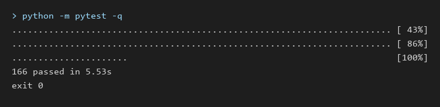

Simulation, 5 boxes. Same cycle times as W2 after the refactor (mean 51.275 s). Log `testing/sim_runs/20261114_000600.csv`.

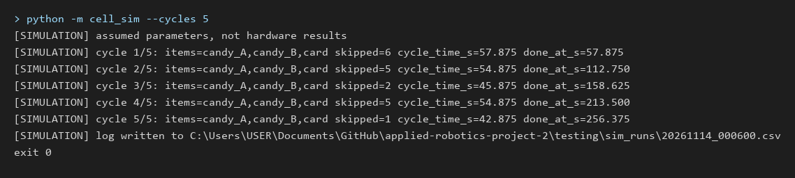

RoboDK station with the Dobot M1 model and the five targets.

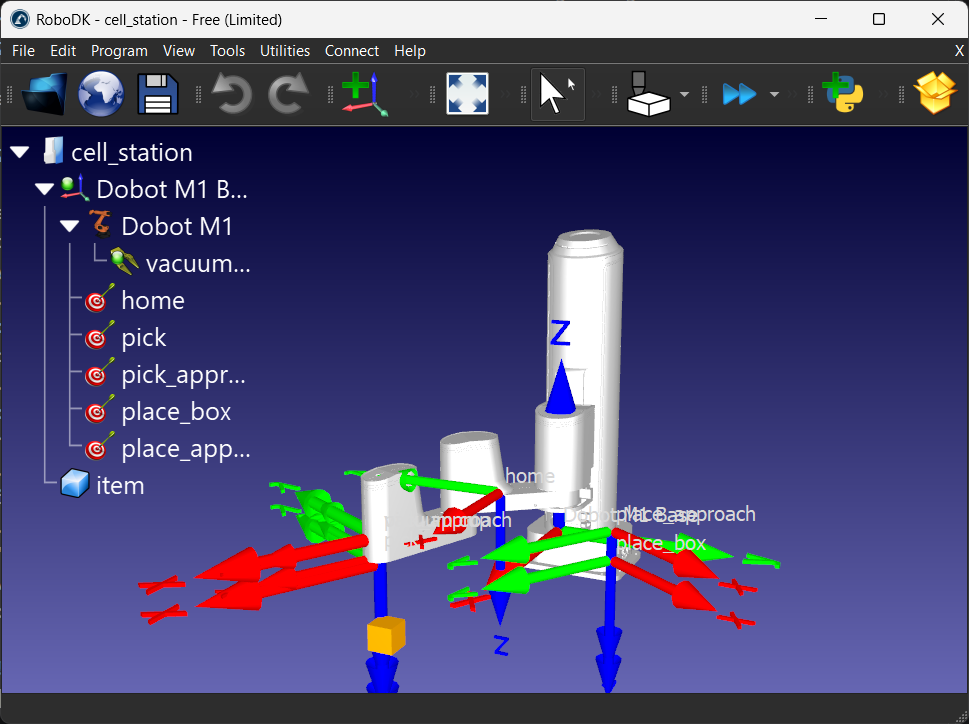

RoboDK run, 1 box: 58.047 s (ROBODK SIMULATION, assumed parameters). Log `testing/sim_runs/20261114_000645.csv`.

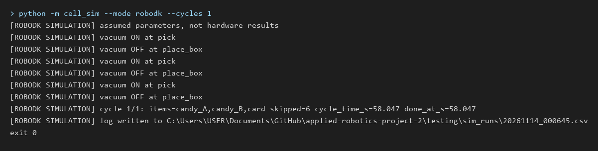

Dobot dry run: the exact TCP commands for the M1 Pro, nothing sent. Targets and DO 1 are ASSUMED.

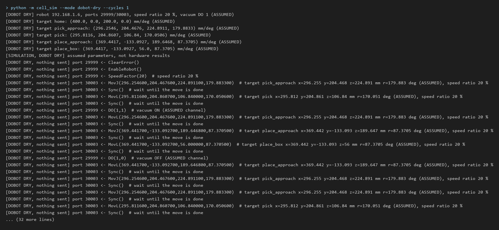

`dobot-real` refuses to start: 14 problems listed (limits, DO, targets, teacher approval).

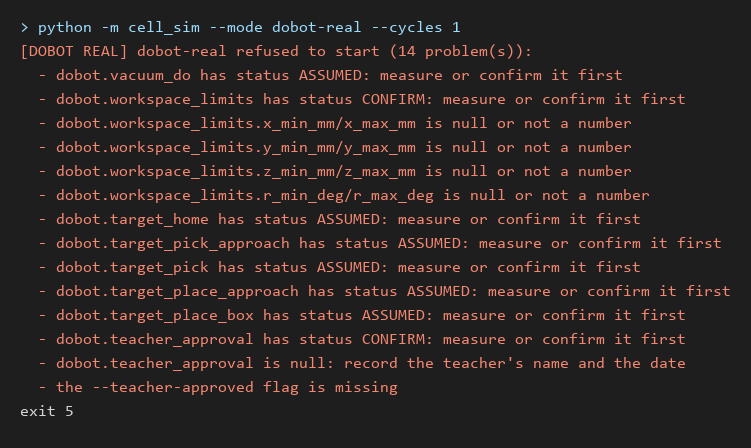

Operator UI: Run tab (sim run from the UI gives the same 57.875 s as the CLI).

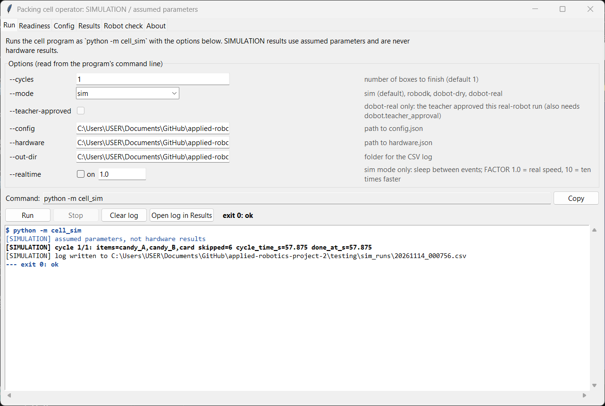

Readiness tab: per-mode checks; dobot-real FAIL is expected.

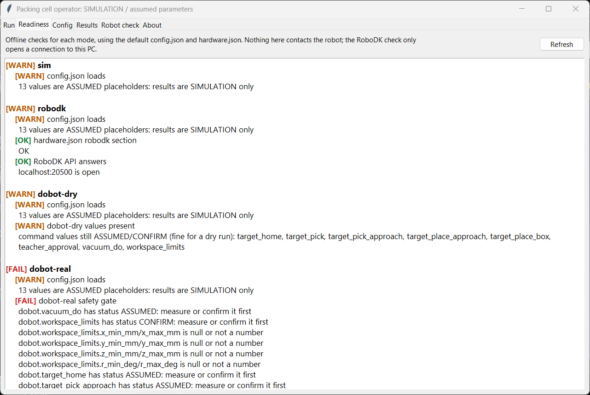

Config tab: every value with its status and note.

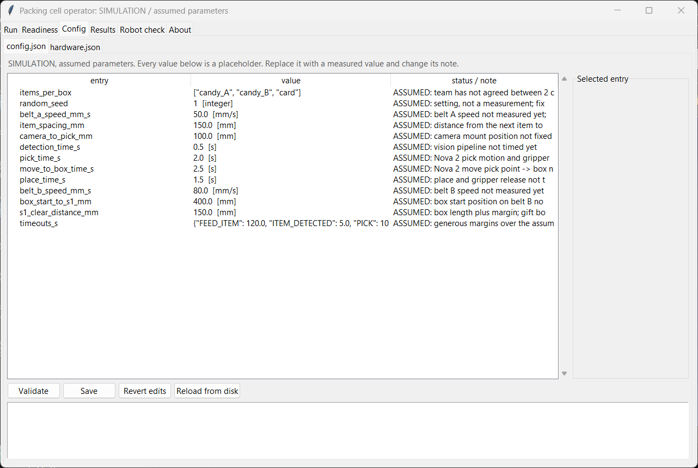

Results tab: cycle-time chart and log table.

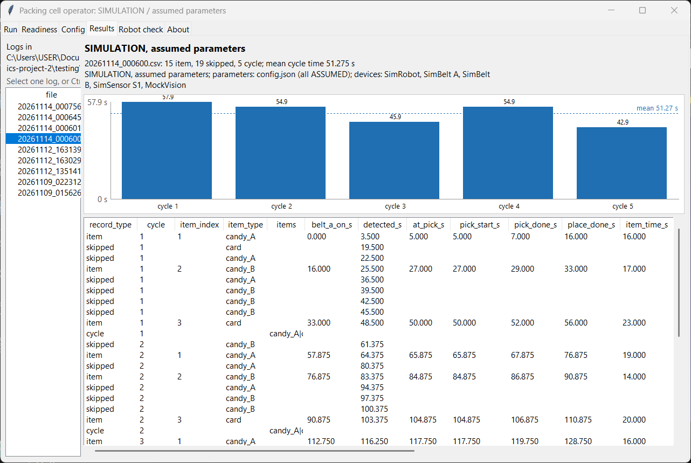

Results compare: RoboDK run vs simulation.

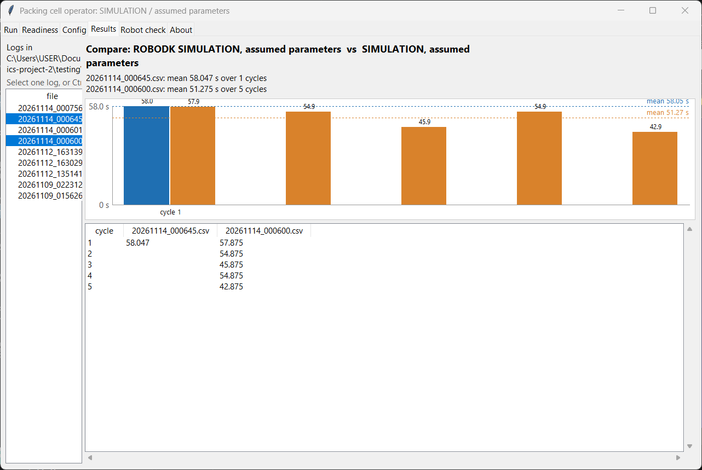

## Team updates read this week

- Rashmika (11–12 Nov): belt runs from an Arduino Nano and TB6600 driver; the E18-D80NK proximity sensor stops it. Plan: two belts on one Nano; belt 2 is switched by a Dobot 24 V DO through a relay.
- Choton: no W3 entry yet.
- Effect on my work: the cell's "belt B stops at S1" matches his setup. The DO channel for belt 2 and the vacuum DO must be confirmed in the lab before `hardware.json` changes from ASSUMED.

## Weekly Reflection

- What went well: one state machine now runs in sim, RoboDK and Dobot dry mode, with identical W2 cycle times and 166 passing tests.
- What did not: no lab time with the robot, so `connect-check` has not been run on the real M1 Pro. RoboDK has no M1 Pro model.
- What the numbers do not show: all times are SIMULATION, assumed parameters. Nothing was run on hardware.
- Next week: run `connect-check` in the lab, confirm vacuum DO, belt DO and workspace limits, get teacher approval for slow real moves, prepare the V1 demo.
