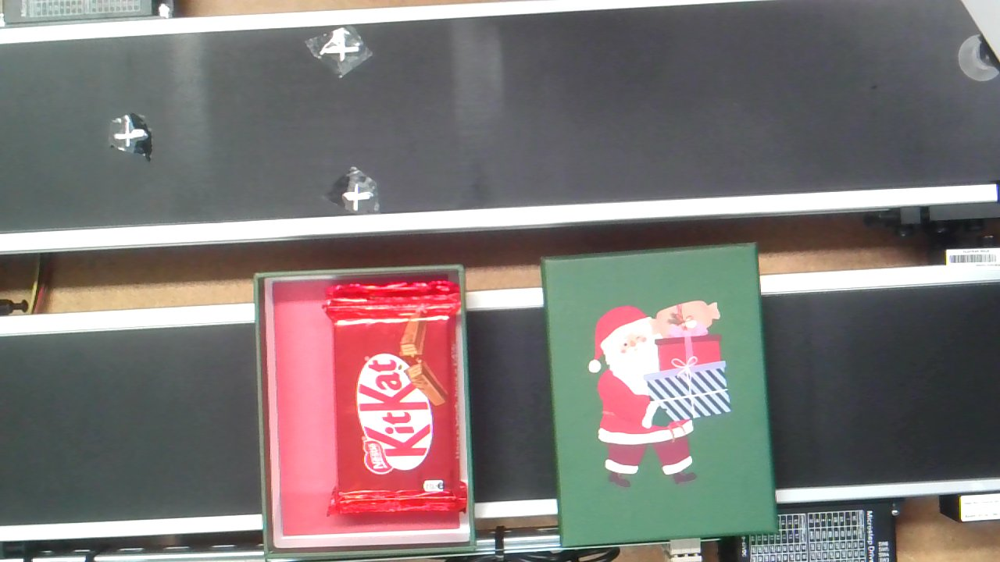
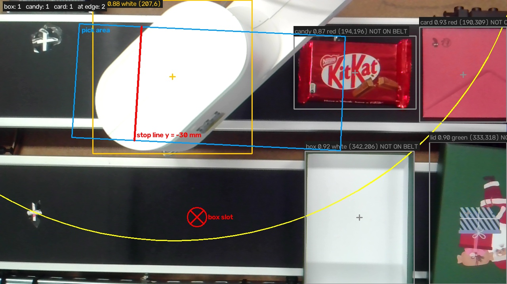
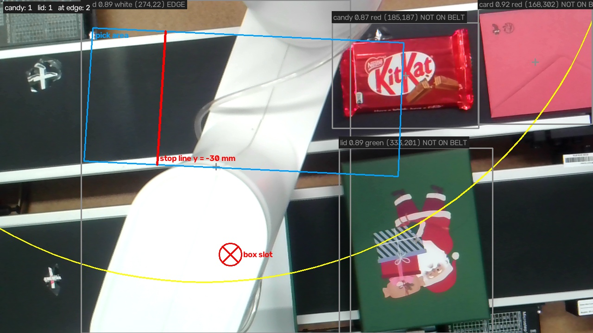
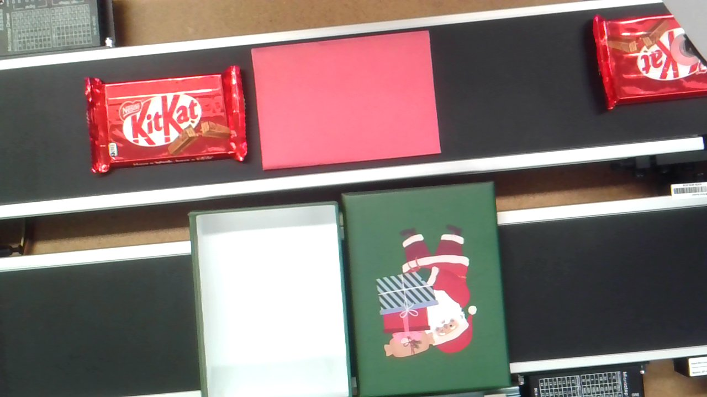
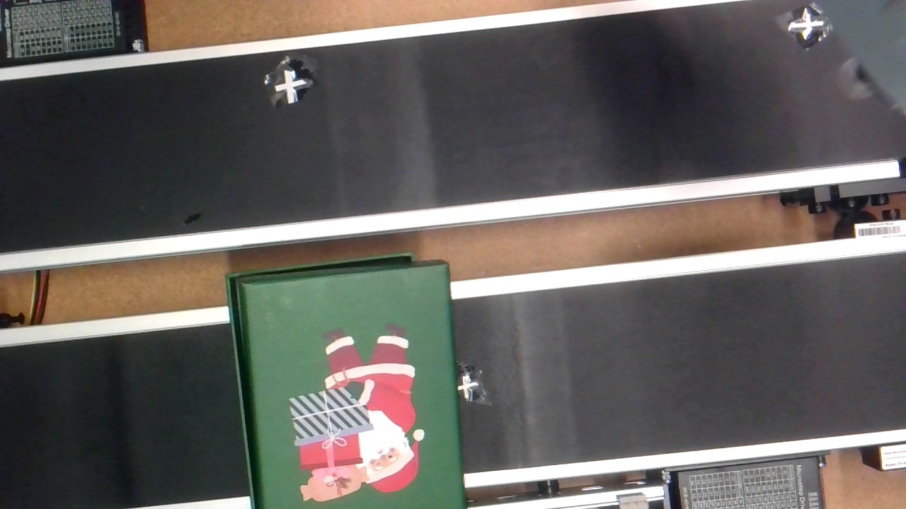
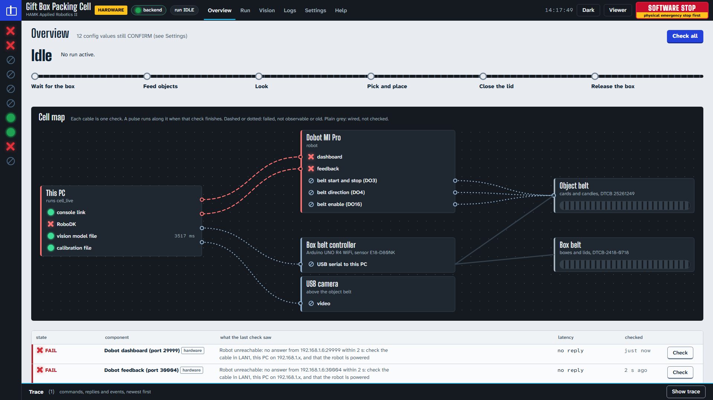
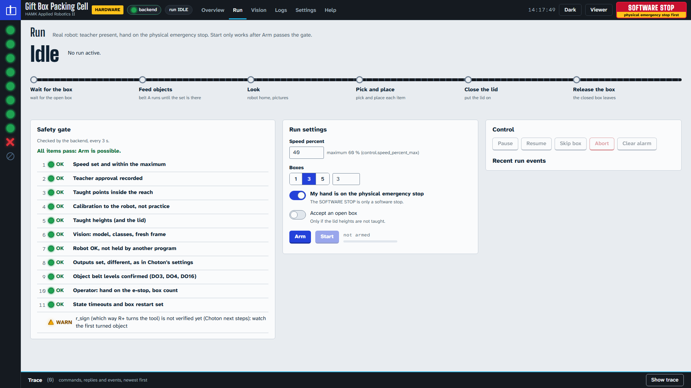
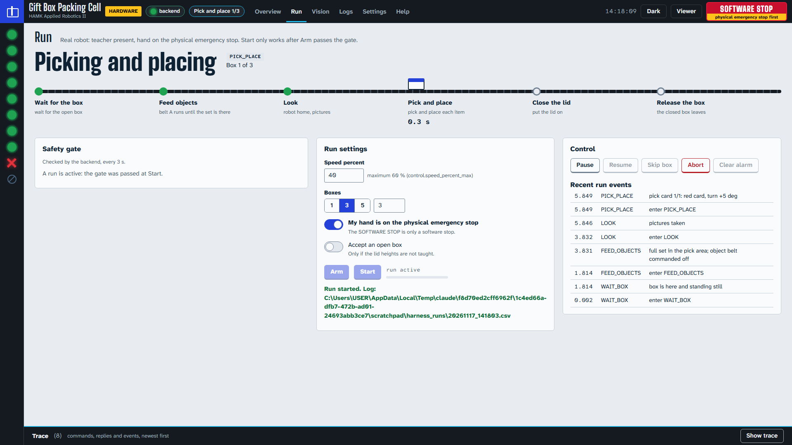

# Engineering Notebook
## Individual Robot Project 02, Week 4

- Name: Sazzad Ibna Mahfuz
- Project: Applied Robotics Project 02
- Week: 4, 16–20 Nov 2026

## Weekly Goals

| Task ID | Expected output | Partner | Reviewer | Estimated personal hours |
|---|---|---|---|---|
| T07 | `cell_live`: read-only checks of every device, then real control of the cell through a safety gate | Choton / Rashmika | Choton | [ ] |
| T07 | Operator console ("Cabinet") for checks, runs, vision, logs and settings | – | Choton | [ ] |
| T08 | V1 on the real cell: one box with 1 card + 2 candies, lid on, logged | Choton / Rashmika | Choton | [ ] |

## 2026-11-16

- Task ID / actual time: T07, [ ] h.
- Working partner / reviewer: team meeting with Choton and Rashmika; reviewer Choton.
- My contribution:
  1. Team decisions taken over into the software: Choton's cycle (wait for box → feed objects → look → pick and place → close lid → release box), box = 1 card + 2 candies, the operator takes the closed box away.
  2. Motion code requested and approved by the teacher (recorded in `CLAUDE.md`): the real robot may only move through a safety gate and a one-time arm token, in supervised lab runs.
  3. Built `software/cell_live` (commit `9514ca4`):
     - read-only checks for the Dobot, camera, Arduino, serial ports, calibration, vision model and RoboDK;
     - the control part (`control/`): safety gate, robot session, vision session, cycle steps and a run log;
     - an adapter that reads Choton's settings and calibration without editing his folder.
  4. Reworked `cell_sim` to the same cycle. All its results stay SIMULATION, assumed parameters.
- Decisions and reasons: Choton's vision and taught points are used through an adapter, so his code stays his.
- Evidence: commit `9514ca4`; console screenshots in `testing/ui_screenshots/` (22:42–23:10).
- Next action: console look and the real cell wiring.

## 2026-11-17

- Task ID / actual time: T07 + T08, [ ] h.
- Working partner / reviewer: Choton (lab values, calibration, taught points), Rashmika (box belt Arduino sketch); teacher Leo present and approval recorded for the runs ("Leo, 2026-11-17" in every log header); reviewer Choton.
- My contribution, morning to afternoon (software, no hardware):
  1. Applied the "Cabinet" console kit and fixed console bugs (Start camera key, cell map pulse, projector view from 1280×720).
  2. Put the cell wiring as built on 17 Nov into config, checks and docs:
     - object belt: DO3 start/stop, DO4 direction, DO16 enable;
     - box belt: own Arduino UNO R4 WiFi with E18-D80NK sensor, not connected to the robot;
     - vacuum cup DO1, blow-off DO2.
  3. Took over Choton's 17 Nov calibration and taught points (`084aa37`). Teacher approval in the gate now needs a name and a date (`04cfdda`).
  4. Added a stop that works with no run active and a "Stop object belt" button (`940352c`). Found in the lab that DO3 = 0 runs the object belt and DO16 = 1 enables it (`d5d4907`, `de3de77`).
- My contribution, 17:09–22:13 (supervised runs on the real cell, started by me from the console): see the run table below.
- Calibration:
  - 21:10–21:27: re-aimed the camera and recalibrated with Choton's `15_robot_setup.py`. 5 marks on both belts, mean error 0.92 mm. The old calibration was backed up in `testing/calibration_backup/`.
  - 21:50–21:58: the camera turned 6.3° in its holder. I added a view correction that re-fits the 21:26 calibration to the new view, without touching Choton's file.
- Failures:
  - three start attempts were refused (the robot closed port 29999);
  - the first pick faulted;
  - items were placed beside the box;
  - the lid step paused or picked the wrong thing;
  - after the last run the lid still lands a little off and does not close perfectly (my note at the end of the day; not fixed yet).
- Evidence: 23 run logs `testing/live_runs/20261117_*.csv`, with pictures for the later runs. PR #22 ("Software Update"), pushed by me at 22:19.
- Next action: repeat the full box in the morning, try 100 % speed.

## 2026-11-18

- Task ID / actual time: T08, [ ] h.
- Working partner / reviewer: [ ]; teacher approval from 17 Nov in the log header; reviewer Choton.
- My contribution:
  1. Rewrote the `cell_live` README short, in the layout of the `cell_sim` README (PR #23, 00:41).
  2. Five more runs 09:05–10:02. The last one at speed 100 % filled and closed a box in 64.4 s without a pause.
- Failures: two starts with no box at the slot. One box stood 23 mm from the slot (20 mm allowed). One closed box was not taken away within 20 s.
- V1 demo: [fill in: shown or not, and the teacher's feedback].
- Evidence: `testing/live_runs/20261118_*.csv` and the `_pictures` folders.

## 2026-11-19 and 2026-11-20

No software commits or run logs from me on these days. [Add an entry if you worked on the project.]

## Real cell runs (HARDWARE RUN, teacher approval Leo, 2026-11-17)

All runs: Dobot M1 Pro, 1 box requested, started by me on the console. "Done" = the log reached BOX_DONE with the lid on. Times are from the run log, in s from the start of the run.

| Run (log) | Speed | Result | What the log and pictures show |
|---|---|---|---|
| 170958, 171006, 171102 | 40 % | refused | The robot closed port 29999 during `SpeedFactor` / `EnableRobot` |
| 172100 | 80 % | aborted 57.3 s | No box within 20 s; paused |
| 172313, 175422, 175744, 175839, 181316 | 40–80 % | aborted, nothing placed | Object belt feed tests: set not complete within 60 s, or paused by me |
| 190902 | 80 % | FAULT 67.2 s | First pick: connection lost (no reply to `Sync()`). Cause found that evening: straight `MovL` from home needed J1 ≈ 90°, M1 Pro limit ±85° |
| 193551 | 80 % | aborted at lid | New route home → above box slot → item (my request, teacher approved). 3 items placed but beside the box (slot 78 mm off); slot re-taught to (349.6, 38.7) |
| 195652 | 80 % | log "done" 98.7 s, **not a real pass** | Four cards rode past (lying across the belt they touch the picture edge); the lid step picked the filled box as "lid" |
| 204319 | 80 % | aborted at lid | Old code: candies flagged "edge" and coasted out of the pick area |
| 204758 | 80 % | aborted at lid | New code: box filled in 44 s, card turned +89°; lid right of the box, cut by the picture bottom |
| 205234 | 80 % | FAULT 732.3 s | Box 142 mm from the slot, box belt did not bring a new box while paused; ended with the software stop |
| 220813 | 80 % | **done 99.7 s** | One lid pause; lid put on |
| 221031 | 80 % | **done 128.4 s** | Three lid pauses; lid put on |
| 221307 | 80 % | **done 65.4 s** | No pause |
| 18 Nov 090559 | 80 % | aborted 44.2 s | No box within 20 s |
| 18 Nov 090648 | 80 % | aborted | Paused by me in LOOK after 1 candy; aborted after 29.8 min |
| 18 Nov 094349 | 80 % | aborted | Box 23 mm from the slot (allowed 20 mm), repeated pauses |
| 18 Nov 094555 | 80 % | aborted in RELEASE_BOX | 3 items + lid on; closed box not taken away within 20 s |
| 18 Nov 100236 | 100 % | **done 64.4 s** | No pause; placed red candy, white card, red candy |

Count: 4 real full boxes with the lid on (65.4–128.4 s), plus one filled and closed box that the operator did not take away in time. Pass/fail against a V1 criterion is not decided here; the team still has to agree on it.

## Pictures

Run 204758 (17 Nov, started 20:47): the box is filled, but the run paused at the lid. The lid (right) is too far from the robot and the bottom of the picture cuts it. The crosses on the object belt are the calibration marks.

Camera view with the console overlay before (21:50) and after (21:58) the camera turned 6.3° in its holder. This is why the view correction exists.

Run 221307 (17 Nov, started 22:13), LOOK picture: candy, card and candy on the object belt, the open box on the box belt, the lid beside it. The box was finished in 65.4 s without a pause.

Run 100236 (18 Nov, started 10:02), speed 100 %: the closed box at the end of the run, 64.4 s.

Console, Overview with nothing connected (17 Nov, 14:17): the cell map shows each cable as one check. The robot is not reachable here, so dashboard and feedback are FAIL.

Console, Run screen and safety gate. **These two screenshots were taken with test fakes, not the cell** (17 Nov, 14:17–14:18). They show what the gate checks before Arm is possible, and the step bar during pick and place.

## Work in the repo (outside the notebook)

| Folder / file | What it is |
|---|---|
| `software/cell_live/` | Real cell program and console. `checks/` only read; `control/` moves the robot only after the safety gate and a one-time arm token |
| `cell_live/control/gate.py` | Gate items: speed cap, teacher approval (name + date), taught points in reach, calibration, vision, outputs, operator on the e-stop, J1 range for the way home |
| `cell_live/adapters/choton.py` | Reads Choton's settings, calibration and taught points; his folder is not edited |
| `cell_live/web/` | "Cabinet" console: Overview (cell map), Run, Vision, Logs, Settings, Help, projector view |
| `software/cell_sim/` | Simulation, now with the team's cycle. SIMULATION, assumed parameters |
| `testing/live_runs/` | One CSV per real run plus its pictures. **Git-ignored: only on my laptop** |
| `testing/calibration_backup/` | Old calibration and the camera view pictures. Git-ignored |

Tests: `python -m pytest -q` from `software/` on 2026-11-22: **549 passed** (fake robot and camera, nothing touches hardware).

## Team updates read this week

- Choton (W3 notebook, "Information for the Team"): robot IP, ports 29999 / 30003, DO1 suction, DO2 blow-off, DO3 to the object belt, heights, calibration. Used as the source for `cell_live`.
- Rashmika (17 Nov): Arduino sketch for the box belt. 19 Nov: new 220 V AC conveyor belt and a 3D-printed enclosure for the electronics ([his W4 log](../Rashmika/README.MD)).
- Effect on my work: the box belt stays outside the robot's control (own UNO and sensor), and the camera confirms the box. If the 220 V belt replaces a belt, the belt checks and levels need to change.

## Weekly Reflection

- What went well:
  - The real cell packed a box end to end: 4 full boxes with the lid on, the fastest in 64.4 s at 100 % speed.
  - Every run is logged with config hashes and pictures, so failures could be traced (J1 limit, slot offset, edge rule, camera turn).
- What did not:
  - many aborted runs before the first full box;
  - the lid step is still the weak point: pauses at the 375 mm reach limit, and the lid does not close perfectly;
  - the box belt sometimes did not bring a box;
  - no runs on 19–20 Nov.
- What the numbers do not show: 4 good boxes is a small sample. Times include pauses, and the V1 pass criterion is not agreed yet. The run logs are not in git.
- Next week:
  - agree on the V1 criterion with the team and teacher;
  - make the lid reliable (the off-centre grip needs my request plus the teacher's approval first);
  - find out why the box belt stops while the run is paused (DO16 suspicion);
  - decide how to keep the run logs as shared evidence.
